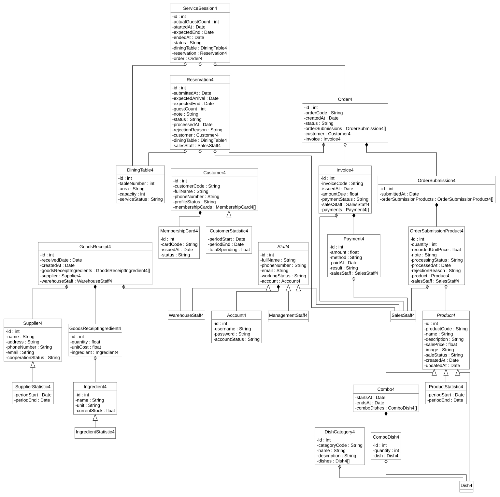
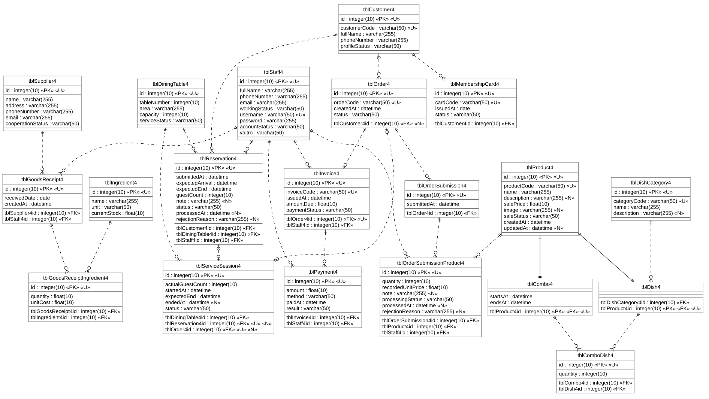
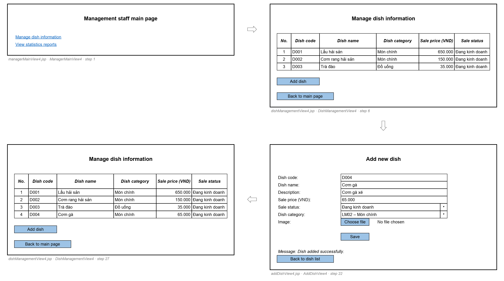
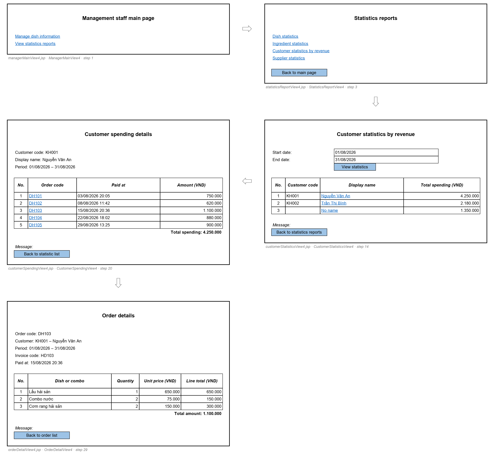
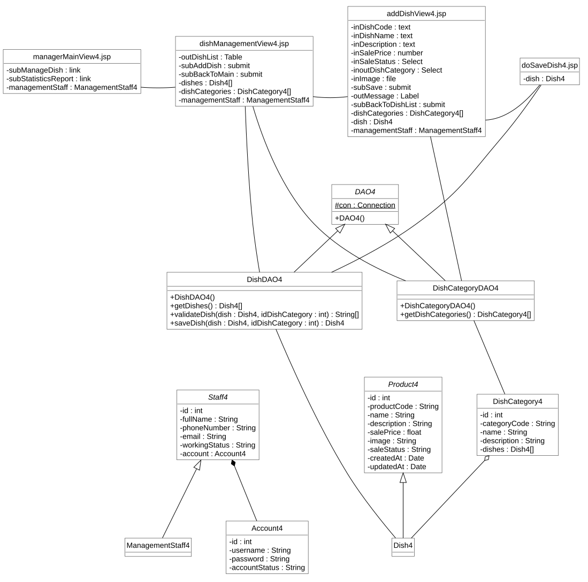
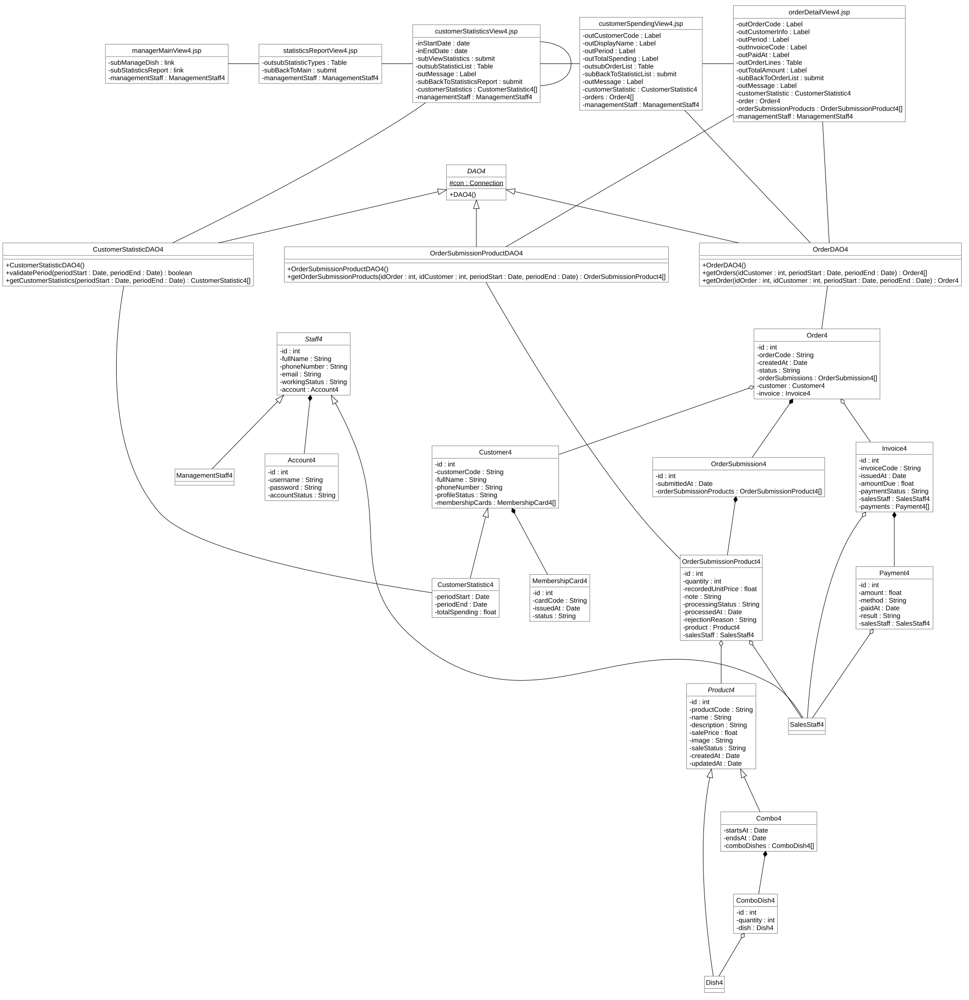
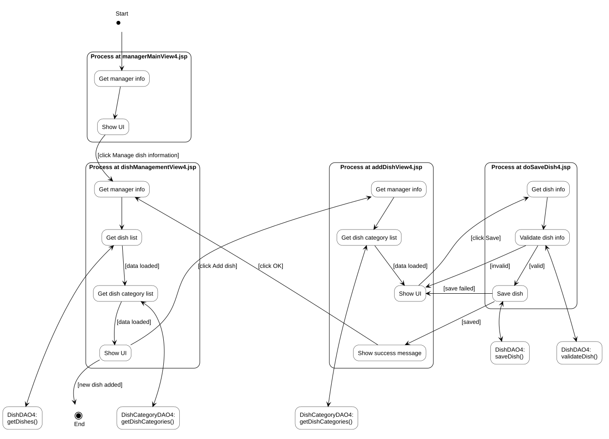
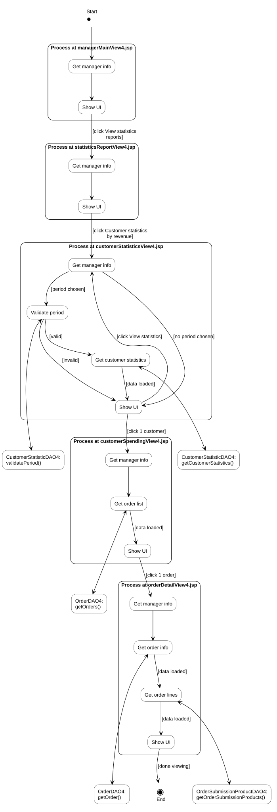

# Thiết kế hệ thống quản lý nhà hàng

## 1 Thiết kế lớp thực thể

Biểu đồ thiết kế lớp thực thể được chuyển đổi từ biểu đồ lớp thực thể toàn hệ thống trong [analysis.md](analysis.md) và [diagrams/class-entity-system.puml](diagrams/class-entity-system.puml). Tập lớp, tên lớp, thuộc tính nghiệp vụ, quan hệ kế thừa, loại quan hệ và phía hình thoi đã chốt ở pha phân tích được giữ nguyên; pha thiết kế chỉ bổ sung định danh kỹ thuật, kiểu dữ liệu, thuộc tính tham chiếu đối tượng và chuyển ký pháp của ba lớp liên kết n–n.

### Bước 1 Bổ sung thuộc tính id

Thuộc tính `-id : int` được đặt ở dòng đầu tiên của 19 lớp gốc: `Staff4`, `Account4`, `Customer4`, `MembershipCard4`, `Supplier4`, `Product4`, `DishCategory4`, `ComboDish4`, `Ingredient4`, `GoodsReceipt4`, `GoodsReceiptIngredient4`, `DiningTable4`, `Reservation4`, `ServiceSession4`, `Order4`, `OrderSubmission4`, `OrderSubmissionProduct4`, `Invoice4` và `Payment4`.

Không bổ sung `id` cho `ManagementStaff4`, `WarehouseStaff4`, `SalesStaff4`, `Dish4`, `Combo4`, `CustomerStatistic4`, `ProductStatistic4`, `IngredientStatistic4` và `SupplierStatistic4` vì các lớp này nhận `id` qua quan hệ kế thừa. Các mã nghiệp vụ như `customerCode`, `productCode`, `categoryCode`, `orderCode`, `invoiceCode` và `cardCode` vẫn được giữ bên cạnh `id`; chúng không bị đổi tên thành định danh kỹ thuật.

### Bước 2 Bổ sung kiểu dữ liệu

Các kiểu Java được dùng nhất quán như sau:

| Nhóm dữ liệu | Kiểu | Áp dụng |
| --- | --- | --- |
| Định danh kỹ thuật, số người, sức chứa, số bàn và số lượng mặt hàng nguyên chiếc | `int` | `id`, `guestCount`, `actualGuestCount`, `capacity`, `tableNumber`, `ComboDish4.quantity`, `OrderSubmissionProduct4.quantity` |
| Tiền, đơn giá và lượng nguyên liệu có thể có phần thập phân | `float` | `salePrice`, `unitCost`, `recordedUnitPrice`, `amountDue`, `amount`, `Ingredient4.currentStock`, `GoodsReceiptIngredient4.quantity`, `CustomerStatistic4.totalSpending` |
| Mã nghiệp vụ, tên, mô tả, liên hệ, hình ảnh, ghi chú, phương thức và trạng thái | `String` | Các thuộc tính mã, tên, văn bản, `phoneNumber`, `email`, `image`, `note`, `method`, `result` và các thuộc tính trạng thái |
| Ngày và thời điểm | `Date` | Các thuộc tính kết thúc bằng `At`, các ngày nhận/xử lý, thời gian dự kiến, `periodStart` và `periodEnd` |
| Tham chiếu đối tượng | Tên lớp hoặc `TênLớp[]` | Thuộc tính đối tượng được bổ sung ở Bước 4 |

`Ingredient4.currentStock` và `GoodsReceiptIngredient4.quantity` dùng `float` vì `Ingredient4.unit` có thể biểu diễn đơn vị đo như kg hoặc lít, nên lượng tồn và lượng nhập có thể không phải số nguyên. Số lượng món/combo trong `ComboDish4` và `OrderSubmissionProduct4` vẫn dùng `int` vì đây là số đơn vị mặt hàng nguyên chiếc. Tất cả thuộc tính ngày và thời điểm dùng `Date` theo quy ước `java.util.Date` của mô hình thiết kế.

### Bước 3 Chuyển đổi quan hệ

Các quan hệ ở pha phân tích được chuyển đổi như sau:

- Quan hệ composition `Staff4 ◆— Account4` được giữ nguyên; `Staff4` chứa một `Account4` vì tài khoản phụ thuộc vòng đời vào hồ sơ nhân viên.
- Quan hệ composition `Customer4 ◆— MembershipCard4` được giữ nguyên; `Customer4` chứa `MembershipCard4[]` vì một khách có thể có nhiều thẻ trong lịch sử và mỗi thẻ phụ thuộc vào hồ sơ khách sở hữu nó.
- Quan hệ aggregation tham chiếu `Reservation4 ◇— Customer4` được giữ nguyên; `Reservation4` chứa một `Customer4` là khách đặt bàn.
- Quan hệ aggregation tham chiếu `Reservation4 ◇— DiningTable4` được giữ nguyên; `Reservation4` chứa một `DiningTable4` là bàn được chọn.
- Quan hệ aggregation tham chiếu `ServiceSession4 ◇— DiningTable4` được giữ nguyên; `ServiceSession4` chứa một `DiningTable4` là bàn đang được sử dụng.
- Quan hệ aggregation tham chiếu `ServiceSession4 ◇— Reservation4` được giữ nguyên; `ServiceSession4` chứa một `Reservation4` có thể để trống đối với lượt phục vụ khách vãng lai.
- Quan hệ aggregation `ServiceSession4 ◇— Order4` được giữ nguyên; `ServiceSession4` chứa một `Order4` vì đơn thuộc một lượt phục vụ nhưng vẫn phải tồn tại sau khi lượt kết thúc.
- Quan hệ aggregation tham chiếu `Order4 ◇— Customer4` được giữ nguyên; `Order4` chứa một `Customer4` có thể để trống đối với đơn thuộc nhóm No name.
- Quan hệ hợp thành `Order4 ◆— OrderSubmission4` được giữ nguyên; `Order4` chứa mảng `OrderSubmission4` vì các lần gửi không tồn tại độc lập ngoài đơn.
- Quan hệ aggregation tham chiếu `Order4 ◇— Invoice4` được giữ nguyên; `Order4` chứa một `Invoice4` chốt nghĩa vụ thanh toán của đơn; tham chiếu có thể trống khi đơn chưa lập hóa đơn.
- Quan hệ composition `Invoice4 ◆— Payment4` được giữ nguyên; `Invoice4` chứa `Payment4[]` vì các lần thanh toán là thành phần lịch sử của hóa đơn.
- Quan hệ aggregation `DishCategory4 ◇— Dish4` được giữ nguyên; `DishCategory4` chứa `Dish4[]` vì loại món ăn nhóm các món nhưng món có thể chuyển sang loại khác.
- Quan hệ aggregation tham chiếu `GoodsReceipt4 ◇— Supplier4` được giữ nguyên; `GoodsReceipt4` chứa một `Supplier4` đã giao nguyên liệu.
- Quan hệ n–n `Combo4 – Dish4` qua `ComboDish4` chọn cách `Combo4` chứa `ComboDish4`, `ComboDish4` chứa `Dish4`: vẽ composition `Combo4 ◆— ComboDish4` với hình thoi đặc ở `Combo4`, và aggregation tham chiếu `ComboDish4 ◇— Dish4` với hình thoi rỗng ở `ComboDish4`. `ComboDish4` là dòng cấu thành chỉ có ý nghĩa trong combo nên phụ thuộc vòng đời vào `Combo4`, đồng thời vẫn giữ `quantity`; món ăn được tham chiếu vẫn tồn tại độc lập.
- Quan hệ n–n `GoodsReceipt4 – Ingredient4` qua `GoodsReceiptIngredient4` chọn cách `GoodsReceipt4` chứa `GoodsReceiptIngredient4`, `GoodsReceiptIngredient4` chứa `Ingredient4`: vẽ composition `GoodsReceipt4 ◆— GoodsReceiptIngredient4` với hình thoi đặc ở `GoodsReceipt4`, và aggregation tham chiếu `GoodsReceiptIngredient4 ◇— Ingredient4` với hình thoi rỗng ở `GoodsReceiptIngredient4`. Dòng nhập chỉ có ý nghĩa trong phiếu nhập nên phụ thuộc vòng đời vào phiếu, đồng thời vẫn giữ `quantity` và `unitCost`; nguyên liệu được tham chiếu vẫn tồn tại độc lập.
- Quan hệ n–n `OrderSubmission4 – Product4` qua `OrderSubmissionProduct4` chọn cách `OrderSubmission4` chứa `OrderSubmissionProduct4`, `OrderSubmissionProduct4` chứa `Product4`: vẽ composition `OrderSubmission4 ◆— OrderSubmissionProduct4` với hình thoi đặc ở `OrderSubmission4`, và aggregation tham chiếu `OrderSubmissionProduct4 ◇— Product4` với hình thoi rỗng ở `OrderSubmissionProduct4`. Dòng gửi món chỉ có ý nghĩa trong lần gửi nên phụ thuộc vòng đời vào lần gửi, đồng thời vẫn giữ số lượng, đơn giá lịch sử và thông tin xử lý; mặt hàng được tham chiếu vẫn tồn tại độc lập.
- Quan hệ aggregation tham chiếu `Reservation4 ◇— SalesStaff4` được giữ nguyên; `Reservation4` chứa một `SalesStaff4` là nhân viên xử lý phiếu đặt.
- Quan hệ aggregation tham chiếu `OrderSubmissionProduct4 ◇— SalesStaff4` được giữ nguyên; `OrderSubmissionProduct4` chứa một `SalesStaff4` là nhân viên xử lý dòng gọi món.
- Quan hệ aggregation tham chiếu `Invoice4 ◇— SalesStaff4` được giữ nguyên; `Invoice4` chứa một `SalesStaff4` là nhân viên lập hóa đơn.
- Quan hệ aggregation tham chiếu `Payment4 ◇— SalesStaff4` được giữ nguyên; `Payment4` chứa một `SalesStaff4` là nhân viên nhận thanh toán.
- Quan hệ aggregation tham chiếu `GoodsReceipt4 ◇— WarehouseStaff4` được giữ nguyên; `GoodsReceipt4` chứa một `WarehouseStaff4` là nhân viên kho tạo phiếu.

Các quan hệ kế thừa `Staff4` với ba lớp nhân viên, `Product4` với `Dish4` và `Combo4`, cùng các quan hệ kế thừa của bốn lớp thống kê được giữ nguyên. Ba lớp liên kết n–n trở thành lớp thông thường có `id`; toàn bộ đường nét đứt của ký pháp lớp liên kết được loại bỏ. Không thêm thuộc tính tham chiếu ngược nào ngoài thuộc tính được xác định trực tiếp bởi phía hình thoi của quan hệ Analysis.

### Bước 4 Bổ sung thuộc tính đối tượng

Mỗi thuộc tính đối tượng dưới đây tương ứng đúng một đường aggregation hoặc composition có hình thoi đặt tại lớp khai báo thuộc tính:

| Lớp khai báo | Thuộc tính đối tượng | Dạng | Căn cứ |
| --- | --- | --- | --- |
| `Staff4` | `-account : Account4` | Đơn | Một hồ sơ nhân viên sở hữu một tài khoản phụ thuộc vòng đời. |
| `Customer4` | `-membershipCards : MembershipCard4[]` | Mảng | Một khách hàng sở hữu các thẻ đã phát hành trong lịch sử. |
| `Reservation4` | `-customer : Customer4` | Đơn | Một phiếu đặt tham chiếu một khách hàng. |
| `Reservation4` | `-diningTable : DiningTable4` | Đơn | Một phiếu đặt chọn một bàn. |
| `Reservation4` | `-salesStaff : SalesStaff4` | Đơn | Một phiếu đặt gắn với một nhân viên xử lý. |
| `ServiceSession4` | `-diningTable : DiningTable4` | Đơn | Một lượt phục vụ diễn ra tại một bàn. |
| `ServiceSession4` | `-reservation : Reservation4` | Đơn, có thể trống | Lượt khách vãng lai có thể không xuất phát từ phiếu đặt. |
| `ServiceSession4` | `-order : Order4` | Đơn | Một lượt phục vụ chứa một đơn vẫn được lưu sau khi lượt kết thúc. |
| `Order4` | `-customer : Customer4` | Đơn, có thể trống | Đơn khách vãng lai không gắn hồ sơ khách. |
| `Order4` | `-orderSubmissions : OrderSubmission4[]` | Mảng | Một đơn gồm một hoặc nhiều lần gửi; đây là quan hệ hợp thành. |
| `Order4` | `-invoice : Invoice4` | Đơn | Đơn giữ hóa đơn chốt nghĩa vụ thanh toán; có thể trống khi đơn chưa lập hóa đơn. |
| `Invoice4` | `-salesStaff : SalesStaff4` | Đơn | Một hóa đơn có một nhân viên lập. |
| `Invoice4` | `-payments : Payment4[]` | Mảng | Một hóa đơn sở hữu các lần thanh toán trong lịch sử của nó. |
| `Payment4` | `-salesStaff : SalesStaff4` | Đơn | Một lần thanh toán có một nhân viên nhận. |
| `DishCategory4` | `-dishes : Dish4[]` | Mảng | Một loại món ăn nhóm nhiều món có thể được chuyển loại. |
| `GoodsReceipt4` | `-supplier : Supplier4` | Đơn | Một phiếu nhập thuộc một nhà cung cấp. |
| `GoodsReceipt4` | `-warehouseStaff : WarehouseStaff4` | Đơn | Một phiếu nhập có một nhân viên kho tạo. |
| `GoodsReceipt4` | `-goodsReceiptIngredients : GoodsReceiptIngredient4[]` | Mảng | Composition: phiếu nhập sở hữu các dòng không có vòng đời độc lập. |
| `GoodsReceiptIngredient4` | `-ingredient : Ingredient4` | Đơn | Một dòng nhập tham chiếu một nguyên liệu. |
| `Combo4` | `-comboDishes : ComboDish4[]` | Mảng | Composition: combo sở hữu các dòng cấu thành không có vòng đời độc lập. |
| `ComboDish4` | `-dish : Dish4` | Đơn | Một dòng cấu thành tham chiếu một món. |
| `OrderSubmission4` | `-orderSubmissionProducts : OrderSubmissionProduct4[]` | Mảng | Composition: lần gửi sở hữu các dòng mặt hàng không có vòng đời độc lập. |
| `OrderSubmissionProduct4` | `-product : Product4` | Đơn | Một dòng gửi món tham chiếu một mặt hàng. |
| `OrderSubmissionProduct4` | `-salesStaff : SalesStaff4` | Đơn | Một dòng gửi món có một nhân viên xử lý. |

`CustomerStatistic4` có `periodStart : Date`, `periodEnd : Date`, `totalSpending : float`; tổng chi tiêu được tính khi lập báo cáo và không lưu CSDL. `ProductStatistic4` và `SupplierStatistic4` giữ `periodStart : Date`, `periodEnd : Date`; `IngredientStatistic4` không có thuộc tính riêng. Không bổ sung thuộc tính dẫn xuất vào các thực thể thường.

PlantUML source: [diagrams/class-entity-design.puml](diagrams/class-entity-design.puml)

Hình 1: Biểu đồ thiết kế lớp thực thể

## 2 Thiết kế CSDL

Phần này chuyển biểu đồ lớp thực thể pha thiết kế ở Hình 1 sang thiết kế CSDL quan hệ theo §4.2, tr. 94–96 và Hình 4.2 của giáo trình. Kết quả gồm 20 bảng; các bảng của lớp thống kê, các lớp con rỗng và bảng tài khoản bị gộp hoặc loại theo đúng năm bước dưới đây.

### Bước 1 Bảng

Mỗi lớp thực thể đề xuất một bảng có tên `tbl` + tên lớp nguyên vẹn:

| Lớp | Bảng | Lớp | Bảng |
| --- | --- | --- | --- |
| `Staff4` | `tblStaff4` | `Account4` | `tblAccount4` |
| `ManagementStaff4` | `tblManagementStaff4` | `WarehouseStaff4` | `tblWarehouseStaff4` |
| `SalesStaff4` | `tblSalesStaff4` | `Customer4` | `tblCustomer4` |
| `MembershipCard4` | `tblMembershipCard4` | `Supplier4` | `tblSupplier4` |
| `Product4` | `tblProduct4` | `Dish4` | `tblDish4` |
| `DishCategory4` | `tblDishCategory4` | `Combo4` | `tblCombo4` |
| `ComboDish4` | `tblComboDish4` | `Ingredient4` | `tblIngredient4` |
| `GoodsReceipt4` | `tblGoodsReceipt4` | `GoodsReceiptIngredient4` | `tblGoodsReceiptIngredient4` |
| `DiningTable4` | `tblDiningTable4` | `Reservation4` | `tblReservation4` |
| `ServiceSession4` | `tblServiceSession4` | `Order4` | `tblOrder4` |
| `OrderSubmission4` | `tblOrderSubmission4` | `OrderSubmissionProduct4` | `tblOrderSubmissionProduct4` |
| `Invoice4` | `tblInvoice4` | `Payment4` | `tblPayment4` |
| `CustomerStatistic4` | `tblCustomerStatistic4` | `ProductStatistic4` | `tblProductStatistic4` |
| `IngredientStatistic4` | `tblIngredientStatistic4` | `SupplierStatistic4` | `tblSupplierStatistic4` |

`tblAccount4` được gộp vào `tblStaff4` ở Bước 3; ba bảng lớp con nhân viên bị loại ở Bước 5; bốn bảng thống kê bị loại ở Bước 5. Hai mươi bảng còn lại là kết quả cuối cùng.

### Bước 2 Cột và kiểu dữ liệu

Bỏ toàn bộ thuộc tính kiểu đối tượng. Mỗi thuộc tính kiểu cơ bản thành một cột giữ nguyên tên và thứ tự trong lớp. Kiểu Java được đổi thống nhất như sau: `int` → `integer(10)`; `float` → `float(10)`; `String` → `varchar(255)`, dùng `varchar(50)` cho mã, trạng thái, vai trò, đơn vị và phương thức; `Date` chỉ ngày → `date`; `Date` có giờ, gồm các thuộc tính kết thúc bằng `At` và các mốc giờ đến/kết thúc → `datetime`. Không có thuộc tính `boolean` trong biểu đồ lớp. Bảng dưới đây ghi đủ cột của từng bảng sau khi đã xác định khóa; quan hệ số lượng, khóa chính, khóa ngoại và ràng buộc được chốt ở Bước 3 và Bước 4.

| Bảng | Cột và kiểu CSDL |
| --- | --- |
| `tblStaff4` | `id integer(10)`, `fullName varchar(255)`, `phoneNumber varchar(255)`, `email varchar(255)`, `workingStatus varchar(50)`, `username varchar(50)`, `password varchar(255)`, `accountStatus varchar(50)`, `vaitro varchar(50)` |
| `tblCustomer4` | `id integer(10)`, `customerCode varchar(50)`, `fullName varchar(255)`, `phoneNumber varchar(255)`, `profileStatus varchar(50)` |
| `tblMembershipCard4` | `id integer(10)`, `cardCode varchar(50)`, `issuedAt date`, `status varchar(50)` |
| `tblSupplier4` | `id integer(10)`, `name varchar(255)`, `address varchar(255)`, `phoneNumber varchar(255)`, `email varchar(255)`, `cooperationStatus varchar(50)` |
| `tblProduct4` | `id integer(10)`, `productCode varchar(50)`, `name varchar(255)`, `description varchar(255)`, `salePrice float(10)`, `image varchar(255)`, `saleStatus varchar(50)`, `createdAt datetime`, `updatedAt datetime` |
| `tblDish4` | `tblDishCategory4id integer(10)`, `tblProduct4id integer(10)` |
| `tblDishCategory4` | `id integer(10)`, `categoryCode varchar(50)`, `name varchar(255)`, `description varchar(255)` |
| `tblCombo4` | `startsAt datetime`, `endsAt datetime`, `tblProduct4id integer(10)` |
| `tblComboDish4` | `id integer(10)`, `quantity integer(10)`, `tblCombo4id integer(10)`, `tblDish4id integer(10)` |
| `tblIngredient4` | `id integer(10)`, `name varchar(255)`, `unit varchar(50)`, `currentStock float(10)` |
| `tblGoodsReceipt4` | `id integer(10)`, `receivedDate date`, `createdAt datetime`, `tblSupplier4id integer(10)`, `tblStaff4id integer(10)` |
| `tblGoodsReceiptIngredient4` | `id integer(10)`, `quantity float(10)`, `unitCost float(10)`, `tblGoodsReceipt4id integer(10)`, `tblIngredient4id integer(10)` |
| `tblDiningTable4` | `id integer(10)`, `tableNumber integer(10)`, `area varchar(255)`, `capacity integer(10)`, `serviceStatus varchar(50)` |
| `tblReservation4` | `id integer(10)`, `submittedAt datetime`, `expectedArrival datetime`, `expectedEnd datetime`, `guestCount integer(10)`, `note varchar(255)`, `status varchar(50)`, `processedAt datetime`, `rejectionReason varchar(255)`, `tblCustomer4id integer(10)`, `tblDiningTable4id integer(10)`, `tblStaff4id integer(10)` |
| `tblServiceSession4` | `id integer(10)`, `actualGuestCount integer(10)`, `startedAt datetime`, `expectedEnd datetime`, `endedAt datetime`, `status varchar(50)`, `tblDiningTable4id integer(10)`, `tblReservation4id integer(10)`, `tblOrder4id integer(10)` |
| `tblOrder4` | `id integer(10)`, `orderCode varchar(50)`, `createdAt datetime`, `status varchar(50)`, `tblCustomer4id integer(10)` |
| `tblOrderSubmission4` | `id integer(10)`, `submittedAt datetime`, `tblOrder4id integer(10)` |
| `tblOrderSubmissionProduct4` | `id integer(10)`, `quantity integer(10)`, `recordedUnitPrice float(10)`, `note varchar(255)`, `processingStatus varchar(50)`, `processedAt datetime`, `rejectionReason varchar(255)`, `tblOrderSubmission4id integer(10)`, `tblProduct4id integer(10)`, `tblStaff4id integer(10)` |
| `tblInvoice4` | `id integer(10)`, `invoiceCode varchar(50)`, `issuedAt datetime`, `amountDue float(10)`, `paymentStatus varchar(50)`, `tblOrder4id integer(10)`, `tblStaff4id integer(10)` |
| `tblPayment4` | `id integer(10)`, `amount float(10)`, `method varchar(50)`, `paidAt datetime`, `result varchar(50)`, `tblInvoice4id integer(10)`, `tblStaff4id integer(10)` |

`tblStaff4` đã nhận các cột `username`, `password`, `accountStatus` của `Account4` sau khi gộp 1–1. `tblStaff4.vaitro` là cột phân loại được thêm theo Bước 5. `tblDish4` và `tblCombo4` không có `id` riêng vì là bảng con của `tblProduct4`; cột `tblProduct4id` của chúng vừa là khóa chính vừa là khóa ngoại.

### Bước 3 Quan hệ số lượng

Các quan hệ 1–n giữ hai bảng và đặt khóa ngoại ở bảng phía n. Các quan hệ 1–1 được gộp hoặc giữ như sau:

- `1 Staff4 – 1 Account4`: quan hệ composition, `Account4` không có vòng đời riêng và không bảng nào khác tham chiếu tới. Gộp `Account4` vào `tblStaff4`; các cột `username`, `password`, `accountStatus` trở thành cột của `tblStaff4`, bảng `tblAccount4` bị loại.
- `1 Reservation4 – 1 ServiceSession4`: giữ hai bảng vì phiếu đặt và lượt phục vụ là hai bản ghi độc lập; phiếu đặt có thể chưa được mở lượt và lượt của khách vãng lai không có phiếu đặt. Khóa ngoại `tblReservation4id` nằm ở `tblServiceSession4`, có `U` để giữ 1–1 và `N` cho trường hợp khách vãng lai.
- `1 ServiceSession4 – 1 Order4`: giữ hai bảng vì đơn phải tiếp tục tồn tại sau khi lượt phục vụ kết thúc để lập hóa đơn và thống kê; lượt có thể chưa phát sinh gọi món. Khóa ngoại `tblOrder4id` nằm ở `tblServiceSession4`, có `U` và `N`.
- `1 Order4 – 1 Invoice4`: giữ hai bảng vì hóa đơn là bản ghi tài chính độc lập, được lập sau khi đơn đã tồn tại. Khóa ngoại `tblOrder4id` nằm ở `tblInvoice4`, có `U` để mỗi đơn có tối đa một hóa đơn. Lớp giữ thuộc tính đối tượng không bắt buộc là bảng giữ khóa ngoại: `Order4.invoice` tham chiếu hóa đơn, còn khóa ngoại vẫn ở `tblInvoice4.tblOrder4id`.

Các quan hệ 1–n còn lại:

- `1 tblStaff4 – n tblReservation4` theo vai trò nhân viên bán hàng xử lý phiếu đặt.
- `1 tblStaff4 – n tblInvoice4` theo vai trò nhân viên bán hàng lập hóa đơn.
- `1 tblStaff4 – n tblPayment4` theo vai trò nhân viên bán hàng nhận thanh toán.
- `1 tblStaff4 – n tblOrderSubmissionProduct4` theo vai trò nhân viên bán hàng xử lý dòng gọi món.
- `1 tblStaff4 – n tblGoodsReceipt4` theo vai trò nhân viên kho tạo phiếu nhập.
- `1 tblCustomer4 – n tblMembershipCard4`.
- `1 tblCustomer4 – n tblReservation4`.
- `1 tblCustomer4 – n tblOrder4`; đơn của khách vãng lai không có khách nên khóa ngoại cho phép trống.
- `1 tblDiningTable4 – n tblReservation4`.
- `1 tblDiningTable4 – n tblServiceSession4`.
- `1 tblOrder4 – n tblOrderSubmission4`.
- `1 tblOrderSubmission4 – n tblOrderSubmissionProduct4`; đây là quan hệ n–n ban đầu đã được lớp liên kết `OrderSubmissionProduct4` chuyển thành hai quan hệ 1–n ở pha thiết kế lớp.
- `1 tblProduct4 – n tblOrderSubmissionProduct4`; `OrderSubmissionProduct4` tham chiếu mặt hàng cha `Product4` nên khóa ngoại trỏ `tblProduct4`.
- `1 tblInvoice4 – n tblPayment4`.
- `1 tblDishCategory4 – n tblDish4`.
- `1 tblCombo4 – n tblComboDish4` và `1 tblDish4 – n tblComboDish4`; đây là hai quan hệ 1–n thay cho n–n `Combo4 – Dish4` qua lớp liên kết `ComboDish4`.
- `1 tblSupplier4 – n tblGoodsReceipt4`.
- `1 tblGoodsReceipt4 – n tblGoodsReceiptIngredient4` và `1 tblIngredient4 – n tblGoodsReceiptIngredient4`; đây là hai quan hệ 1–n thay cho n–n `GoodsReceipt4 – Ingredient4` qua lớp liên kết `GoodsReceiptIngredient4`.

Xử lý kế thừa:

- `Staff4` là bảng gốc có `id`. Ba lớp con `ManagementStaff4`, `WarehouseStaff4`, `SalesStaff4` không có thuộc tính riêng và không có khóa ngoại nào khác, nên bảng của chúng bị loại ở Bước 5; thêm cột phân loại `vaitro` vào `tblStaff4`. Mọi khóa ngoại của các lớp khác trỏ tới ba lớp con này đều chuyển sang trỏ `tblStaff4`.
- `Product4` là bảng gốc có `id`. `Dish4` có khóa ngoại tới `DishCategory4`, `Combo4` có hai thuộc tính `startsAt`, `endsAt`, nên hai bảng con được giữ. Bảng con dùng `tblProduct4id` làm khóa chính đồng thời là khóa ngoại tới `tblProduct4`; quan hệ cha–con là 1–1.
- Bốn lớp thống kê `CustomerStatistic4`, `ProductStatistic4`, `IngredientStatistic4`, `SupplierStatistic4` không tạo bảng theo Bước 5.

### Bước 4 Khóa chính, khóa ngoại, unique và nullable

**Khóa chính.** Mọi bảng có đúng một khóa chính, kiểu `integer(10)`. Khóa chính `id` là số nguyên dương tự tăng từ 1:

| Bảng | Khóa chính | Bảng | Khóa chính |
| --- | --- | --- | --- |
| `tblStaff4` | `id` | `tblCustomer4` | `id` |
| `tblMembershipCard4` | `id` | `tblSupplier4` | `id` |
| `tblProduct4` | `id` | `tblDish4` | `tblProduct4id` |
| `tblDishCategory4` | `id` | `tblCombo4` | `tblProduct4id` |
| `tblComboDish4` | `id` | `tblIngredient4` | `id` |
| `tblGoodsReceipt4` | `id` | `tblGoodsReceiptIngredient4` | `id` |
| `tblDiningTable4` | `id` | `tblReservation4` | `id` |
| `tblServiceSession4` | `id` | `tblOrder4` | `id` |
| `tblOrderSubmission4` | `id` | `tblOrderSubmissionProduct4` | `id` |
| `tblInvoice4` | `id` | `tblPayment4` | `id` |

**Khóa ngoại.** Mỗi quan hệ dưới đây sinh đúng một khóa ngoại, tên `tbl<Bảng>id`:

| Quan hệ | Khóa ngoại |
| --- | --- |
| `1 tblCustomer4 – n tblMembershipCard4` | `tblMembershipCard4.tblCustomer4id` |
| `1 tblCustomer4 – n tblReservation4` | `tblReservation4.tblCustomer4id` |
| `1 tblDiningTable4 – n tblReservation4` | `tblReservation4.tblDiningTable4id` |
| `1 tblStaff4 – n tblReservation4` | `tblReservation4.tblStaff4id` |
| `1 tblDiningTable4 – n tblServiceSession4` | `tblServiceSession4.tblDiningTable4id` |
| `1 tblReservation4 – 1 tblServiceSession4` | `tblServiceSession4.tblReservation4id` |
| `1 tblServiceSession4 – 1 tblOrder4` | `tblServiceSession4.tblOrder4id` |
| `1 tblCustomer4 – n tblOrder4` | `tblOrder4.tblCustomer4id` |
| `1 tblOrder4 – n tblOrderSubmission4` | `tblOrderSubmission4.tblOrder4id` |
| `1 tblOrderSubmission4 – n tblOrderSubmissionProduct4` | `tblOrderSubmissionProduct4.tblOrderSubmission4id` |
| `1 tblProduct4 – n tblOrderSubmissionProduct4` | `tblOrderSubmissionProduct4.tblProduct4id` |
| `1 tblStaff4 – n tblOrderSubmissionProduct4` | `tblOrderSubmissionProduct4.tblStaff4id` |
| `1 tblOrder4 – 1 tblInvoice4` | `tblInvoice4.tblOrder4id` |
| `1 tblStaff4 – n tblInvoice4` | `tblInvoice4.tblStaff4id` |
| `1 tblInvoice4 – n tblPayment4` | `tblPayment4.tblInvoice4id` |
| `1 tblStaff4 – n tblPayment4` | `tblPayment4.tblStaff4id` |
| `1 tblDishCategory4 – n tblDish4` | `tblDish4.tblDishCategory4id` |
| `1 tblCombo4 – n tblComboDish4` | `tblComboDish4.tblCombo4id` |
| `1 tblDish4 – n tblComboDish4` | `tblComboDish4.tblDish4id` |
| `1 tblSupplier4 – n tblGoodsReceipt4` | `tblGoodsReceipt4.tblSupplier4id` |
| `1 tblStaff4 – n tblGoodsReceipt4` | `tblGoodsReceipt4.tblStaff4id` |
| `1 tblGoodsReceipt4 – n tblGoodsReceiptIngredient4` | `tblGoodsReceiptIngredient4.tblGoodsReceipt4id` |
| `1 tblIngredient4 – n tblGoodsReceiptIngredient4` | `tblGoodsReceiptIngredient4.tblIngredient4id` |
| `1 tblProduct4 – 1 tblDish4` (kế thừa) | `tblDish4.tblProduct4id` vừa là khóa chính vừa là khóa ngoại |
| `1 tblProduct4 – 1 tblCombo4` (kế thừa) | `tblCombo4.tblProduct4id` vừa là khóa chính vừa là khóa ngoại |

Mọi khóa ngoại nằm ở ngăn cuối của bảng; ở `tblDish4` và `tblCombo4`, khóa chính–khóa ngoại `tblProduct4id` là dòng cuối cùng sau các khóa ngoại khác. Mỗi bảng chỉ có một khóa ngoại tới `tblStaff4` nên không cần thêm hậu tố vai trò vào tên khóa ngoại.

**Unique.** Mọi khóa chính đều có `U`. Các cột nghiệp vụ và khóa ngoại 1–1 sau đây có `U`:

- `tblStaff4.username`: tên đăng nhập dùng để đăng nhập nên không được trùng.
- `tblCustomer4.customerCode`: mã khách hàng định danh duy nhất theo đặc tả.
- `tblMembershipCard4.cardCode`: mã thẻ thành viên là duy nhất theo đặc tả.
- `tblProduct4.productCode`: mã mặt hàng dùng chung cho món và combo, phải duy nhất.
- `tblDishCategory4.categoryCode`: mã loại món ăn định danh duy nhất.
- `tblOrder4.orderCode`: mã đơn định danh duy nhất.
- `tblInvoice4.invoiceCode`: mã hóa đơn định danh duy nhất.
- `tblServiceSession4.tblReservation4id`: giữ quan hệ 1–1, mỗi phiếu đặt có tối đa một lượt phục vụ.
- `tblServiceSession4.tblOrder4id`: giữ quan hệ 1–1, mỗi đơn thuộc tối đa một lượt phục vụ.
- `tblInvoice4.tblOrder4id`: giữ quan hệ 1–1, mỗi đơn có tối đa một hóa đơn.

**Nullable.** Các cột sau đây có `N`:

- `tblProduct4.description`: mô tả mặt hàng không bắt buộc.
- `tblProduct4.image`: ảnh minh họa là tùy chọn theo đặc tả.
- `tblProduct4.updatedAt`: mặt hàng chưa được cập nhật lần nào.
- `tblDishCategory4.description`: mô tả loại món ăn không bắt buộc.
- `tblReservation4.note`: ghi chú của phiếu đặt là tùy chọn.
- `tblReservation4.processedAt`: phiếu chưa được xử lý.
- `tblReservation4.rejectionReason`: chỉ có khi phiếu bị từ chối.
- `tblServiceSession4.endedAt`: lượt phục vụ chưa kết thúc.
- `tblServiceSession4.tblReservation4id`: lượt của khách vãng lai không có phiếu đặt.
- `tblServiceSession4.tblOrder4id`: lượt chưa phát sinh gọi món.
- `tblOrder4.tblCustomer4id`: đơn của khách vãng lai không gắn hồ sơ khách.
- `tblOrderSubmissionProduct4.note`: ghi chú của dòng gọi món là tùy chọn.
- `tblOrderSubmissionProduct4.processedAt`: dòng gọi món chưa được xử lý.
- `tblOrderSubmissionProduct4.rejectionReason`: chỉ có khi dòng gọi món bị từ chối.

Không khóa chính nào có `N`.

### Bước 5 Loại dư thừa

- Loại bảng `tblAccount4` bằng cách gộp vào `tblStaff4`: quan hệ `Staff4 – Account4` là composition 1–1, tài khoản không có vòng đời riêng và không bảng nào khác tham chiếu tới. Cột `id` của `Account4` bị loại cùng bảng.
- Loại ba bảng `tblManagementStaff4`, `tblWarehouseStaff4`, `tblSalesStaff4`: đây là các lớp con không có cột riêng và không có khóa ngoại nào khác. Thay vào đó, `tblStaff4` nhận cột phân loại `vaitro varchar(50)`; mọi khóa ngoại trước đây trỏ tới ba bảng con đều đổi sang `tblStaff4id`.
- Loại bốn bảng `tblCustomerStatistic4`, `tblProductStatistic4`, `tblIngredientStatistic4`, `tblSupplierStatistic4`: đây là các lớp thống kê, không lưu dữ liệu nghiệp vụ gốc.
- Không lưu cột dẫn xuất: `CustomerStatistic4.totalSpending` là thuộc tính tạm được tính khi lập báo cáo, không thành cột vì `tblCustomerStatistic4` đã bị loại. Các tổng tiền, thành tiền, doanh thu và số lượng tổng hợp khác không được bổ sung vào bảng.
- Không có cột trùng lặp. `recordedUnitPrice` trong `tblOrderSubmissionProduct4`, `unitCost` trong `tblGoodsReceiptIngredient4` và `amountDue` trong `tblInvoice4` là đơn giá, số tiền được ghi nhận tại đúng thời điểm phát sinh, không phải bản sao của `tblProduct4.salePrice` hay của tổng tính lại; chúng được giữ làm dữ kiện lịch sử.
- `tblDish4` không có cột thường nhưng vẫn được giữ vì có khóa ngoại `tblDishCategory4id`; `tblCombo4` được giữ vì có hai cột `startsAt`, `endsAt`. `tblProduct4` được giữ làm bảng gốc cho hai bảng con này.

PlantUML source: [diagrams/database-design.puml](diagrams/database-design.puml)

Hình 2: Sơ đồ thiết kế CSDL

## 3 Thiết kế giao diện

Phần này thực hiện Bước 1 của thiết kế tĩnh module theo §4.3.1, tr. 96–102 của giáo trình: thiết kế giao diện cho các lớp giao diện (GD) trong biểu đồ lớp phân tích của hai module. Nền tảng là web J2EE nên mỗi lớp GD thành một trang jsp, đặt tên `gd` + tên lớp bỏ tiền tố `GD`; giao diện chính thêm hậu tố actor (`gdChinhQuanLy`). Mỗi thuộc tính của lớp GD thành đúng một thành phần trên khung; bảng đối chiếu thuộc tính – thành phần – đích chuyển trang, cùng bảng thông báo, nằm ở tab "Đối chiếu" của [diagrams/ui-design.xlsx](diagrams/ui-design.xlsx). Chỉ vẽ luồng chuẩn của kịch bản v.2; số bước ghi ở chú thích dưới mỗi khung.

### Bổ sung so với pha phân tích

Giáo trình ở Chương 6 coi việc thiếu nút đóng hoặc quay về màn hình chính là lỗi thiết kế giao diện. Vì vậy bốn lớp GD chưa có nút rời trang được bổ sung thuộc tính `sub` tương ứng; biểu đồ lớp, biểu đồ trạng thái và mô tả trong [analysis.md](analysis.md) đã được cập nhật theo. Kịch bản v.1, v.2 và biểu đồ giao tiếp không đổi vì luồng chuẩn không dùng các nút này.

| Lớp GD | Thuộc tính mới | Nhãn nút | Đích |
| --- | --- | --- | --- |
| `DishManagementView4` | `subBackToMain` | Back to main page | `ManagerMainView4` |
| `AddDishView4` | `subBackToDishList` | Back to dish list | `DishManagementView4` (không lưu dữ liệu đang nhập) |
| `StatisticsReportView4` | `subBackToMain` | Back to main page | `ManagerMainView4` |
| `CustomerStatisticsView4` | `subBackToStatisticsReport` | Back to statistics reports | `StatisticsReportView4` |

### a Module Thêm món ăn mới

Các giao diện được thiết kế như Hình 3. Tầng giao diện gồm các trang jsp: gdChinhQuanLy, gdQuanLyMonAn, gdThemMonAn; trang xử lý doLuuMonAn không có giao diện.

Hình 3: Thiết kế giao diện cho module Thêm món ăn mới

Dữ liệu trên hình là dữ liệu minh họa: món nhập D004 – Cơm gà theo kịch bản, cùng ba dòng món có sẵn D001 – Lẩu hải sản, D002 – Cơm rang hải sản, D003 – Trà đào để danh sách có nội dung.

### b Module Xem thống kê khách hàng theo doanh thu

Các giao diện được thiết kế như Hình 4. Tầng giao diện gồm các trang jsp: gdChinhQuanLy, gdBaoCaoThongKe, gdThongKeKhachHang, gdChiTietChiTieuKhachHang, gdChiTietDonHang; module chỉ đọc dữ liệu nên không có trang xử lý.

Hình 4: Thiết kế giao diện cho module Xem thống kê khách hàng theo doanh thu

Dữ liệu trên hình lấy đúng từ kịch bản: kỳ 01/08/2026 – 31/08/2026, ba dòng thống kê KH001, KH002 và No name, năm đơn của KH001 và chi tiết đơn DH103.

## 4 Thiết kế lớp chi tiết cho module

Phần này thực hiện Bước 2–4 của thiết kế tĩnh module theo §4.3.1, tr. 96–103 của giáo trình, sau thiết kế giao diện ở mục 3. Trên nền tảng web J2EE, biểu đồ gồm ba tầng: các trang JSP tiếp nhận và hiển thị dữ liệu; các lớp DAO4 kiểm tra, truy xuất và đóng gói dữ liệu; các lớp thực thể mang dữ liệu, giữ quan hệ của biểu đồ thiết kế lớp thực thể ở Hình 1. Mỗi lớp giao diện, thuộc tính hiện và phương thức của pha phân tích có một phần tử tương ứng ở pha thiết kế; tên phương thức và lớp sở hữu được giữ nguyên khi chuyển sang DAO4.

### Bổ sung so với pha phân tích

| Thay đổi | Căn cứ và mục đích | Các phần đã cập nhật |
| --- | --- | --- |
| Đơn giữ tham chiếu hóa đơn: `Order4 ◇— Invoice4`, `Order4.invoice : Invoice4`; bỏ `Invoice4.order` | Từ kết quả `getOrders()` hoặc `getOrder()` tới được số tiền hóa đơn và thời điểm thanh toán, giữ tên đơn theo đặc tả. Quan hệ vẫn là 1–0..1; hóa đơn tồn tại độc lập. | analysis.md mục 2 Bước 5; biểu đồ thực thể phân tích, biểu đồ phân tích module thống kê; mục 1, Hình 1 và giải thích khóa ngoại ở mục 2 Bước 3. |
| `CustomerStatistic4.totalSpending : float`; No name là một đối tượng `CustomerStatistic4` tạm | Theo spec §4.5, kết quả thống kê gồm tổng chi tiêu trong kỳ. Giá trị được tính khi lập báo cáo, không lưu CSDL; nhóm No name không tạo hồ sơ khách. | analysis.md mục 2 Bước 3 và mục 3b; biểu đồ thực thể phân tích, biểu đồ phân tích module thống kê; mục 1, Hình 1 và mục 2 Bước 5. |

Trang danh sách món sử dụng thêm dữ liệu loại món từ `getDishCategories()` để hiển thị cột Loại món ăn. Liên kết `DishManagementView4–DishCategory4` và phần giải thích dùng lại phương thức này đã được bổ sung ở analysis.md mục 3a và biểu đồ lớp phân tích module. Ở thiết kế, trang giữ `dishCategories : DishCategory4[]`, đối chiếu `DishCategory4.dishes` theo `id` món; không cần thêm thuộc tính đối tượng vào `Dish4`. Để chuyển đủ dữ liệu biểu mẫu xuống DAO4, `validateDish` và `saveDish` nhận thêm `idDishCategory : int` từ lựa chọn `inoutDishCategory`, cùng `dish : Dish4`. Tham số này biểu diễn loại món đã chọn trong input của analysis.md mục 3a; không thêm thuộc tính ẩn hoặc tham chiếu ngược vào Dish4.

### Quy ước chung

| Thành phần giao diện | Kiểu trên biểu đồ | Thuộc tính |
| --- | --- | --- |
| Ô nhập chữ | `text` | `inDishCode`, `inDishName`, `inDescription` |
| Ô nhập số | `number` | `inSalePrice` |
| Ô nhập ngày | `date` | `inStartDate`, `inEndDate` |
| Ô chọn | `Select` | `inSaleStatus`, `inoutDishCategory` |
| Ô tải tệp | `file` | `inImage` |
| Bảng, bảng có chọn | `Table` | `outDishList`, `outsubStatisticTypes`, `outsubStatisticList`, `outsubOrderList`, `outOrderLines` |
| Thông tin, thông báo | `Label` | Các thuộc tính `out` còn lại, gồm `outMessage` |
| Liên kết | `link` | `subManageDish`, `subStatisticsReport` |
| Nút | `submit` | Các thuộc tính `sub` còn lại |

Lớp trừu tượng `DAO4` chứa `{static} #con : Connection` và hàm tạo `+DAO4()`; `Connection` thuộc `java.sql`. Các DAO4 cụ thể kế thừa kết nối dùng chung, có hàm tạo và nhận nguyên tên, thứ tự phương thức từ lớp thực thể tương ứng. `Date` là `java.util.Date`; các thực thể không còn phương thức trên biểu đồ. Cả `validateDish()` và `validatePeriod()` đều chuyển sang DAO4 của đúng lớp sở hữu ở pha phân tích; `validatePeriod()` không đọc CSDL nhưng vẫn thuộc `CustomerStatisticDAO4` để giữ ánh xạ 1–1.

No name là đối tượng `CustomerStatistic4` tạm có `id = 0`, `customerCode` trống, `fullName = "No name"`, kỳ hiện tại và `totalSpending`; không lưu đối tượng này và không tạo hồ sơ `Customer4`. Khi truy vấn đơn hoặc chi tiết đơn, truyền `idCustomer = 0` cho nhóm này. Mọi bản ghi lưu CSDL có khóa chính dương tự tăng từ 1 theo mục 2 Bước 4.

Mỗi trang `gd…jsp` giữ `managementStaff : ManagementStaff4` từ session đăng nhập; `doSaveDish4.jsp` chỉ giữ `dish : Dish4`, không có thuộc tính người dùng. Các thuộc tính ẩn đặt sau thành phần hiện, có tên và kiểu thống nhất với tab Đối chiếu của ui-design.xlsx:

| Trang | Thuộc tính ẩn | Mục đích |
| --- | --- | --- |
| `managerMainView4.jsp` | `managementStaff : ManagementStaff4` | Nhân viên quản lý đã đăng nhập. |
| `dishManagementView4.jsp` | `dishes : Dish4[]` | Dữ liệu của outDishList. |
| `dishManagementView4.jsp` | `dishCategories : DishCategory4[]` | Đối chiếu DishCategory4.dishes để hiển thị loại món. |
| `dishManagementView4.jsp` | `managementStaff : ManagementStaff4` | Nhân viên quản lý đã đăng nhập. |
| `addDishView4.jsp` | `dishCategories : DishCategory4[]` | Danh sách cho inoutDishCategory. |
| `addDishView4.jsp` | `dish : Dish4` | Món đã nhập, giữ lại khi không hợp lệ. |
| `addDishView4.jsp` | `managementStaff : ManagementStaff4` | Nhân viên quản lý đã đăng nhập. |
| `doSaveDish4.jsp` | `dish : Dish4` | Món gửi từ addDishView4.jsp. |
| `statisticsReportView4.jsp` | `managementStaff : ManagementStaff4` | Nhân viên quản lý đã đăng nhập. |
| `customerStatisticsView4.jsp` | `customerStatistics : CustomerStatistic4[]` | Dữ liệu của outsubStatisticList. |
| `customerStatisticsView4.jsp` | `managementStaff : ManagementStaff4` | Nhân viên quản lý đã đăng nhập. |
| `customerSpendingView4.jsp` | `customerStatistic : CustomerStatistic4` | Khách/nhóm được chọn, tên hiển thị, kỳ và tổng chi tiêu; giữ để quay lại. |
| `customerSpendingView4.jsp` | `orders : Order4[]` | Dữ liệu của outsubOrderList. |
| `customerSpendingView4.jsp` | `managementStaff : ManagementStaff4` | Nhân viên quản lý đã đăng nhập. |
| `orderDetailView4.jsp` | `customerStatistic : CustomerStatistic4` | Khách/nhóm được chọn, tên hiển thị, kỳ và tổng chi tiêu; giữ để quay lại. |
| `orderDetailView4.jsp` | `order : Order4` | Đơn được chọn, kèm customer, invoice và invoice.payments. |
| `orderDetailView4.jsp` | `orderSubmissionProducts : OrderSubmissionProduct4[]` | Dữ liệu của outOrderLines. |
| `orderDetailView4.jsp` | `managementStaff : ManagementStaff4` | Nhân viên quản lý đã đăng nhập. |

Khi quay lại `customerStatisticsView4.jsp`, kỳ được nhận vào chính `inStartDate` và `inEndDate`, không giữ thêm hai thuộc tính ẩn về ngày. `validateDish()` trả `String[]` các trường lỗi; mảng rỗng nghĩa là hợp lệ. `validatePeriod()` trả `boolean`; `saveDish()` trả món vừa tạo hoặc `null` nếu không tạo được. Nếu dữ liệu không còn khớp khách/nhóm, kỳ hoặc trạng thái hóa đơn, các truy vấn chi tiết trả mảng rỗng hoặc `null` để trang đi theo nhánh ngoại lệ đã phân tích; không bổ sung lớp kết quả riêng.

Các đường trang–trang, trang–DAO4 và DAO4–thực thể là đường liền không mũi tên, không nhãn. Mỗi DAO4 chỉ nối tới thực thể của chính nó; quan hệ giữa các thực thể giữ đúng Hình 1. Trang gửi về chính nó có đường tự nối. Các lớp thực thể bổ sung để mọi kiểu đối tượng xuất hiện trên biểu đồ đều có hộp, kể cả lớp cha.

### a Module Thêm món ăn mới

Các giao diện đã được thiết kế ở Hình 3. Biểu đồ lớp thiết kế tương ứng trong Hình 5:

- Tầng giao diện có các trang jsp: gdChinhQuanLy, gdQuanLyMonAn, gdThemMonAn và doLuuMonAn.
- Tầng thao tác với dữ liệu có các lớp DAO4, DishDAO4, DishCategoryDAO4.
- Tầng thực thể gồm Product4, Dish4, DishCategory4, ManagementStaff4, Staff4, Account4.

**Đối chiếu pha phân tích – pha thiết kế**

| Pha phân tích | Pha thiết kế | Ghi chú |
| --- | --- | --- |
| `ManagerMainView4` | `managerMainView4.jsp` | Giữ nguyên tên và thứ tự các thuộc tính hiện; bổ sung thuộc tính ẩn như bảng trên. |
| `DishManagementView4` | `dishManagementView4.jsp` | Giữ nguyên tên và thứ tự các thuộc tính hiện; bổ sung thuộc tính ẩn như bảng trên. |
| `AddDishView4` | `addDishView4.jsp` | Giữ nguyên tên và thứ tự các thuộc tính hiện; bổ sung thuộc tính ẩn như bảng trên. |
| `Dish4.getDishes()` | `DishDAO4.getDishes() : Dish4[]` | Giữ tên và lớp sở hữu; bổ sung tham số và kiểu trả về. |
| `Dish4.validateDish()` | `DishDAO4.validateDish(dish : Dish4, idDishCategory : int) : String[]` | Giữ tên và lớp sở hữu; bổ sung tham số và kiểu trả về. |
| `Dish4.saveDish()` | `DishDAO4.saveDish(dish : Dish4, idDishCategory : int) : Dish4` | Giữ tên và lớp sở hữu; bổ sung tham số và kiểu trả về. |
| `DishCategory4.getDishCategories()` | `DishCategoryDAO4.getDishCategories() : DishCategory4[]` | Giữ tên và lớp sở hữu; bổ sung tham số và kiểu trả về. |
| `DishManagementView4–Dish4` | `gdQuanLyMonAn–DishDAO4` | Trang thực sự gọi phương thức. |
| `DishManagementView4–DishCategory4` | `gdQuanLyMonAn–DishCategoryDAO4` | Dùng lại getDishCategories để hiển thị loại món qua DishCategory4.dishes. |
| `AddDishView4–DishCategory4` | `gdThemMonAn–DishCategoryDAO4` | Trang thực sự gọi phương thức. |
| `AddDishView4–Dish4` | `doLuuMonAn–DishDAO4` | subSave gửi tới doSaveDish4.jsp; chuyển liên kết gọi validateDish, saveDish sang trang xử lý. |

`doSaveDish4.jsp` được bổ sung theo đích của `AddDishView4.subSave`. Trang thêm món gửi tới trang xử lý này, và trang xử lý luôn trả kết quả về trang thêm món theo cùng đường nối `gdThemMonAn–doLuuMonAn`. Khi lưu thành công, trang thêm món thông báo rồi chuyển tới danh sách món theo đường `gdThemMonAn–gdQuanLyMonAn`, đúng bước 23 của kịch bản v.2 ("Lớp AddDishView4 gọi lớp DishManagementView4"); vì vậy không có đường `doLuuMonAn–gdQuanLyMonAn`. Khi không hợp lệ, dữ liệu được trả lại trang thêm món để sửa. Hai DAO4 chứa tổng cộng bốn phương thức nghiệp vụ. Các quan hệ thực thể là `Product4–Dish4`, `DishCategory4–Dish4`, `Staff4–ManagementStaff4`, `Staff4–Account4`.

Các cột Mã món, Tên món, Giá bán, Trạng thái kinh doanh lấy từ `dishes` qua thuộc tính kế thừa của `Product4`; Loại món ăn lấy từ `dishCategories` qua phép đối chiếu `DishCategory4.dishes` với `Dish4.id`. Danh sách chọn loại món dùng `dishCategories.categoryCode` và `dishCategories.name`; dữ liệu nhập giữ trong `dish` và các ô biểu mẫu. TT là số thứ tự hiển thị, thông báo lấy từ kết quả kiểm tra/lưu, không thêm thuộc tính thực thể.

Hình 5: Biểu đồ lớp thiết kế module Thêm món ăn mới

PlantUML source: [diagrams/class-design-add-dish.puml](diagrams/class-design-add-dish.puml)

### b Module Xem thống kê khách hàng theo doanh thu

Các giao diện đã được thiết kế ở Hình 4. Biểu đồ lớp thiết kế tương ứng trong Hình 6:

- Tầng giao diện có các trang jsp: gdChinhQuanLy, gdBaoCaoThongKe, gdThongKeKhachHang, gdChiTietChiTieuKhachHang và gdChiTietDonHang.
- Tầng thao tác với dữ liệu có các lớp DAO4, CustomerStatisticDAO4, OrderDAO4, OrderSubmissionProductDAO4.
- Tầng thực thể gồm Customer4, CustomerStatistic4, Order4, Invoice4, Payment4, OrderSubmission4, OrderSubmissionProduct4, Product4, Dish4, Combo4, ComboDish4, MembershipCard4, SalesStaff4, ManagementStaff4, Staff4, Account4.

**Đối chiếu pha phân tích – pha thiết kế**

| Pha phân tích | Pha thiết kế | Ghi chú |
| --- | --- | --- |
| `ManagerMainView4` | `managerMainView4.jsp` | Giữ nguyên tên và thứ tự các thuộc tính hiện; bổ sung thuộc tính ẩn như bảng trên. |
| `StatisticsReportView4` | `statisticsReportView4.jsp` | Giữ nguyên tên và thứ tự các thuộc tính hiện; bổ sung thuộc tính ẩn như bảng trên. |
| `CustomerStatisticsView4` | `customerStatisticsView4.jsp` | Giữ nguyên tên và thứ tự các thuộc tính hiện; bổ sung thuộc tính ẩn như bảng trên. |
| `CustomerSpendingView4` | `customerSpendingView4.jsp` | Giữ nguyên tên và thứ tự các thuộc tính hiện; bổ sung thuộc tính ẩn như bảng trên. |
| `OrderDetailView4` | `orderDetailView4.jsp` | Giữ nguyên tên và thứ tự các thuộc tính hiện; bổ sung thuộc tính ẩn như bảng trên. |
| `CustomerStatistic4.validatePeriod()` | `CustomerStatisticDAO4.validatePeriod(periodStart : Date, periodEnd : Date) : boolean` | Giữ tên và lớp sở hữu; bổ sung tham số và kiểu trả về. |
| `CustomerStatistic4.getCustomerStatistics()` | `CustomerStatisticDAO4.getCustomerStatistics(periodStart : Date, periodEnd : Date) : CustomerStatistic4[]` | Giữ tên và lớp sở hữu; bổ sung tham số và kiểu trả về. |
| `Order4.getOrders()` | `OrderDAO4.getOrders(idCustomer : int, periodStart : Date, periodEnd : Date) : Order4[]` | Giữ tên và lớp sở hữu; bổ sung tham số và kiểu trả về. |
| `Order4.getOrder()` | `OrderDAO4.getOrder(idOrder : int, idCustomer : int, periodStart : Date, periodEnd : Date) : Order4` | Giữ tên và lớp sở hữu; bổ sung tham số và kiểu trả về. |
| `OrderSubmissionProduct4.getOrderSubmissionProducts()` | `OrderSubmissionProductDAO4.getOrderSubmissionProducts(idOrder : int, idCustomer : int, periodStart : Date, periodEnd : Date) : OrderSubmissionProduct4[]` | Giữ tên và lớp sở hữu; bổ sung tham số và kiểu trả về. |
| `CustomerStatisticsView4–CustomerStatistic4` | `gdThongKeKhachHang–CustomerStatisticDAO4` | Trang thực sự gọi phương thức. |
| `CustomerSpendingView4–Order4` | `gdChiTietChiTieuKhachHang–OrderDAO4` | Trang thực sự gọi phương thức. |
| `OrderDetailView4–Order4` | `gdChiTietDonHang–OrderDAO4` | Trang thực sự gọi phương thức. |
| `OrderDetailView4–OrderSubmissionProduct4` | `gdChiTietDonHang–OrderSubmissionProductDAO4` | Trang thực sự gọi phương thức. |

Ba DAO4 chứa tổng cộng năm phương thức nghiệp vụ. Đường tự nối ở `customerStatisticsView4.jsp` tương ứng `subViewStatistics`. `OrderSubmissionProduct4` là lớp thường ở thiết kế, giữ các thuộc tính đối tượng của Hình 1 thay cho ký pháp lớp liên kết ở pha phân tích. `MembershipCard4`, `SalesStaff4`, `ManagementStaff4`, `Staff4`, `Account4` được bổ sung để đóng kiểu; bổ sung `Dish4`, `Combo4`, `ComboDish4` để đóng gói kiểu thực tế của thuộc tính `product : Product4` trừu tượng. Các quan hệ `Product4 <|-- Dish4`, `Product4 <|-- Combo4`, `Combo4 *-- ComboDish4`, `ComboDish4 o-- Dish4` giữ nguyên Hình 1. Báo cáo không tải thành phần combo, nên `Combo4.comboDishes` là mảng rỗng.

Dữ liệu hiển thị tới được từ các đối tượng đã đóng gói như sau:

| Giao diện / thông tin | Đường lấy dữ liệu |
| --- | --- |
| Danh sách thống kê: mã khách, tên hiển thị, tổng chi tiêu | `customerStatistics[].customerCode`, `.fullName`, `.totalSpending`; mã và tên kế thừa từ Customer4. |
| Chi tiết chi tiêu: khách/nhóm, kỳ, tổng chi tiêu | `customerStatistic.customerCode`, `.fullName`, `.periodStart`, `.periodEnd`, `.totalSpending`. |
| Danh sách đơn: mã đơn, số tiền | `orders[].orderCode`, `orders[].invoice.amountDue`. |
| Danh sách đơn: thời điểm thanh toán | `orders[].invoice.payments[]`: lấy `paidAt` sớm nhất của Payment4 có `result` thành công, rồi kiểm tra thời điểm đó trong kỳ; mỗi hóa đơn chỉ tính một lần. |
| Chi tiết đơn: mã đơn, khách, kỳ, mã hóa đơn, thời điểm thanh toán, tổng tiền | `order.orderCode`, `order.customer`; `customerStatistic` giữ ngữ cảnh khách/nhóm và kỳ; `order.invoice.invoiceCode`, `.payments[].paidAt` của lần thành công, `.amountDue`. Khi order.customer trống, tên nhóm lấy từ customerStatistic. |
| Chi tiết đơn: món/combo, số lượng, đơn giá, thành tiền | `orderSubmissionProducts[].product.name` (mã từ `.product.productCode`), `.quantity`, `.recordedUnitPrice`; thành tiền tính bằng quantity × recordedUnitPrice, chỉ với dòng đã chấp nhận, chưa hủy. |

Các ô ngày lấy giá trị từ `inStartDate`, `inEndDate`; loại báo cáo là danh sách cố định đã thiết kế. TT là số thứ tự hiển thị. Thông báo và điều hướng dùng các nhánh kiểm tra, ngoại lệ đã có, không thêm thuộc tính dẫn xuất vào Order4, Invoice4 hoặc OrderSubmissionProduct4.

Hình 6: Biểu đồ lớp thiết kế module Xem thống kê khách hàng theo doanh thu

PlantUML source: [diagrams/class-design-customer-statistics.puml](diagrams/class-design-customer-statistics.puml)

## 5 Thiết kế hoạt động và tuần tự module Thêm món ăn mới

Thiết kế module gồm hai bước: vẽ biểu đồ hoạt động, rồi viết kịch bản v.3 và vẽ biểu đồ tuần tự. Mỗi hoạt động lấy, kiểm tra hoặc lưu dữ liệu tương ứng một phương thức đã thiết kế ở Hình 5. Tiền điều kiện: nhân viên quản lý đã đăng nhập. Luồng chuẩn kết thúc khi danh sách hiển thị món vừa thêm. Mã cài đặt và các tag truy vết được trình bày ở [implement.md](implement.md) mục 1.

### a Biểu đồ hoạt động

Biểu đồ hoạt động của module được trình bày trong Hình 7. Mỗi vùng "Process at …jsp" là một trang jsp của Hình 5. Mỗi hoạt động lấy, kiểm tra hoặc lưu dữ liệu tương ứng một phương thức DAO4 của Hình 5 và nối hai chiều tới nút ghi tên lớp DAO4 và phương thức đó. Get manager info là việc trang nhận nhân viên quản lý đã đăng nhập (thuộc tính ẩn managementStaff); Get dish info là việc doSaveDish4.jsp đóng gói món từ biểu mẫu (thuộc tính ẩn dish). Điều kiện chuyển trang là thao tác của nhân viên trên giao diện. Trang xử lý luôn trả kết quả về addDishView4.jsp, nơi có thành phần thông báo: dữ liệu không hợp lệ hoặc lưu lỗi thì hiển thị lại biểu mẫu, lưu xong thì thông báo thành công rồi chuyển tới danh sách món.

Hình 7: Biểu đồ thiết kế hoạt động module Thêm món ăn mới

PlantUML source: [diagrams/activity-add-dish.puml](diagrams/activity-add-dish.puml).

**Đối chiếu hoạt động – phương thức**

| Vùng | Hoạt động | Phương thức (Hình 5) |
| --- | --- | --- |
| managerMainView4.jsp | Get manager info | — |
| | Show UI | — |
| dishManagementView4.jsp | Get manager info | — |
| | Get dish list | `DishDAO4.getDishes()` |
| | Get dish category list | `DishCategoryDAO4.getDishCategories()` |
| | Show UI | — |
| addDishView4.jsp | Get manager info | — |
| | Get dish category list | `DishCategoryDAO4.getDishCategories()` |
| | Show UI | — |
| | Show success message | — |
| doSaveDish4.jsp | Get dish info | — |
| | Validate dish info | `DishDAO4.validateDish()` |
| | Save dish | `DishDAO4.saveDish()` |

Biểu đồ giữ mức chi tiết của giáo trình: không vẽ các nút quay lại vì chúng không gọi phương thức nào; các lỗi kiểm tra (mã trùng, thiếu dữ liệu, giá không lớn hơn 0, loại không tồn tại, không còn loại món) gộp vào điều kiện [invalid] vì cùng là kết quả của validateDish(); lỗi ghi gộp vào [save failed]; danh sách loại rỗng đi cùng đường [data loaded] và được thông báo ngay trên giao diện thêm món.

### b Kịch bản v.3

Tương ứng với biểu đồ tuần tự được trình bày trong Hình 8, kịch bản các hoạt động diễn ra như sau:

| Bước | Nội dung | v.2 |
| --- | --- | --- |
| 1 | Tại trang managerMainView4.jsp, sau khi đăng nhập, nhân viên quản lý click chọn Manage dish information. | 1 |
| 2 | Trang managerMainView4.jsp gọi trang dishManagementView4.jsp. | 2 |
| 3 | Trang dishManagementView4.jsp gọi lớp DishDAO4 yêu cầu lấy danh sách món ăn. | 3 |
| 4 | Lớp DishDAO4 gọi hàm getDishes(). | 4 |
| 5 | Hàm getDishes() gọi lớp Dish4 để đóng gói thông tin. | 4 |
| 6 | Lớp Dish4 đóng gói thông tin thực thể. | 4 |
| 7 | Lớp Dish4 trả kết quả cho hàm getDishes(). | 4 |
| 8 | Hàm getDishes() trả kết quả cho trang dishManagementView4.jsp. | 5 |
| 9 | Trang dishManagementView4.jsp gọi lớp DishCategoryDAO4 yêu cầu lấy danh sách loại món ăn. | — |
| 10 | Lớp DishCategoryDAO4 gọi hàm getDishCategories(). | — |
| 11 | Hàm getDishCategories() gọi lớp DishCategory4 để đóng gói thông tin. | — |
| 12 | Lớp DishCategory4 đóng gói thông tin thực thể. | — |
| 13 | Lớp DishCategory4 trả kết quả cho hàm getDishCategories(). | — |
| 14 | Hàm getDishCategories() trả kết quả cho trang dishManagementView4.jsp. | — |
| 15 | Trang dishManagementView4.jsp hiển thị danh sách món ăn cho nhân viên quản lý. | 6 |
| 16 | Nhân viên quản lý click Add dish. | 7 |
| 17 | Trang dishManagementView4.jsp gọi trang addDishView4.jsp. | 8 |
| 18 | Trang addDishView4.jsp gọi lớp DishCategoryDAO4 yêu cầu lấy danh sách loại món ăn. | 9 |
| 19 | Lớp DishCategoryDAO4 gọi hàm getDishCategories(). | 10 |
| 20 | Hàm getDishCategories() gọi lớp DishCategory4 để đóng gói thông tin. | 10 |
| 21 | Lớp DishCategory4 đóng gói thông tin thực thể. | 10 |
| 22 | Lớp DishCategory4 trả kết quả cho hàm getDishCategories(). | 10 |
| 23 | Hàm getDishCategories() trả kết quả cho trang addDishView4.jsp. | 11 |
| 24 | Trang addDishView4.jsp hiển thị biểu mẫu thêm món ăn cho nhân viên quản lý. | 12 |
| 25 | Nhân viên quản lý nhập thông tin món ăn, chọn loại món ăn, trạng thái kinh doanh và click Save. | 13–15 |
| 26 | Trang addDishView4.jsp gọi trang doSaveDish4.jsp. | 15 |
| 27 | Trang doSaveDish4.jsp gọi lớp Dish4 yêu cầu đóng gói thông tin món ăn đã nhập. | 16 |
| 28 | Lớp Dish4 gọi các hàm set thuộc tính tương ứng. | 16 |
| 29 | Lớp Dish4 trả đối tượng về cho trang doSaveDish4.jsp. | 16 |
| 30 | Trang doSaveDish4.jsp gọi lớp DishDAO4 yêu cầu kiểm tra thông tin món ăn. | 16 |
| 31 | Lớp DishDAO4 gọi hàm validateDish(). | 17 |
| 32 | Hàm validateDish() trả kết quả hợp lệ cho trang doSaveDish4.jsp. | 18 |
| 33 | Trang doSaveDish4.jsp gọi lớp DishDAO4 yêu cầu lưu món ăn. | 19 |
| 34 | Lớp DishDAO4 gọi hàm saveDish(). | 20 |
| 35 | Hàm saveDish() trả kết quả món ăn vừa tạo cho trang doSaveDish4.jsp. | 21 |
| 36 | Trang doSaveDish4.jsp gọi trang addDishView4.jsp. | 21 |
| 37 | Trang addDishView4.jsp gọi lớp DishCategoryDAO4 yêu cầu lấy danh sách loại món ăn. | — |
| 38 | Lớp DishCategoryDAO4 gọi hàm getDishCategories(). | — |
| 39 | Hàm getDishCategories() gọi lớp DishCategory4 để đóng gói thông tin. | — |
| 40 | Lớp DishCategory4 đóng gói thông tin thực thể. | — |
| 41 | Lớp DishCategory4 trả kết quả cho hàm getDishCategories(). | — |
| 42 | Hàm getDishCategories() trả kết quả cho trang addDishView4.jsp. | — |
| 43 | Trang addDishView4.jsp thông báo thêm món ăn thành công cho nhân viên quản lý. | 22 |
| 44 | Nhân viên quản lý click OK của thông báo. | — |
| 45 | Trang addDishView4.jsp gọi trang dishManagementView4.jsp. | 23 |
| 46 | Trang dishManagementView4.jsp gọi lớp DishDAO4 yêu cầu lấy danh sách món ăn. | 24 |
| 47 | Lớp DishDAO4 gọi hàm getDishes(). | 25 |
| 48 | Hàm getDishes() gọi lớp Dish4 để đóng gói thông tin. | 25 |
| 49 | Lớp Dish4 đóng gói thông tin thực thể. | 25 |
| 50 | Lớp Dish4 trả kết quả cho hàm getDishes(). | 25 |
| 51 | Hàm getDishes() trả kết quả cho trang dishManagementView4.jsp. | 26 |
| 52 | Trang dishManagementView4.jsp gọi lớp DishCategoryDAO4 yêu cầu lấy danh sách loại món ăn. | — |
| 53 | Lớp DishCategoryDAO4 gọi hàm getDishCategories(). | — |
| 54 | Hàm getDishCategories() gọi lớp DishCategory4 để đóng gói thông tin. | — |
| 55 | Lớp DishCategory4 đóng gói thông tin thực thể. | — |
| 56 | Lớp DishCategory4 trả kết quả cho hàm getDishCategories(). | — |
| 57 | Hàm getDishCategories() trả kết quả cho trang dishManagementView4.jsp. | — |
| 58 | Trang dishManagementView4.jsp hiển thị danh sách có món vừa thêm cho nhân viên quản lý. | 27 |

### c Nhánh thay thế và ngoại lệ

| Nhánh | Rẽ tại bước | Diễn biến |
| --- | --- | --- |
| A1 | 24 | Hàm getDishCategories() trả danh sách rỗng cho trang addDishView4.jsp. Trang addDishView4.jsp thông báo không cho lưu và khóa nút Save. |
| A2 | 32 | Hàm validateDish() trả kết quả không còn loại món ăn cho trang doSaveDish4.jsp. Trang doSaveDish4.jsp gọi lại trang addDishView4.jsp. Trang addDishView4.jsp thông báo không cho lưu. |
| E1 | 32 | Hàm validateDish() trả danh sách trường lỗi cho trang doSaveDish4.jsp. Trang doSaveDish4.jsp gọi lại trang addDishView4.jsp kèm món đã nhập. Trang addDishView4.jsp chỉ rõ trường lỗi. Nhân viên quản lý sửa và làm lại từ bước 25. |
| E2 | 35 | Hàm saveDish() hoàn tác và trả null cho trang doSaveDish4.jsp. Trang doSaveDish4.jsp gọi lại trang addDishView4.jsp. Trang addDishView4.jsp thông báo chưa tạo được món ăn. |

### d Biểu đồ tuần tự

Mỗi thông điệp mang số của câu v.3 tương ứng.

Hình 8: Biểu đồ tuần tự thiết kế module Thêm món ăn mới

PlantUML source: [diagrams/sequence-add-dish.puml](diagrams/sequence-add-dish.puml).

## 6 Thiết kế hoạt động và tuần tự module Xem thống kê khách hàng theo doanh thu

Thiết kế module gồm hai bước: vẽ biểu đồ hoạt động, rồi viết kịch bản v.3 và vẽ biểu đồ tuần tự. Tiền điều kiện là nhân viên quản lý đã đăng nhập, luồng chuẩn kết thúc tại chi tiết đơn. Mã cài đặt và các tag truy vết được trình bày ở [implement.md](implement.md) mục 2.

### a Biểu đồ hoạt động

Biểu đồ hoạt động của module được trình bày trong Hình 9. Mỗi vùng Process at …jsp là một trang jsp của Hình 6. Mỗi hoạt động kiểm tra hoặc lấy dữ liệu tương ứng một phương thức DAO4 của Hình 6 và nối hai chiều tới nút phương thức đó.

Hình 9: Biểu đồ thiết kế hoạt động module Xem thống kê khách hàng theo doanh thu

PlantUML source: [diagrams/activity-customer-statistics.puml](diagrams/activity-customer-statistics.puml).

**Đối chiếu hoạt động – phương thức**

| Vùng | Hoạt động | Phương thức (Hình 6) |
| --- | --- | --- |
| managerMainView4.jsp | Get manager info | — |
| managerMainView4.jsp | Show UI | — |
| statisticsReportView4.jsp | Get manager info | — |
| statisticsReportView4.jsp | Show UI | — |
| customerStatisticsView4.jsp | Get manager info | — |
| customerStatisticsView4.jsp | Validate period | `CustomerStatisticDAO4.validatePeriod()` |
| customerStatisticsView4.jsp | Get customer statistics | `CustomerStatisticDAO4.getCustomerStatistics()` |
| customerStatisticsView4.jsp | Show UI | — |
| customerSpendingView4.jsp | Get manager info | — |
| customerSpendingView4.jsp | Get order list | `OrderDAO4.getOrders()` |
| customerSpendingView4.jsp | Show UI | — |
| orderDetailView4.jsp | Get manager info | — |
| orderDetailView4.jsp | Get order info | `OrderDAO4.getOrder()` |
| orderDetailView4.jsp | Get order lines | `OrderSubmissionProductDAO4.getOrderSubmissionProducts()` |
| orderDetailView4.jsp | Show UI | — |

Biểu đồ không vẽ nút quay lại và hạ tầng vì không thêm phương thức nghiệp vụ. A1/E3 cùng đường lấy xong dữ liệu tới Show UI, khác ở thông báo; No name cùng đường chọn một khách hàng, khác idCustomer 0. Các nhánh dữ liệu thay đổi thông báo rồi quay về trang trước, không tạo phương thức mới. Vòng click View statistics thực hiện đường tự nối của Hình 6.

### b Kịch bản v.3

Tương ứng với biểu đồ tuần tự được trình bày trong Hình 10, kịch bản các hoạt động diễn ra như sau:

| Bước | Nội dung | v.2 |
| --- | --- | --- |
| 1 | Tại trang managerMainView4.jsp, sau khi đăng nhập, nhân viên quản lý click chọn View statistics reports. | 1 |
| 2 | Trang managerMainView4.jsp gọi trang statisticsReportView4.jsp. | 2 |
| 3 | Trang statisticsReportView4.jsp hiển thị các loại thống kê cho nhân viên quản lý. | 3 |
| 4 | Nhân viên quản lý click chọn Customer statistics by revenue. | 4 |
| 5 | Trang statisticsReportView4.jsp gọi trang customerStatisticsView4.jsp. | 5 |
| 6 | Trang customerStatisticsView4.jsp hiển thị ô ngày bắt đầu, ô ngày kết thúc và nút View statistics cho nhân viên quản lý. | 6 |
| 7 | Nhân viên quản lý chọn ngày bắt đầu, ngày kết thúc và click View statistics. | 7 |
| 8 | Trang customerStatisticsView4.jsp submit gọi chính nó xử lí. | 7 |
| 9 | Trang customerStatisticsView4.jsp gọi lớp CustomerStatisticDAO4 yêu cầu kiểm tra khoảng ngày đã chọn. | 8 |
| 10 | Lớp CustomerStatisticDAO4 gọi hàm validatePeriod(). | 9 |
| 11 | Hàm validatePeriod() trả kết quả hợp lệ cho trang customerStatisticsView4.jsp. | 10 |
| 12 | Trang customerStatisticsView4.jsp gọi lớp CustomerStatisticDAO4 yêu cầu lấy thống kê khách hàng theo kỳ đã chọn. | 11 |
| 13 | Lớp CustomerStatisticDAO4 gọi hàm getCustomerStatistics(). | 12 |
| 14 | Hàm getCustomerStatistics() gọi lớp CustomerStatistic4 để đóng gói thông tin. | 12 |
| 15 | Lớp CustomerStatistic4 đóng gói thông tin thực thể. | 12 |
| 16 | Lớp CustomerStatistic4 trả kết quả cho hàm getCustomerStatistics(). | 12 |
| 17 | Hàm getCustomerStatistics() trả kết quả cho trang customerStatisticsView4.jsp. | 13 |
| 18 | Trang customerStatisticsView4.jsp hiển thị danh sách thống kê cho nhân viên quản lý. | 14 |
| 19 | Nhân viên quản lý click chọn một khách hàng trong danh sách. | 15 |
| 20 | Trang customerStatisticsView4.jsp gọi trang customerSpendingView4.jsp. | 16 |
| 21 | Trang customerSpendingView4.jsp gọi lớp OrderDAO4 yêu cầu lấy danh sách đơn của khách hàng trong kỳ. | 17 |
| 22 | Lớp OrderDAO4 gọi hàm getOrders(). | 18 |
| 23 | Hàm getOrders() gọi lớp Order4 để đóng gói thông tin. | 18 |
| 24 | Lớp Order4 đóng gói thông tin thực thể. | 18 |
| 25 | Lớp Order4 trả kết quả cho hàm getOrders(). | 18 |
| 26 | Hàm getOrders() trả kết quả cho trang customerSpendingView4.jsp. | 19 |
| 27 | Trang customerSpendingView4.jsp gọi lớp CustomerStatistic4 yêu cầu đóng gói thông tin khách hàng, kỳ và tổng chi tiêu. | 19 |
| 28 | Lớp CustomerStatistic4 gọi các hàm set thuộc tính tương ứng. | 19 |
| 29 | Lớp CustomerStatistic4 trả đối tượng về cho trang customerSpendingView4.jsp. | 19 |
| 30 | Trang customerSpendingView4.jsp hiển thị chi tiết chi tiêu và danh sách đơn cho nhân viên quản lý. | 20 |
| 31 | Nhân viên quản lý click chọn một đơn trong danh sách. | 21 |
| 32 | Trang customerSpendingView4.jsp gọi trang orderDetailView4.jsp. | 22 |
| 33 | Trang orderDetailView4.jsp gọi lớp OrderDAO4 yêu cầu lấy thông tin đơn đã chọn. | 23 |
| 34 | Lớp OrderDAO4 gọi hàm getOrder(). | 24 |
| 35 | Hàm getOrder() gọi lớp Order4 để đóng gói thông tin. | 24 |
| 36 | Lớp Order4 đóng gói thông tin thực thể. | 24 |
| 37 | Lớp Order4 trả kết quả cho hàm getOrder(). | 24 |
| 38 | Hàm getOrder() trả kết quả cho trang orderDetailView4.jsp. | 25 |
| 39 | Trang orderDetailView4.jsp gọi lớp CustomerStatistic4 yêu cầu đóng gói thông tin khách hàng và kỳ. | 25 |
| 40 | Lớp CustomerStatistic4 gọi các hàm set thuộc tính tương ứng. | 25 |
| 41 | Lớp CustomerStatistic4 trả đối tượng về cho trang orderDetailView4.jsp. | 25 |
| 42 | Trang orderDetailView4.jsp gọi lớp OrderSubmissionProductDAO4 yêu cầu lấy các dòng tính tiền của đơn. | 26 |
| 43 | Lớp OrderSubmissionProductDAO4 gọi hàm getOrderSubmissionProducts(). | 27 |
| 44 | Hàm getOrderSubmissionProducts() gọi lớp OrderSubmissionProduct4 để đóng gói thông tin. | 27 |
| 45 | Lớp OrderSubmissionProduct4 đóng gói thông tin thực thể. | 27 |
| 46 | Lớp OrderSubmissionProduct4 trả kết quả cho hàm getOrderSubmissionProducts(). | 27 |
| 47 | Hàm getOrderSubmissionProducts() trả kết quả cho trang orderDetailView4.jsp. | 28 |
| 48 | Trang orderDetailView4.jsp hiển thị chi tiết đơn cho nhân viên quản lý. Use case kết thúc. | 29 |

Các bước quay lại và lặp của v.2 (30–38) không có số riêng: chúng chạy lại các bước 21–30 khi quay lại danh sách đơn và các bước 8–18 khi quay lại danh sách thống kê hoặc đổi kỳ.

### c Nhánh thay thế và ngoại lệ

| Nhánh | Rẽ tại bước | Diễn biến |
| --- | --- | --- |
| E1 | 11 | Hàm validatePeriod() trả kết quả không hợp lệ. Trang customerStatisticsView4.jsp thông báo chọn lại khoảng ngày, giữ hai ô ngày và không gọi getCustomerStatistics(). |
| A1 | 17 | Hàm getCustomerStatistics() trả danh sách rỗng. Trang customerStatisticsView4.jsp hiển thị danh sách rỗng và thông báo không có hóa đơn hợp lệ trong kỳ. |
| E3 | 17 | Hàm getCustomerStatistics() trả kết quả tổng hợp thất bại. Trang customerStatisticsView4.jsp thông báo chưa thể lập báo cáo, không hiển thị số liệu dở dang. |
| A2 | 19 | Nhân viên quản lý chọn dòng No name. Trang customerStatisticsView4.jsp gọi trang customerSpendingView4.jsp với nhóm đơn không gắn khách hàng. Hàm getOrders() lấy đơn không gắn hồ sơ khách. Trang hiển thị mã khách trống và tên No name. |
| E2a | 26 | Hàm getOrders() trả danh sách rỗng vì khách hoặc nhóm không còn phù hợp. Trang customerSpendingView4.jsp thông báo dữ liệu đã thay đổi rồi gọi lại trang customerStatisticsView4.jsp với kỳ hiện tại. |
| E2b | 38, 47 | Hàm getOrder() không trả đơn, hoặc hàm getOrderSubmissionProducts() trả danh sách rỗng. Trang orderDetailView4.jsp thông báo dữ liệu đã thay đổi rồi gọi lại trang customerSpendingView4.jsp. |

### d Biểu đồ tuần tự

Mỗi thông điệp mang số của câu v.3 tương ứng. Các bước đóng gói thuộc tính con được lược bỏ trên hình.

Hình 10: Biểu đồ tuần tự thiết kế module Xem thống kê khách hàng theo doanh thu

PlantUML source: [diagrams/sequence-customer-statistics.puml](diagrams/sequence-customer-statistics.puml).
