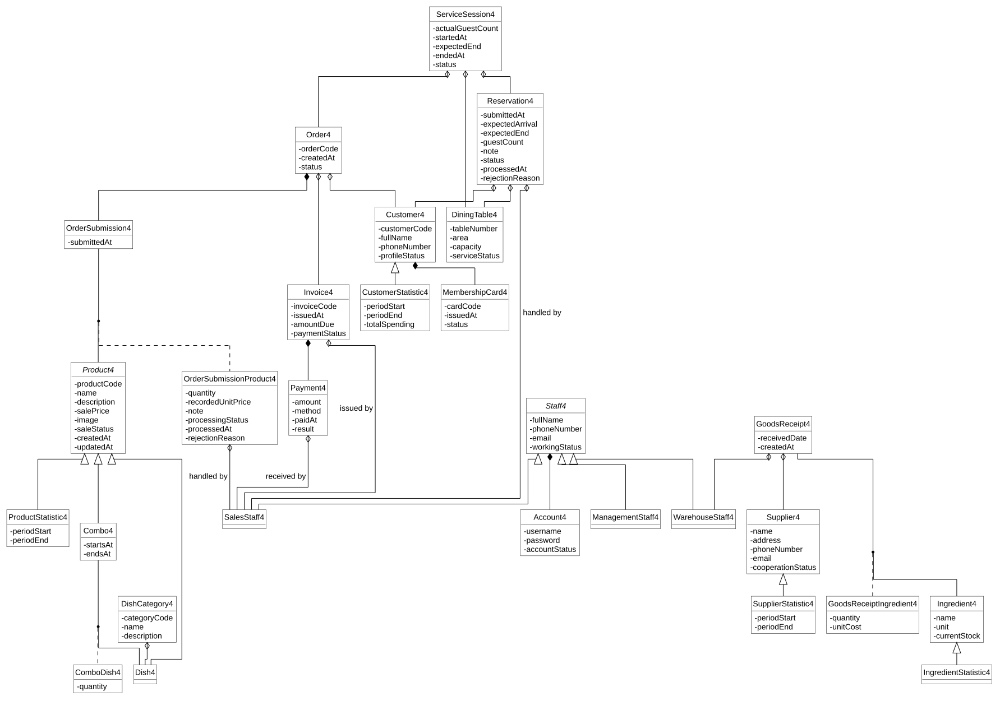
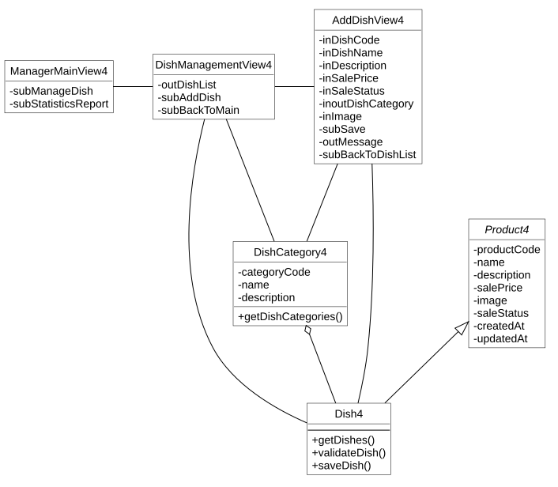
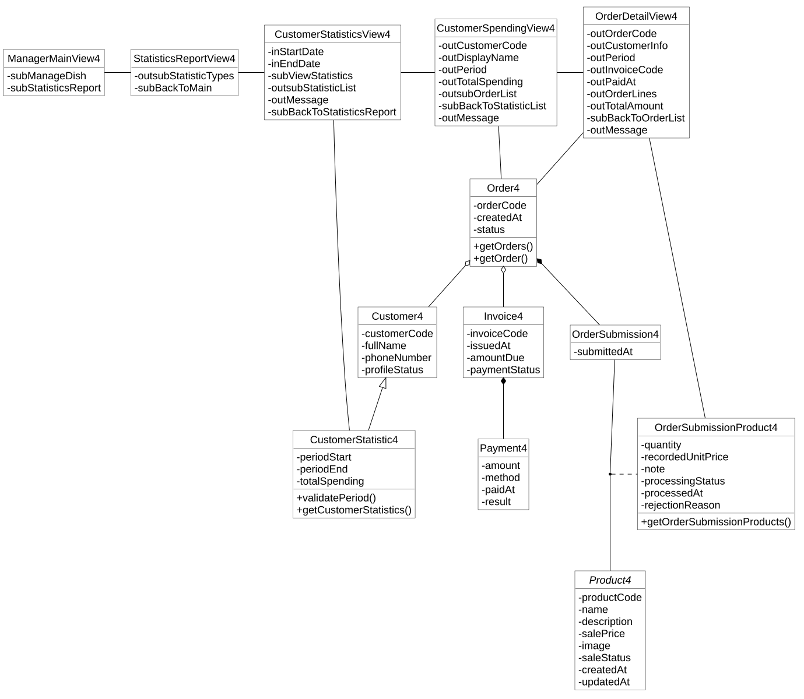
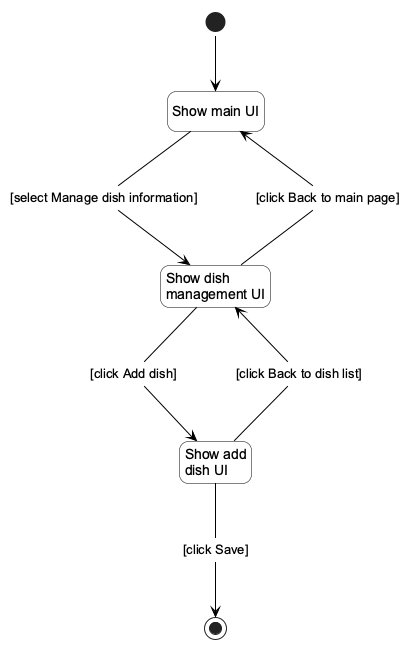
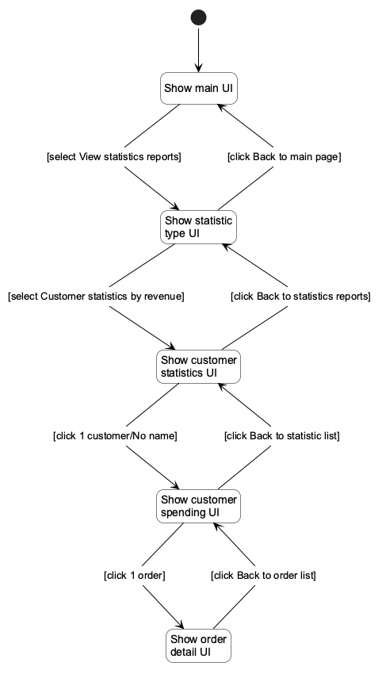

# Analysis

Source: https://docs.google.com/document/d/1GWPsqz3_sEYtDO7RkADnIStIWtwDOArcqlMYknjqMmY

# Phân tích hệ thống quản lý nhà hàng

## 1 Viết kịch bản

Phần kịch bản triển khai hai module Thêm món ăn mới và Xem thống kê khách hàng theo doanh thu. Phần trích lớp thực thể bao quát toàn bộ hệ thống quản lý nhà hàng. Các mã, tên, ngày và số tiền trong hai kịch bản là dữ liệu minh họa.

### a Kịch bản cho module Thêm món ăn mới

| Use case | Add new dish 4 |
| --- | --- |
| Actor | Nhân viên quản lý. |
| Tiền điều kiện | Nhân viên quản lý đã đăng nhập thành công bằng tài khoản đang hoạt động và đang ở giao diện chính; hệ thống có ít nhất một loại món ăn. |
| Hậu điều kiện | Món ăn hợp lệ được tạo trong danh mục, thuộc đúng loại món ăn đã chọn và có trạng thái kinh doanh đã nhập; thời điểm tạo được ghi nhận; món mới xuất hiện trong danh sách. |
| Kịch bản chính | 1. Nhân viên quản lý chọn Manage dish information từ giao diện chính. 2. Hệ thống hiển thị danh sách món với mã món, tên món, loại món ăn, giá bán, trạng thái kinh doanh và nút Add dish. 3. Nhân viên quản lý chọn Add dish. 4. Hệ thống hiển thị biểu mẫu gồm Mã món, Tên món, Mô tả, Giá bán, Trạng thái kinh doanh, danh sách chọn Loại món ăn, mục tải Ảnh minh họa tùy chọn và nút Save. Trong dữ liệu minh họa, danh sách loại có LM02 – Món chính. 5. Nhân viên nhập mã D004, tên Cơm gà, mô tả Cơm gà xé, giá bán 65.000 đồng; chọn loại LM02 – Món chính và trạng thái Đang kinh doanh. Nhân viên không tải ảnh trong lần minh họa này. 6. Nhân viên chọn Save. 7. Hệ thống kiểm tra mã món duy nhất, tên món không trống, giá bán lớn hơn 0 và loại món ăn đã chọn tồn tại. Ảnh không phải thông tin bắt buộc. 8. Khi dữ liệu hợp lệ, hệ thống lưu món ăn cùng loại món ăn, trạng thái đã chọn và thời điểm tạo. 9. Hệ thống thông báo thêm món thành công và hiển thị món D004 – Cơm gà, loại Món chính, giá 65.000 đồng, trạng thái Đang kinh doanh trong danh sách món. Use case kết thúc. |
| Ngoại lệ | 7. Mã món bị trùng, thiếu dữ liệu bắt buộc, giá bán không lớn hơn 0 hoặc loại món ăn không tồn tại: hệ thống không lưu, chỉ rõ trường lỗi và giữ dữ liệu đã nhập. Nhân viên sửa dữ liệu rồi thực hiện lại các bước 5–7; việc kiểm tra được lặp đến khi dữ liệu hợp lệ hoặc nhân viên dừng thao tác. 7. Không còn loại món ăn để lựa chọn: hệ thống không cho lưu và yêu cầu tạo loại món ăn trước. Chỉ tiếp tục thêm món khi tiền điều kiện về loại món ăn được đáp ứng. 8. Lưu thất bại: hệ thống thông báo chưa tạo được món và không để lại bản ghi món dở dang; hậu điều kiện thành công chưa đạt. |

### b Kịch bản cho module Xem thống kê khách hàng

+------------------+--------------------------------------------------------------------------------------------------+
| Use case         | View customer statistics by revenue 4                                                            |
+==================+==================================================================================================+
| Actor            | Nhân viên quản lý.                                                                               |
+------------------+--------------------------------------------------------------------------------------------------+
| Tiền điều kiện   | Nhân viên quản lý đã đăng nhập thành công bằng tài khoản đang hoạt động và đang ở giao diện      |
|                  | chính.                                                                                           |
+------------------+--------------------------------------------------------------------------------------------------+
| Hậu điều kiện    | Nhân viên xem được thống kê khách hàng hoặc nhóm No name, chi tiết chi tiêu, danh sách đơn và    |
|                  | chi tiết đơn thuộc đúng kỳ và đối tượng đã chọn; dữ liệu khách hàng, đơn, hóa đơn và thanh toán  |
|                  | không thay đổi.                                                                                  |
+------------------+--------------------------------------------------------------------------------------------------+
| Kịch bản chính   | 1\. Nhân viên quản lý chọn View statistics reports từ giao diện chính.                           |
|                  |                                                                                                  |
|                  | 2\. Hệ thống hiển thị các loại thống kê: món ăn, nguyên liệu, khách hàng và nhà cung cấp.        |
|                  |                                                                                                  |
|                  | 3\. Nhân viên chọn Customer statistics by revenue.                                               |
|                  |                                                                                                  |
|                  | 4\. Hệ thống hiển thị ô Ngày bắt đầu, ô Ngày kết thúc và nút View statistics.                    |
|                  |                                                                                                  |
|                  | 5\. Nhân viên chọn Ngày bắt đầu 01/08/2026, Ngày kết thúc 31/08/2026 và chọn View statistics.    |
|                  |                                                                                                  |
|                  | 6\. Hệ thống kiểm tra ngày bắt đầu không sau ngày kết thúc; tổng hợp các hóa đơn đã thanh toán   |
|                  | thành công, có thời điểm thanh toán từ đầu ngày 01/08/2026 đến hết ngày 31/08/2026. Hóa đơn được |
|                  | nhóm theo hồ sơ khách; đơn không gắn hồ sơ khách được gom vào nhóm No name. Mỗi hóa đơn hợp lệ   |
|                  | chỉ được tính một lần, không cộng các lần thanh toán thất bại hoặc thử lại.                      |
|                  |                                                                                                  |
|                  | 7\. Hệ thống hiển thị danh sách mã khách, tên hiển thị và tổng chi tiêu, sắp xếp theo tổng chi   |
|                  | tiêu giảm dần; các ô thời gian giữ nguyên để đổi kỳ khi cần. Dòng No name để trống mã khách và   |
|                  | chỉ xuất hiện khi phát sinh dữ liệu trong kỳ. Kết quả minh họa như sau, các khoản tiền tính bằng |
|                  | đồng:                                                                                            |
|                  |                                                                                                  |
|                  | +----------+---------------+---------------+                                                     |
|                  | | Mã khách | Tên hiển thị  | Tổng chi tiêu |                                                     |
|                  | +==========+===============+===============+                                                     |
|                  | | KH001    | Nguyễn Văn An | 4.250.000     |                                                     |
|                  | +----------+---------------+---------------+                                                     |
|                  | | KH002    | Trần Thị Bình | 2.180.000     |                                                     |
|                  | +----------+---------------+---------------+                                                     |
|                  | |          | No name       | 1.350.000     |                                                     |
|                  | +----------+---------------+---------------+                                                     |
|                  |                                                                                                  |
|                  | 8\. Nhân viên chọn dòng KH001 – Nguyễn Văn An để xem chi tiết chi tiêu.                          |
|                  |                                                                                                  |
|                  | 9\. Hệ thống hiển thị mã KH001, tên Nguyễn Văn An, kỳ 01/08/2026–31/08/2026, tổng chi tiêu       |
|                  | 4.250.000 đồng, nút Back to statistic list và danh sách các đơn tạo nên tổng này. Nếu chọn No    |
|                  | name ở bước 8, mã khách để trống, tên hiển thị là No name và chỉ liệt kê các đơn không gắn hồ sơ |
|                  | khách trong cùng kỳ. Danh sách minh họa cho KH001 như sau:                                       |
|                  |                                                                                                  |
|                  | +--------+----------------------+-----------+                                                    |
|                  | | Mã đơn | Thời điểm thanh toán | Số tiền   |                                                    |
|                  | +========+======================+===========+                                                    |
|                  | | DH101  | 03/08/2026 20:05     | 750.000   |                                                    |
|                  | +--------+----------------------+-----------+                                                    |
|                  | | DH102  | 08/08/2026 11:42     | 620.000   |                                                    |
|                  | +--------+----------------------+-----------+                                                    |
|                  | | DH103  | 15/08/2026 20:36     | 1.100.000 |                                                    |
|                  | +--------+----------------------+-----------+                                                    |
|                  | | DH104  | 22/08/2026 18:02     | 880.000   |                                                    |
|                  | +--------+----------------------+-----------+                                                    |
|                  | | DH105  | 29/08/2026 13:25     | 900.000   |                                                    |
|                  | +--------+----------------------+-----------+                                                    |
|                  |                                                                                                  |
|                  | 10\. Nhân viên chọn đơn DH103 trong danh sách của KH001.                                         |
|                  |                                                                                                  |
|                  | 11\. Hệ thống hiển thị chi tiết đơn DH103 thuộc KH001, hóa đơn HD103 đã thanh toán thành công    |
|                  | lúc 15/08/2026 20:36 và tổng tiền 1.100.000 đồng. Các dòng tính tiền là món hoặc combo đã được   |
|                  | chấp nhận, chưa hủy; đơn giá là giá đã ghi nhận khi gọi món. Giao diện có nút Back to order      |
|                  | list. Chi tiết minh họa như sau:                                                                 |
|                  |                                                                                                  |
|                  | +------------------+----------+---------+------------+                                           |
|                  | | Món hoặc combo   | Số lượng | Đơn giá | Thành tiền |                                           |
|                  | +==================+==========+=========+============+                                           |
|                  | | Lẩu hải sản      | 1        | 650.000 | 650.000    |                                           |
|                  | +------------------+----------+---------+------------+                                           |
|                  | | Combo nước       | 2        | 75.000  | 150.000    |                                           |
|                  | +------------------+----------+---------+------------+                                           |
|                  | | Cơm rang hải sản | 2        | 150.000 | 300.000    |                                           |
|                  | +------------------+----------+---------+------------+                                           |
|                  |                                                                                                  |
|                  | 12\. Nếu muốn xem đơn khác, nhân viên dùng Quay lại danh sách đơn, hệ thống hiển thị lại danh    |
|                  | sách ở bước 9 rồi lặp các bước 10–11. Nếu muốn xem khách khác, nhân viên dùng Quay lại danh sách |
|                  | thống kê rồi lặp các bước 8–11. Nếu đổi kỳ, nhân viên trở về màn hình thống kê và thực hiện lại  |
|                  | các bước 5–11. Việc xem kết thúc khi nhân viên không yêu cầu xem thêm.                           |
+------------------+--------------------------------------------------------------------------------------------------+
| Ngoại lệ         | 6\. Ngày bắt đầu sau ngày kết thúc: hệ thống không lập báo cáo, đánh dấu điều kiện lỗi và yêu    |
|                  | cầu chọn lại; nhân viên sửa khoảng ngày rồi thực hiện lại các bước 5–6 đến khi hợp lệ hoặc dừng  |
|                  | xem.                                                                                             |
|                  |                                                                                                  |
|                  | 6\. Tổng hợp dữ liệu thất bại: hệ thống thông báo chưa thể lập báo cáo, không hiển thị số liệu   |
|                  | tổng hợp dở dang và không thay đổi dữ liệu nguồn.                                                |
|                  |                                                                                                  |
|                  | 7\. Không có hóa đơn hợp lệ trong kỳ: hệ thống hiển thị danh sách rỗng, giữ nguyên điều kiện     |
|                  | thời gian và cho phép nhân viên quay lại bước 5 để chọn kỳ khác; không thực hiện các bước 8–11   |
|                  | khi danh sách rỗng.                                                                              |
|                  |                                                                                                  |
|                  | 8\. Khách hàng hoặc nhóm đang chọn không còn phù hợp bộ lọc: hệ thống thông báo dữ liệu đã thay  |
|                  | đổi và tải lại danh sách thống kê theo điều kiện hiện tại, trở về bước 7.                        |
|                  |                                                                                                  |
|                  | 10\. Đơn được chọn không còn thuộc khách hàng hoặc nhóm No name và kỳ đang xem, hoặc hóa đơn     |
|                  | không còn hợp lệ: hệ thống thông báo dữ liệu đã thay đổi và tải lại danh sách đơn theo điều kiện |
|                  | hiện tại, trở về bước 9.                                                                         |
+------------------+--------------------------------------------------------------------------------------------------+

## 2 Trích lớp thực thể

### Bước 1 Mô tả hệ thống trong một đoạn văn

Hệ thống quản lý nhà hàng phục vụ bốn nhóm người dùng nghiệp vụ: nhân viên quản lý, nhân viên kho, nhân viên bán hàng và khách hàng. Nhân viên quản lý quản lý món ăn, loại món ăn, combo và xem thống kê món ăn, nguyên liệu, khách hàng, nhà cung cấp. Nhân viên kho quản lý nhà cung cấp và ghi nhận các phiếu nhập nguyên liệu. Nhân viên bán hàng tiếp nhận khách, xử lý đặt bàn, mở lượt phục vụ tại bàn, ghi nhận đơn gọi món, lập hóa đơn, nhận thanh toán và cấp thẻ thành viên. Khách hàng tìm kiếm món ăn hoặc combo, đặt bàn và gọi món trực tuyến. Hệ thống quản lý tài khoản nhân viên; hồ sơ khách hàng và thẻ thành viên; mặt hàng bán; nguyên liệu và nhà cung cấp; bàn, phiếu đặt và lượt phục vụ; đơn, lần gửi món, hóa đơn, thanh toán; đồng thời tạo các kết quả thống kê theo dữ liệu nghiệp vụ đã ghi nhận.

### Bước 2 Trích các danh từ xuất hiện trong đoạn văn

Liên quan đến người: người dùng; nhân viên; nhân viên quản lý; nhân viên kho; nhân viên bán hàng; khách hàng; nhà cung cấp.

Liên quan đến vật: nhà hàng; kho; mặt hàng bán; món ăn; loại món ăn; combo; nguyên liệu; bàn ăn; thẻ thành viên.

Liên quan đến thông tin: tài khoản; hồ sơ nhân viên; hồ sơ khách hàng; thông tin liên hệ; thông tin mặt hàng; mã mặt hàng; tên mặt hàng; mô tả; giá bán; hình ảnh; trạng thái kinh doanh; thời điểm tạo và cập nhật; chi tiết combo; số lượng; phiếu nhập; chi tiết phiếu nhập; ngày nhận; đơn giá nhập; tổng giá trị nhập; tồn kho hiện tại; phiếu đặt bàn; thời gian dự kiến; lượt phục vụ; đơn gọi món; lần gửi món; chi tiết lần gửi; kênh gọi; trạng thái xử lý; đơn giá ghi nhận; thành tiền; hóa đơn; lần thanh toán; kết quả thanh toán; báo cáo thống kê; thống kê khách hàng; thống kê mặt hàng bán; thống kê nguyên liệu; thống kê nhà cung cấp; khoảng thời gian thống kê; tổng chi tiêu; số lượng bán; doanh thu; số lần nhập; danh sách khách hàng; danh sách đơn; nhãn No name.

### Bước 3 Đánh giá và lựa chọn các danh từ

Người dùng → loại: Là tên chung của các bên tương tác, chưa có hồ sơ chung cần quản lý; không tạo lớp riêng.

Nhân viên → lớp trừu tượng Staff4: Quản lý fullName, phoneNumber, email, workingStatus. Đây là lớp cha chung, không tạo đối tượng Staff4 trực tiếp.

Nhân viên quản lý → lớp ManagementStaff4; nhân viên kho → lớp WarehouseStaff4; nhân viên bán hàng → lớp SalesStaff4: Ba lớp con biểu diễn ba loại nhân viên nghiệp vụ được đề bài xác định. Các lớp con kế thừa dữ liệu chung từ Staff4 và để trống ngăn thuộc tính riêng khi chưa có dữ kiện chuyên biệt.

Tài khoản → lớp Account4: Quản lý username, password, accountStatus. Không giữ role vì loại nhân viên đã được biểu diễn bằng cây kế thừa; không đưa mã kỹ thuật hoặc cách băm mật khẩu vào mô hình phân tích.

Khách hàng, hồ sơ khách hàng, thông tin liên hệ → lớp Customer4: Quản lý customerCode, fullName, phoneNumber, profileStatus. Khách vãng lai không có hồ sơ không được tạo thành một Customer4 giả.

Thẻ thành viên → lớp MembershipCard4: Quản lý cardCode, issuedAt, status. Tư cách thành viên được xác định qua thẻ, không tạo lớp Khách hàng thành viên chỉ để lặp dữ liệu Customer4.

Nhà cung cấp → lớp Supplier4: Quản lý name, address, phoneNumber, email, cooperationStatus.

Nhà hàng, kho → loại: Là bối cảnh hoạt động trong phạm vi đề bài, chưa có yêu cầu quản lý nhiều nhà hàng hoặc nhiều kho độc lập.

Mặt hàng bán → lớp trừu tượng Product4: Khái quát productCode, name, description, salePrice, image, saleStatus, createdAt, updatedAt. Product4 không phải một loại mặt hàng thứ ba được tạo trực tiếp.

Món ăn → lớp Dish4; combo → lớp Combo4: Là hai dạng chuyên biệt của Product4. Combo4 có thêm startsAt, endsAt; Dish4 chưa có thuộc tính riêng ngoài phần kế thừa.

Loại món ăn → lớp DishCategory4: Quản lý categoryCode, name, description và phân loại Dish4.

Chi tiết combo, số lượng → lớp liên kết ComboDish4 với quantity: Dữ kiện số lượng phụ thuộc đồng thời vào Combo4 và Dish4. Tên lớp ghép nguyên tên hai đầu mút theo quy tắc lớp liên kết n–n.

Nguyên liệu, tồn kho hiện tại → lớp Ingredient4: Quản lý name, unit, currentStock. Tồn kho hiện tại là dữ kiện gốc được ghi nhận của nguyên liệu trong phạm vi hệ thống; không tạo lớp Kho riêng.

Phiếu nhập → lớp GoodsReceipt4: Quản lý receivedDate và createdAt. Nghiệp vụ hiện tại chỉ yêu cầu nhân viên kho tạo phiếu, không có bước xác nhận phiếu. Tổng giá trị phiếu được tính từ các dòng nhập nên không giữ thành thuộc tính.

Chi tiết phiếu nhập, số lượng, đơn giá nhập, thành tiền → lớp liên kết GoodsReceiptIngredient4: Giữ quantity và unitCost vì đây là dữ kiện gốc của từng nguyên liệu trong từng phiếu; unitCost là đơn giá được ghi nhận tại lần nhập. lineAmount và totalAmount là kết quả tính nên loại.

Bàn ăn → lớp DiningTable4: Quản lý tableNumber, area, capacity, serviceStatus.

Phiếu đặt bàn, thời gian dự kiến → lớp Reservation4: Quản lý submittedAt, expectedArrival, expectedEnd, guestCount, note, status, processedAt, rejectionReason.

Lượt phục vụ → lớp ServiceSession4: Phân biệt các lần sử dụng một bàn; quản lý actualGuestCount, startedAt, expectedEnd, endedAt, status. endedAt là thời điểm thực tế lượt phục vụ kết thúc, không gắn với một thao tác kỹ thuật cụ thể chưa được đề bài xác định.

Đơn gọi món → lớp Order4: Quản lý orderCode, createdAt, status. Tổng tiền đơn là kết quả cộng các dòng hợp lệ nên không giữ thành thuộc tính.

Lần gửi món, phần gọi thêm → lớp OrderSubmission4: Quản lý submittedAt; mỗi lần gọi thêm tạo một lần gửi mới trong cùng Order4. Kênh gọi không được giữ thành thuộc tính vì đặc tả hiện tại không yêu cầu lưu cách khởi tạo từng lần gửi.

Chi tiết lần gửi, số lượng, đơn giá ghi nhận, trạng thái xử lý, thành tiền → lớp liên kết OrderSubmissionProduct4: Giữ quantity, recordedUnitPrice, note, processingStatus, processedAt, rejectionReason. recordedUnitPrice là giá được chốt tại lần gọi; lineAmount là quantity × recordedUnitPrice nên loại.

Hóa đơn → lớp Invoice4: Quản lý invoiceCode, issuedAt, amountDue, paymentStatus. amountDue là số tiền nghĩa vụ được chốt khi phát hành hóa đơn, vì vậy được giữ như dữ kiện lịch sử của giao dịch.

Lần thanh toán, kết quả thanh toán → lớp Payment4: Quản lý amount, method, paidAt, result cho từng lần thanh toán.

Trạng thái → thuộc tính: Đặt tại đúng đối tượng nghiệp vụ bằng accountStatus, workingStatus, profileStatus, status, saleStatus, cooperationStatus, serviceStatus, processingStatus, paymentStatus hoặc result; không tạo lớp trạng thái chung.

Thống kê khách hàng → lớp CustomerStatistic4 kế thừa Customer4, bổ sung periodStart, periodEnd, totalSpending theo spec §4.5. totalSpending được tính khi lập báo cáo từ hóa đơn đã thanh toán trong kỳ và không lưu CSDL.

Thống kê mặt hàng bán → lớp ProductStatistic4 kế thừa Product4, bổ sung periodStart, periodEnd. soldQuantity và revenue là kết quả tổng hợp nên loại khỏi lớp.

Thống kê nguyên liệu → lớp IngredientStatistic4 kế thừa Ingredient4 và không có thuộc tính riêng. currentStock và unit đã được kế thừa; không lặp lại ở lớp con.

Thống kê nhà cung cấp → lớp SupplierStatistic4 kế thừa Supplier4, bổ sung periodStart, periodEnd. receiptCount và receivedValue là kết quả tổng hợp nên loại khỏi lớp.

Báo cáo thống kê, tổng chi tiêu, số lượng bán, doanh thu, số lần nhập, tổng giá trị nhập → loại khỏi tập lớp hoặc thuộc tính: Là tên kết quả và các giá trị tính từ dữ liệu gốc. Công thức được dùng khi hiển thị báo cáo nhưng không đưa vào hộp lớp.

Danh sách khách hàng, danh sách đơn, nhãn No name → loại khỏi tập lớp: Danh sách là tập đối tượng hiển thị; No name chỉ là nhãn nhóm các đơn không gắn hồ sơ khách, không đại diện cho một thực thể Customer4 hay một lớp thống kê độc lập.

### Bước 4 Xác định quan hệ số lượng giữa các thực thể

1. Staff4 – Account4 là 1–1: mỗi hồ sơ nhân viên có một tài khoản dùng để truy cập và mỗi tài khoản thuộc một nhân viên.

2. Customer4 – MembershipCard4 là 1–n: một khách có thể có nhiều thẻ trong lịch sử, mỗi thẻ thuộc một khách.

3. Customer4 – Reservation4 là 1–n: một khách có thể đặt bàn nhiều lần, mỗi phiếu đặt gắn với một hồ sơ khách.

4. DiningTable4 – Reservation4 là 1–n: một bàn có nhiều phiếu theo thời gian, mỗi phiếu gắn với một bàn được chọn.

5. DiningTable4 – ServiceSession4 là 1–n: một bàn có nhiều lượt phục vụ theo thời gian, mỗi lượt thuộc một bàn.

6. Reservation4 – ServiceSession4 là 1–1 khi một lượt được mở từ phiếu đặt; lượt phục vụ khách vãng lai có thể không xuất phát từ phiếu.

7. ServiceSession4 – Order4 là 1–1: một lượt sử dụng một đơn gọi món và mỗi đơn thuộc một lượt.

8. Customer4 – Order4 là 1–n: một khách có thể có nhiều đơn; đơn của khách vãng lai có thể không gắn hồ sơ Customer4.

9. Order4 – OrderSubmission4 là 1–n: một đơn có lần gửi ban đầu và có thể có các lần gọi thêm; mỗi lần gửi thuộc một đơn.

10. OrderSubmission4 – Product4 là n–n, lớp liên kết OrderSubmissionProduct4: một lần gửi có nhiều mặt hàng và một mặt hàng có thể xuất hiện trong nhiều lần gửi. quantity, recordedUnitPrice, note và thông tin xử lý phụ thuộc vào đúng cặp lần gửi–mặt hàng.

11. Order4 – Invoice4 là 1–1: một hóa đơn chốt nghĩa vụ thanh toán của một đơn và mỗi đơn có tối đa một hóa đơn.

12. Invoice4 – Payment4 là 1–n: một hóa đơn có thể phát sinh nhiều lần thanh toán, mỗi lần thanh toán thuộc một hóa đơn.

13. DishCategory4 – Dish4 là 1–n: một loại có nhiều món, mỗi món thuộc một loại.

14. Combo4 – Dish4 là n–n, lớp liên kết ComboDish4: một combo gồm nhiều món và một món có thể thuộc nhiều combo; quantity là dữ kiện của liên kết.

15. Supplier4 – GoodsReceipt4 là 1–n: một nhà cung cấp có nhiều phiếu nhập, mỗi phiếu nhập thuộc một nhà cung cấp.

16. GoodsReceipt4 – Ingredient4 là n–n, lớp liên kết GoodsReceiptIngredient4: một phiếu ghi nhận nhiều nguyên liệu và một nguyên liệu xuất hiện trong nhiều phiếu; quantity và unitCost thuộc liên kết.

17. SalesStaff4 có các quan hệ 1–n với Reservation4, OrderSubmissionProduct4, Invoice4 và Payment4 theo các vai trò xử lý đặt bàn, xử lý dòng gọi món, lập hóa đơn và nhận thanh toán; mỗi bản ghi ở từng quan hệ gắn với một nhân viên bán hàng chịu trách nhiệm.

18. WarehouseStaff4 – GoodsReceipt4 là 1–n theo vai trò người tạo phiếu: một nhân viên kho có thể tạo nhiều phiếu nhập và mỗi phiếu nhập gắn với một nhân viên kho tạo phiếu; không có vai trò xác nhận phiếu.

19. CustomerStatistic4 – Customer4, ProductStatistic4 – Product4, IngredientStatistic4 – Ingredient4 và SupplierStatistic4 – Supplier4 là các quan hệ kế thừa, không phải quan hệ số lượng độc lập.

### Bước 5 Xác định quan hệ đối tượng giữa các thực thể

Kế thừa generalization: ManagementStaff4, WarehouseStaff4 và SalesStaff4 là các loại nghiệp vụ cụ thể của Staff4; Staff4 là lớp cha trừu tượng chứa dữ liệu chung. Dish4 và Combo4 là các loại Product4. CustomerStatistic4 kế thừa Customer4; ProductStatistic4 kế thừa Product4; IngredientStatistic4 kế thừa Ingredient4; SupplierStatistic4 kế thừa Supplier4. Lớp thống kê không lặp thuộc tính kế thừa. CustomerStatistic4 giữ tham số kỳ và totalSpending được tính khi lập báo cáo; các lớp thống kê khác giữ nguyên thuộc tính đã phân tích.

Composition / gắn chặt, bộ phận phụ thuộc vòng đời vào tổng thể:

- `Staff4 ◆— Account4`: đặt hình thoi đặc ở Staff4 vì tài khoản chỉ tồn tại cho một hồ sơ nhân viên và bị loại bỏ cùng hồ sơ đó.

- `Customer4 ◆— MembershipCard4`: đặt hình thoi đặc ở Customer4 vì thẻ được phát hành cho một khách hàng và không có ý nghĩa ngoài hồ sơ khách sở hữu thẻ.

- `Invoice4 ◆— Payment4`: đặt hình thoi đặc ở Invoice4 vì mỗi lần thanh toán là một phần lịch sử thanh toán của đúng hóa đơn đó.

- `Order4 ◆— OrderSubmission4`: đặt hình thoi đặc ở Order4 vì một lần gửi không có ý nghĩa ngoài đơn gọi món chứa nó.

Aggregation / hợp thành theo quan hệ tổng thể–bộ phận, trong đó bộ phận có thể tiếp tục tồn tại:

- `DishCategory4 ◇— Dish4`: đặt hình thoi rỗng ở DishCategory4 vì một loại món ăn nhóm nhiều món, nhưng món vẫn tồn tại khi được chuyển sang loại khác.

- `ServiceSession4 ◇— Order4`: đặt hình thoi rỗng ở ServiceSession4 vì mỗi đơn thuộc một lượt phục vụ, nhưng đơn phải được giữ lại sau khi lượt kết thúc để phục vụ hóa đơn và thống kê.

Aggregation / hợp thành dùng để biểu diễn tham chiếu; hình thoi rỗng đặt tại lớp giữ tham chiếu:

- `Reservation4 ◇— Customer4`: Reservation4 giữ tham chiếu đến khách hàng đã đặt bàn.

- `Reservation4 ◇— DiningTable4`: Reservation4 giữ tham chiếu đến bàn được chọn.

- `ServiceSession4 ◇— DiningTable4`: ServiceSession4 giữ tham chiếu đến bàn đang được sử dụng.

- `ServiceSession4 ◇— Reservation4`: ServiceSession4 có thể giữ tham chiếu đến phiếu đặt làm nguồn mở lượt; tham chiếu này để trống với khách vãng lai.

- `Order4 ◇— Customer4`: Order4 có thể giữ tham chiếu đến hồ sơ khách; tham chiếu để trống đối với đơn thuộc nhóm No name.

- `Order4 ◇— Invoice4`: Order4 giữ tham chiếu có thể trống đến hóa đơn chốt nghĩa vụ thanh toán của đơn. Hình thoi đánh dấu lớp khai báo thuộc tính đối tượng ở pha thiết kế; giao diện danh sách đơn và chi tiết đơn đi từ đơn tới hóa đơn. Hóa đơn là chứng từ độc lập nên dùng aggregation, không dùng composition. Quan hệ số lượng 1–0..1 không đổi.

- `GoodsReceipt4 ◇— Supplier4`: GoodsReceipt4 giữ tham chiếu đến nhà cung cấp đã giao nguyên liệu.

- `Reservation4 ◇— SalesStaff4`: Reservation4 giữ tham chiếu đến nhân viên bán hàng xử lý phiếu đặt.

- `OrderSubmissionProduct4 ◇— SalesStaff4`: OrderSubmissionProduct4 giữ tham chiếu đến nhân viên bán hàng xử lý dòng gọi món.

- `Invoice4 ◇— SalesStaff4`: Invoice4 giữ tham chiếu đến nhân viên bán hàng lập hóa đơn.

- `Payment4 ◇— SalesStaff4`: Payment4 giữ tham chiếu đến nhân viên bán hàng nhận thanh toán.

- `GoodsReceipt4 ◇— WarehouseStaff4`: GoodsReceipt4 giữ tham chiếu đến nhân viên kho tạo phiếu.

Không tạo các liên kết ManagementStaff4–Product4, SalesStaff4–ServiceSession4, SalesStaff4–MembershipCard4 hoặc vai trò WarehouseStaff4 xác nhận GoodsReceipt4 vì mô hình hiện tại không yêu cầu lưu các liên kết đó.

Lớp liên kết association class: ComboDish4 lớp hóa quan hệ n–n Combo4–Dish4; GoodsReceiptIngredient4 lớp hóa quan hệ n–n GoodsReceipt4–Ingredient4; OrderSubmissionProduct4 lớp hóa quan hệ n–n OrderSubmission4–Product4. Trên sơ đồ, mỗi cặp đầu mút vẫn nối trực tiếp bằng một association liền và hộp lớp liên kết nối bằng nét đứt vào chính association đó; không thay bằng hai association qua lớp trung gian.

Không bổ sung dependency từ các lớp thống kê tới dữ liệu nguồn. Việc đọc dữ liệu để tính báo cáo không tạo thêm quan hệ đối tượng; các kết quả tính được trình bày ở xử lý và giao diện. Riêng CustomerStatistic4.totalSpending là thuộc tính tạm của kết quả báo cáo theo spec §4.5, không lưu CSDL.

### Script PlantUML cho sơ đồ lớp thực thể tổng thể của toàn hệ thống

PlantUML source: [diagrams/class-entity-system.puml](../diagrams/class-entity-system.puml)

## 3 Trích và vẽ biểu đồ lớp cho module

### a Phân tích tĩnh module Thêm món ăn mới

- Ban đầu, nhân viên quản lý đã đăng nhập và đang ở giao diện chính → đề xuất lớp ManagerMainView4, cần các thành phần:

  - subManageDish: kiểu submit, cho phép chọn chức năng Quản lý thông tin món ăn.

  - subStatisticsReport: kiểu submit, cho phép mở Báo cáo thống kê; đây là thành phần dùng chung với module thống kê khách hàng.

- Bước 2 của kịch bản v.1, giao diện quản lý thông tin món ăn → đề xuất lớp DishManagementView4, cần các thành phần:

  - outDishList: kiểu output, hiển thị mã món, tên món, loại món ăn, giá bán và trạng thái kinh doanh.

  - subAddDish: kiểu submit, cho phép mở biểu mẫu thêm món ăn mới.

  - subBackToMain: kiểu submit, cho phép quay lại giao diện chính.

- Để có danh sách món ăn tại bước 2 và danh sách cập nhật tại bước 9, cần xử lí dưới hệ thống:

  - Lấy các món ăn hiện có cùng thông tin loại món ăn; sau khi thêm thành công, danh sách phải có món vừa tạo theo trạng thái kinh doanh đã chọn.

  - input: không có dữ liệu nghiệp vụ nhập thêm.

  - output: danh sách Dish4 kèm mã, tên, loại món ăn, giá bán và trạng thái kinh doanh.

  - Đề xuất phương thức getDishes(), gán cho lớp Dish4 vì output là danh sách các món ăn.

- Bước 4 của kịch bản v.1, biểu mẫu thêm món ăn mới → đề xuất lớp AddDishView4, cần các thành phần:

  - inDishCode, inDishName, inDescription, inSalePrice, inSaleStatus: kiểu input, nhận mã món, tên món, mô tả, giá bán và trạng thái kinh doanh.

  - inoutDishCategory: kiểu input/output, hiển thị danh sách loại món ăn và nhận loại được chọn.

  - inImage: kiểu input, nhận ảnh minh họa tùy chọn; ảnh không phải điều kiện bắt buộc để lưu món.

  - subSave: kiểu submit, gửi yêu cầu kiểm tra và lưu thông tin món ăn.

  - outMessage: kiểu output, hiển thị kết quả thêm món hoặc chỉ rõ lỗi; khi có lỗi, biểu mẫu giữ dữ liệu đã nhập để nhân viên sửa.

  - subBackToDishList: kiểu submit, cho phép quay lại danh sách món ăn mà không lưu dữ liệu đang nhập.

- Để hiển thị danh sách chọn loại món ăn tại bước 4, cần xử lí dưới hệ thống:

  - Lấy các loại món ăn hiện có; nếu danh sách rỗng thì không cho lưu và yêu cầu có loại món ăn trước.

  - input: không có dữ liệu nghiệp vụ nhập thêm.

  - output: danh sách DishCategory4 gồm mã và tên loại món ăn.

  - Đề xuất phương thức getDishCategories(), gán cho lớp DishCategory4 vì output là danh sách các loại món ăn.

- Để kiểm tra thông tin ở bước 7, cần xử lí dưới hệ thống:

  - Kiểm tra mã món không trống và không trùng, tên món không trống, giá bán được nhập và lớn hơn 0, loại món ăn được chọn tồn tại; ảnh minh họa là thông tin tùy chọn.

  - input: mã món, tên món, mô tả, giá bán, trạng thái kinh doanh, loại món ăn đã chọn và ảnh minh họa nếu có.

  - output: kết quả hợp lệ hoặc danh sách trường lỗi; kết quả kiểm tra không tạo món ăn.

  - Đề xuất phương thức validateDish(), gán cho lớp Dish4. Output là kết quả kiểm tra nên xét input: Dish4 là thực thể nhỏ nhất bao quát thông tin món ăn kế thừa từ Product4 và liên kết đến DishCategory4.

Danh sách loại món ăn từ getDishCategories() cũng được dùng tại DishManagementView4 để đối chiếu mỗi Dish4 với DishCategory4.dishes và hiển thị cột Loại món ăn; dùng lại phương thức hiện có, không thêm phương thức hoặc tham chiếu ngược ở Dish4.

- Để lưu món ăn ở bước 8, cần xử lí dưới hệ thống:

  - Chỉ lưu khi thông tin món ăn hợp lệ; lưu nhất quán dữ liệu món, loại món ăn, trạng thái kinh doanh và thời điểm tạo. Nếu lưu thất bại thì hoàn tác toàn bộ việc tạo món, không để lại bản ghi dở dang.

  - input: thông tin món ăn đã nhập và loại món ăn đã chọn.

  - output: Dish4 vừa được tạo với loại món ăn, trạng thái và thời điểm tạo; nếu thất bại, trả kết quả chưa tạo được món.

  - Đề xuất phương thức saveDish(), gán cho lớp Dish4 vì output thành công là món ăn vừa được tạo.

Product4 là lớp cha trừu tượng, giữ productCode, name, description, salePrice, image, saleStatus, createdAt và updatedAt; Dish4 kế thừa các thuộc tính này và không bổ sung thuộc tính riêng. DishCategory4 phân loại Dish4. Quyền thêm món của ManagementStaff4 được thể hiện trong use case và kịch bản, không tạo association ManagementStaff4–Product4 vì hệ thống không lưu người tạo mặt hàng. Những thực thể không tham gia xử lí thêm món được lược khỏi biểu đồ module.

Các lớp ManagerMainView4–DishManagementView4 và DishManagementView4–AddDishView4 liên kết theo việc mở giao diện. DishManagementView4 sử dụng Dish4 và DishCategory4 để hiển thị món cùng tên loại qua DishCategory4.dishes; AddDishView4 sử dụng Dish4 và DishCategory4. Những liên kết này được vẽ bằng đường liền không mũi tên theo mẫu biểu đồ lớp phân tích module.

Kết quả thu được biểu đồ lớp phân tích cho module Thêm món ăn mới như trong Hình 3.1.

PlantUML source: [diagrams/class-add-dish.puml](../diagrams/class-add-dish.puml)

Hình 3.1: Biểu đồ lớp phân tích module Thêm món ăn mới

### b Phân tích tĩnh module Xem thống kê khách hàng theo doanh thu

- Ban đầu, giao diện chính sau khi nhân viên quản lý đăng nhập → đề xuất lớp ManagerMainView4, cần các thành phần:

  - subManageDish: kiểu submit để chọn quản lý thông tin món ăn; subStatisticsReport: kiểu submit để mở báo cáo thống kê. Đây là lớp giao diện chính dùng chung với module Thêm món ăn mới.

- Bước 2, giao diện lựa chọn báo cáo thống kê → đề xuất lớp StatisticsReportView4, cần các thành phần:

  - outsubStatisticTypes: kiểu kết hợp output và submit, hiển thị danh sách bốn loại báo cáo món ăn, nguyên liệu, khách hàng, nhà cung cấp và cho phép chọn một loại; module hiện tại chỉ triển khai nhánh khách hàng.

  - subBackToMain: kiểu submit, cho phép quay lại giao diện chính.

- Bước 4 và bước 7, giao diện chọn khoảng ngày và xem danh sách thống kê → đề xuất cùng một lớp CustomerStatisticsView4, cần các thành phần:

  - inStartDate, inEndDate: kiểu input, chọn ngày đầu và ngày cuối của kỳ thống kê.

  - subViewStatistics: kiểu submit, yêu cầu kiểm tra khoảng ngày và lập báo cáo.

  - outsubStatisticList: kiểu kết hợp output và submit, hiển thị mã khách, tên hiển thị, tổng chi tiêu và cho phép chọn một khách hoặc nhóm No name để xem tiếp; kết quả sắp giảm dần theo tổng chi tiêu. Các ô ngày vẫn nằm trên giao diện này để nhân viên đổi kỳ.

  - outMessage: kiểu output, hiển thị điều kiện lỗi, trạng thái danh sách rỗng hoặc thông báo chưa thể lập báo cáo.

  - subBackToStatisticsReport: kiểu submit, cho phép quay lại giao diện báo cáo thống kê để chọn loại báo cáo khác.

- Bước 9, giao diện chi tiết chi tiêu khách hàng và danh sách đơn → đề xuất lớp CustomerSpendingView4, cần các thành phần:

  - outCustomerCode, outDisplayName, outPeriod, outTotalSpending: kiểu output, hiển thị khách/nhóm đang chọn, kỳ hiện tại và tổng chi tiêu. Với No name, mã khách để trống; tên hiển thị là No name.

  - outsubOrderList: kiểu kết hợp output và submit, hiển thị mã đơn, thời điểm thanh toán và số tiền; cho phép chọn một đơn thuộc đúng khách/nhóm và kỳ đang xem.

  - subBackToStatisticList: kiểu submit để trở lại kết quả thống kê và giữ nguyên kỳ; outMessage: kiểu output để thông báo dữ liệu đã thay đổi.

- Bước 11, giao diện chi tiết đơn hàng → đề xuất lớp OrderDetailView4, cần các thành phần:

  - outOrderCode, outCustomerInfo, outPeriod, outInvoiceCode, outPaidAt: kiểu output, hiển thị ngữ cảnh đơn, khách/nhóm, kỳ, hóa đơn và thời điểm thanh toán thành công.

  - outOrderLines: kiểu output, hiển thị món hoặc combo, số lượng, đơn giá đã ghi nhận và thành tiền; bảng này chỉ đọc, không dùng tiền tố outsub.

  - outTotalAmount: kiểu output, hiển thị tổng tiền hóa đơn hợp lệ; subBackToOrderList: kiểu submit để quay lại đúng danh sách đơn; outMessage: kiểu output để phản hồi dữ liệu đã thay đổi.

- Để nhận biết khoảng ngày có thể dùng lập báo cáo, cần xử lí dưới hệ thống:

  - Kiểm tra ngày bắt đầu không sau ngày kết thúc.

  - input: Ngày bắt đầu và ngày kết thúc do nhân viên quản lý chọn.

  - output: Kết quả khoảng ngày hợp lệ hoặc thông tin điều kiện lỗi.

  - Đề xuất phương thức validatePeriod(), gán cho lớp CustomerStatistic4. Output là kết quả kiểm tra, không phải một thực thể; hai giá trị input tương ứng periodStart và periodEnd của CustomerStatistic4 nên gán phương thức cho lớp này.

- Để có danh sách thống kê ở bước 7, cần xử lí dưới hệ thống:

  - Tổng hợp Invoice4 có Payment4 thành công trong kỳ; mỗi hóa đơn chỉ tính một lần, không cộng các lần thanh toán thất bại hoặc thử lại. Gom theo Customer4; gom riêng các đơn không gắn hồ sơ khách vào No name và chỉ đưa nhóm này vào kết quả khi có phát sinh. Tổng chi tiêu là tổng amountDue của các hóa đơn hợp lệ.

  - input: Ngày bắt đầu và ngày kết thúc đã hợp lệ; khoảng xử lý từ đầu ngày bắt đầu đến hết ngày kết thúc.

  - output: Danh sách CustomerStatistic4, mỗi phần tử gồm mã khách, tên hiển thị, kỳ và totalSpending; kèm một đối tượng CustomerStatistic4 tạm cho nhóm No name nếu có đơn không gắn hồ sơ khách phát sinh trong kỳ. Danh sách được sắp theo tổng chi tiêu giảm dần; có thể rỗng hoặc trả thông tin tổng hợp thất bại.

  - Đề xuất phương thức getCustomerStatistics(), gán cho lớp CustomerStatistic4. Output chính là kết quả thống kê khách hàng nên gán cho CustomerStatistic4. Nhóm No name là một đối tượng CustomerStatistic4 tạm có id = 0, customerCode trống, fullName = "No name", cùng periodStart, periodEnd và totalSpending; không lưu đối tượng này và không tạo hồ sơ Customer4 cho nhóm.

- Để có tổng chi tiêu và danh sách đơn ở bước 9, cần xử lí dưới hệ thống:

  - Kiểm tra lựa chọn khách/nhóm còn có kết quả trong kỳ; lấy đúng các đơn tạo nên tổng chi tiêu theo cùng điều kiện hóa đơn và thời điểm thanh toán, không lấy đơn ngoài kỳ hoặc của đối tượng khác.

  - input: Khoảng ngày hiện tại và đối tượng đang chọn: mã của khách có hồ sơ hoặc lựa chọn nhóm các đơn không gắn Customer4 (No name), không dùng mã khách giả.

  - output: Danh sách Order4 hợp lệ của đối tượng trong kỳ, mỗi đơn kèm mã đơn, thời điểm thanh toán thành công và số tiền hóa đơn; kèm thông tin hiển thị đối tượng, kỳ, tổng chi tiêu và kết quả kiểm tra đối tượng còn phù hợp bộ lọc.

  - Đề xuất phương thức getOrders(), gán cho lớp Order4. Output chính là danh sách Order4; ưu tiên gán cho Order4 theo output. Invoice4 và Payment4 cung cấp điều kiện hợp lệ, thời điểm và số tiền, không làm thay đổi lớp sở hữu truy vấn lấy đơn.

- Để xác định đơn và chứng từ hợp lệ trước khi hiển thị bước 11, cần xử lí dưới hệ thống:

  - Kiểm tra đơn còn thuộc khách/nhóm và kỳ hiện tại, hóa đơn còn hợp lệ; lấy thông tin đơn, hóa đơn và lần thanh toán thành công để định danh chi tiết đang xem.

  - input: Mã đơn được chọn, khoảng ngày và khách có hồ sơ hoặc nhóm No name đang xem.

  - output: Order4 được chọn cùng thông tin khách/nhóm, Invoice4 hợp lệ, thời điểm thanh toán thành công và tổng tiền phải trả; hoặc thông tin đơn không còn phù hợp bộ lọc. Output này chưa chứa bảng các dòng tính tiền.

  - Đề xuất phương thức getOrder(), gán cho lớp Order4. Output xác định một Order4 và thông tin chứng từ liên quan của chính đơn đó nên gán cho Order4. Tách phần các dòng tính tiền sang OrderSubmissionProduct4 vì loại đối tượng của output phần đó khác.

- Để có các dòng chi tiết tính tiền ở bước 11, cần xử lí dưới hệ thống:

  - Đọc các dòng của các lần gửi thuộc đơn; chỉ giữ dòng đã chấp nhận, chưa hủy; dùng quantity × recordedUnitPrice để tính thành tiền và lấy mã/tên mặt hàng qua Product4. Giữ kiểm tra cùng ngữ cảnh đơn, khách/nhóm và kỳ trước khi trả kết quả.

  - input: Order4 đã được xác định cùng khoảng ngày và khách/nhóm đang xem; giữ nguyên ngữ cảnh của truy vấn chi tiết đơn.

  - output: Các dòng tính tiền thuộc những OrderSubmission4 của đơn: mã/tên mặt hàng từ Product4, quantity, recordedUnitPrice và thành tiền tính từ hai giá trị này; chỉ trả các dòng đã chấp nhận, chưa hủy. Nếu đơn không còn hợp lệ theo cùng ngữ cảnh thì trả thông tin dữ liệu đã thay đổi.

  - Đề xuất phương thức getOrderSubmissionProducts(), gán cho lớp OrderSubmissionProduct4. Output chính là các dòng liên kết OrderSubmissionProduct4 của đơn, vì vậy gán phương thức cho lớp liên kết này. OrderSubmission4 xác định lần gửi thuộc đơn; Product4 cung cấp mã/tên; recordedUnitPrice giữ giá lịch sử, không thay bằng salePrice hiện tại.

- Phần mô hình thực thể của module gồm Customer4, CustomerStatistic4, Order4, Invoice4, Payment4, OrderSubmission4, OrderSubmissionProduct4 và Product4; giữ nguyên thuộc tính và quan hệ tương ứng đã chốt trong Analysis. CustomerStatistic4 kế thừa Customer4; Order4 chứa các OrderSubmission4; OrderSubmissionProduct4 vẫn là lớp liên kết của quan hệ OrderSubmission4–Product4. Invoice4 và Payment4 được giữ để giải thích doanh thu hợp lệ; Product4 được giữ để xác định mặt hàng của từng dòng lịch sử.

  - Không cần đưa MembershipCard4, Reservation4, ServiceSession4, DiningTable4 và các lớp nhân viên, kho, nhà cung cấp vào hình này vì luồng chỉ đọc báo cáo không dùng thuộc tính hoặc xử lý riêng của chúng. Dish4 và Combo4 không cần tách hộp trong hình module vì phần chi tiết chỉ sử dụng các thuộc tính chung qua Product4; không truy vấn cấu thành combo hoặc dùng thời hạn kinh doanh hiện tại để sửa dữ liệu lịch sử.

  - Liên kết giao diện: ManagerMainView4–StatisticsReportView4–CustomerStatisticsView4–CustomerSpendingView4–OrderDetailView4. Liên kết sử dụng xử lý: CustomerStatisticsView4–CustomerStatistic4, CustomerSpendingView4–Order4, OrderDetailView4–Order4 và OrderDetailView4–OrderSubmissionProduct4. Các liên kết này là đường liền không mũi tên theo mẫu lớp phân tích module.

Các phương thức của module chỉ đọc dữ liệu. Không thêm thuộc tính dẫn xuất vào Order4, Invoice4 hoặc OrderSubmissionProduct4; thành tiền tính từ quantity × recordedUnitPrice. CustomerStatistic4.totalSpending và đối tượng CustomerStatistic4 tạm cho nhóm No name chỉ tồn tại khi lập báo cáo; không tạo hồ sơ Customer4 cho nhóm.

Kết quả thu được biểu đồ lớp phân tích cho module Xem thống kê khách hàng theo doanh thu như trong Hình 3.2.

PlantUML source: [diagrams/class-customer-statistics.puml](../diagrams/class-customer-statistics.puml)

Hình 3.2: Biểu đồ lớp phân tích module Xem thống kê khách hàng theo doanh thu

## 4 Phân tích hoạt động

### a Module Thêm món ăn mới

#### Biểu đồ trạng thái

Biểu đồ trạng thái của module được trình bày trong Hình 4.1:

- Ban đầu, giao diện chính được hiển thị để chờ nhân viên quản lý chọn chức năng; việc đăng nhập đã hoàn tất theo tiền điều kiện.

- Từ giao diện chính, nếu nhân viên chọn Manage dish information thì chuyển sang giao diện quản lý món ăn, hiển thị danh sách món và chờ lựa chọn Add dish.

- Từ giao diện quản lý món ăn, nếu nhân viên chọn Add dish thì chuyển sang giao diện thêm món ăn; danh sách loại món ăn được tải trước khi hiển thị biểu mẫu.

- Tại giao diện quản lý món ăn, nếu nhân viên chọn Back to main page thì hệ thống trở về giao diện chính. Tại giao diện thêm món ăn, nếu nhân viên chọn Back to dish list thì hệ thống trở về giao diện quản lý món ăn và không lưu dữ liệu đang nhập.

- Tại giao diện thêm món ăn, nếu nhân viên chọn Save và dữ liệu hợp lệ, việc lưu thành công thì thông tin món, loại, trạng thái và thời điểm tạo được ghi nhận; danh sách món được hiển thị lại với món mới rồi use case kết thúc. Việc lưu và hiển thị kết quả trước kết thúc không tạo một trạng thái chờ riêng.

- Nếu nhân viên chọn Save nhưng dữ liệu không hợp lệ, giao diện thêm món ăn giữ các thông tin đã nhập và chỉ rõ trường lỗi; nhân viên sửa rồi chọn Save lại trên cùng giao diện.

- Nếu nhân viên chọn Save khi không còn loại món ăn, giao diện thêm món ăn thông báo không cho lưu và yêu cầu có loại món ăn trước; không chuyển sang một module tạo loại món ăn trong phạm vi này.

- Nếu nhân viên chọn Save nhưng việc lưu thất bại, toàn bộ việc tạo món được hoàn tác; giao diện thêm món ăn thông báo chưa tạo được món và không đi tới kết thúc thành công.

PlantUML source: [diagrams/state-add-dish.puml](../diagrams/state-add-dish.puml)

Hình 4.1: Biểu đồ chuyển trạng thái của module Thêm món ăn mới

#### Kịch bản v.2

Kịch bản v.2 cho module Thêm món ăn mới diễn ra như sau:

1. Tại giao diện chính ManagerMainView4 sau khi đăng nhập thành công, nhân viên quản lý chọn Manage dish information.
2. Lớp ManagerMainView4 gọi lớp DishManagementView4.
3. Lớp DishManagementView4 gọi lớp Dish4 yêu cầu lấy danh sách món ăn hiện có.
4. Lớp Dish4 thực hiện getDishes().
5. Lớp Dish4 trả kết quả lại cho lớp DishManagementView4.
6. Lớp DishManagementView4 hiển thị danh sách món ăn và nút Add dish cho nhân viên quản lý.
7. Tại giao diện quản lý món ăn, nhân viên quản lý chọn Add dish.
8. Lớp DishManagementView4 gọi lớp AddDishView4.
9. Lớp AddDishView4 gọi lớp DishCategory4 yêu cầu lấy danh sách loại món ăn hiện có.
10. Lớp DishCategory4 thực hiện getDishCategories().
11. Lớp DishCategory4 trả kết quả lại cho lớp AddDishView4.
12. Lớp AddDishView4 hiển thị các mục Mã món, Tên món, Mô tả, Giá bán, Trạng thái kinh doanh, danh sách chọn Loại món ăn, mục Ảnh minh họa tùy chọn và nút Save cho nhân viên quản lý.
13. Tại giao diện thêm món ăn, nhân viên quản lý nhập mã D004, tên Cơm gà, mô tả Cơm gà xé và giá bán 65.000 đồng; mục ảnh minh họa được để trống.
14. Tại giao diện thêm món ăn, nhân viên quản lý chọn loại LM02 – Món chính và trạng thái Đang kinh doanh.
15. Tại giao diện thêm món ăn, nhân viên quản lý chọn Save.
16. Lớp AddDishView4 gọi lớp Dish4 yêu cầu kiểm tra thông tin món ăn đã nhập và loại món ăn đã chọn.
17. Lớp Dish4 thực hiện validateDish().
18. Lớp Dish4 trả kết quả thông tin món ăn hợp lệ lại cho lớp AddDishView4.
19. Lớp AddDishView4 gọi lớp Dish4 yêu cầu lưu thông tin món ăn và loại món ăn đã chọn.
20. Lớp Dish4 thực hiện saveDish().
21. Lớp Dish4 trả kết quả cùng món ăn vừa được tạo lại cho lớp AddDishView4.
22. Lớp AddDishView4 thông báo thêm món ăn thành công cho nhân viên quản lý.
23. Lớp AddDishView4 gọi lớp DishManagementView4.
24. Lớp DishManagementView4 gọi lớp Dish4 yêu cầu lấy danh sách món ăn sau khi thêm.
25. Lớp Dish4 thực hiện getDishes().
26. Lớp Dish4 trả kết quả lại cho lớp DishManagementView4.
27. Lớp DishManagementView4 hiển thị danh sách có món D004 – Cơm gà, loại Món chính, giá 65.000 đồng, trạng thái Đang kinh doanh cho nhân viên quản lý. Use case kết thúc.

#### Biểu đồ giao tiếp

Mỗi thông điệp trong Hình 4.2 mang đúng số thứ tự của một bước trong kịch bản v.2; các liên kết là liên kết không hướng, còn chiều truyền thông điệp được biểu diễn bằng ký hiệu mũi tên trong nhãn.

PlantUML source: [diagrams/communication-add-dish.puml](../diagrams/communication-add-dish.puml)

Hình 4.2: Biểu đồ giao tiếp của module Thêm món ăn mới

#### Luồng thay thế và ngoại lệ

A1 – Không còn loại món ăn khi tải biểu mẫu tại bước 10:

- Lớp DishCategory4 trả danh sách rỗng cho lớp AddDishView4.

- Lớp AddDishView4 thông báo không cho lưu và yêu cầu có loại món ăn trước tại biểu mẫu thêm món.

Việc thêm món dừng; chỉ thực hiện lại luồng thêm món khi tiền điều kiện có ít nhất một loại món ăn được đáp ứng.

A2 – Không còn loại món ăn khi kiểm tra sau khi chọn Save tại bước 17:

- Lớp Dish4 trả kết quả không còn loại món ăn cho lớp AddDishView4.

- Lớp AddDishView4 thông báo không cho lưu và yêu cầu có loại món ăn trước trên biểu mẫu đang giữ dữ liệu đã nhập.

Việc thêm món dừng; chỉ thực hiện lại luồng thêm món khi tiền điều kiện có ít nhất một loại món ăn được đáp ứng.

E1 – Dữ liệu không hợp lệ tại bước 17:

- Lớp Dish4 trả danh sách trường lỗi cho lớp AddDishView4.

- Lớp AddDishView4 chỉ rõ mã bị trùng, dữ liệu bắt buộc còn thiếu, giá bán không lớn hơn 0 hoặc loại đã chọn không tồn tại trên biểu mẫu đang giữ dữ liệu đã nhập; không gửi yêu cầu lưu.

- Tại giao diện thêm món ăn, nhân viên quản lý sửa các thông tin bị lỗi.

Lặp các bước từ 13 đến 18 với các giá trị thực tế đã sửa, thay cho dữ liệu minh họa, đến khi dữ liệu hợp lệ hoặc nhân viên dừng thao tác. Khi hợp lệ, tiếp tục bước 19 với dữ liệu đã được kiểm tra; nếu không còn loại món ăn nào thì thực hiện nhánh A2.

E2 – Lưu thất bại tại bước 20:

- Lớp Dish4 hoàn tác toàn bộ việc tạo món, không để lại bản ghi món dở dang.

- Lớp Dish4 trả kết quả chưa tạo được món cho lớp AddDishView4.

- Lớp AddDishView4 thông báo chưa tạo được món tại biểu mẫu thêm món ăn.

Không thực hiện các bước 22–27; hậu điều kiện thành công chưa đạt.

### b Module Xem thống kê khách hàng theo doanh thu

#### Biểu đồ trạng thái

Biểu đồ trạng thái của module được trình bày trong Hình 4.3:

- Từ giao diện chính, khi nhân viên quản lý chọn View statistics reports, ManagerMainView4 gọi StatisticsReportView4 để hiển thị các loại báo cáo. Khi chọn thống kê khách hàng, StatisticsReportView4 gọi CustomerStatisticsView4.

- Tại giao diện chọn loại thống kê, nếu nhân viên chọn Back to main page thì hệ thống trở về giao diện chính.

- Tại giao diện thống kê khách hàng, nếu nhân viên chọn Quay lại thì hệ thống trở về giao diện chọn loại thống kê StatisticsReportView4 để có thể chọn loại báo cáo khác.

- Tại giao diện thống kê khách hàng, nhân viên chọn khoảng ngày và chọn View statistics; hệ thống kiểm tra, tổng hợp và hiển thị lại kết quả trên cùng CustomerStatisticsView4. Vì màn hình hiển thị không thay đổi, thao tác Xem thống kê hoặc đổi kỳ không được vẽ thành chuyển tiếp tự quay lại chính trạng thái này.

- Nếu khoảng ngày không hợp lệ, danh sách rỗng hoặc tổng hợp thất bại, CustomerStatisticsView4 vẫn giữ điều kiện thời gian và phản hồi trên cùng giao diện; không chuyển sang chi tiết khi không có dòng hợp lệ để chọn và không hiển thị số liệu dở dang.

- Tại danh sách thống kê, khi chọn một khách hàng hoặc nhóm No name còn phù hợp bộ lọc, CustomerStatisticsView4 gọi CustomerSpendingView4 để hiển thị tổng chi tiêu và danh sách đơn đúng đối tượng, cùng kỳ. Nếu lựa chọn không còn phù hợp, hệ thống thông báo và tải lại danh sách thống kê theo kỳ hiện tại, trở lại trạng thái hiển thị CustomerStatisticsView4.

- Tại giao diện chi tiết chi tiêu và danh sách đơn, khi chọn một đơn còn hợp lệ, CustomerSpendingView4 gọi OrderDetailView4. Nếu đơn không còn thuộc khách/nhóm và kỳ hoặc hóa đơn không còn hợp lệ, hệ thống thông báo và tải lại danh sách đơn theo điều kiện hiện tại, giữ trạng thái CustomerSpendingView4; nếu cả khách/nhóm không còn phù hợp thì trở lại danh sách thống kê theo nhánh đã nêu.

- Tại giao diện chi tiết đơn, khi chọn Back to order list, OrderDetailView4 gọi CustomerSpendingView4 và giữ khách/nhóm, kỳ. Tại giao diện danh sách đơn, khi chọn Back to statistic list, CustomerSpendingView4 gọi CustomerStatisticsView4 và giữ kỳ. Nhân viên có thể chọn đối tượng khác hoặc đổi kỳ; việc xem kết thúc khi nhân viên không yêu cầu xem thêm và không làm thay đổi dữ liệu nguồn.

PlantUML source: [diagrams/state-customer-statistics.puml](../diagrams/state-customer-statistics.puml)

Hình 4.3: Biểu đồ chuyển trạng thái của module Xem thống kê khách hàng theo doanh thu

#### Kịch bản v.2

Kịch bản v.2 cho module Xem thống kê khách hàng theo doanh thu diễn ra như sau:

1. Tại giao diện chính ManagerMainView4 sau khi đăng nhập, nhân viên quản lý chọn View statistics reports.
2. Lớp ManagerMainView4 gọi lớp StatisticsReportView4.
3. Lớp StatisticsReportView4 hiển thị các lựa chọn thống kê món ăn, nguyên liệu, khách hàng và nhà cung cấp cho nhân viên quản lý.
4. Tại giao diện báo cáo thống kê, nhân viên quản lý chọn Customer statistics by revenue.
5. Lớp StatisticsReportView4 gọi lớp CustomerStatisticsView4.
6. Lớp CustomerStatisticsView4 hiển thị ô Ngày bắt đầu, ô Ngày kết thúc và nút View statistics cho nhân viên quản lý.
7. Tại giao diện thống kê khách hàng, nhân viên quản lý chọn ngày bắt đầu 01/08/2026, ngày kết thúc 31/08/2026 và chọn View statistics.
8. Lớp CustomerStatisticsView4 gọi lớp CustomerStatistic4 yêu cầu kiểm tra khoảng ngày vừa chọn.
9. Lớp CustomerStatistic4 thực hiện validatePeriod().
10. Lớp CustomerStatistic4 trả kết quả khoảng ngày hợp lệ lại cho lớp CustomerStatisticsView4.
11. Lớp CustomerStatisticsView4 gọi lớp CustomerStatistic4 yêu cầu lập thống kê khách hàng theo kỳ đã chọn.
12. Lớp CustomerStatistic4 thực hiện getCustomerStatistics().
13. Lớp CustomerStatistic4 trả danh sách kết quả theo tổng chi tiêu giảm dần lại cho lớp CustomerStatisticsView4.
14. Lớp CustomerStatisticsView4 hiển thị danh sách mã khách, tên hiển thị và tổng chi tiêu, đồng thời giữ nguyên hai ô ngày cho nhân viên quản lý.
15. Tại danh sách thống kê, nhân viên quản lý chọn KH001 – Nguyễn Văn An để xem chi tiết.
16. Lớp CustomerStatisticsView4 gọi lớp CustomerSpendingView4.
17. Lớp CustomerSpendingView4 gọi lớp Order4 yêu cầu lấy các đơn của khách/nhóm trong kỳ đã chọn.
18. Lớp Order4 thực hiện getOrders().
19. Lớp Order4 trả thông tin khách/nhóm, kỳ, tổng chi tiêu và danh sách đơn lại cho lớp CustomerSpendingView4.
20. Lớp CustomerSpendingView4 hiển thị khách/nhóm, kỳ, tổng chi tiêu, danh sách đơn và nút Back to statistic list cho nhân viên quản lý.
21. Tại danh sách đơn, nhân viên quản lý chọn đơn DH103 để xem chi tiết.
22. Lớp CustomerSpendingView4 gọi lớp OrderDetailView4.
23. Lớp OrderDetailView4 gọi lớp Order4 yêu cầu lấy chi tiết đơn trong đúng ngữ cảnh khách/nhóm và kỳ hiện tại.
24. Lớp Order4 thực hiện getOrder().
25. Lớp Order4 trả thông tin đơn, khách/nhóm, hóa đơn, thời điểm thanh toán thành công và tổng tiền lại cho lớp OrderDetailView4.
26. Lớp OrderDetailView4 gọi lớp OrderSubmissionProduct4 yêu cầu lấy các dòng tính tiền của đơn hợp lệ.
27. Lớp OrderSubmissionProduct4 thực hiện getOrderSubmissionProducts().
28. Lớp OrderSubmissionProduct4 trả các dòng tính tiền lại cho lớp OrderDetailView4.
29. Lớp OrderDetailView4 hiển thị thông tin đơn DH103, khách KH001, hóa đơn HD103, thời điểm thanh toán, các dòng tính tiền, tổng tiền 1.100.000 đồng và nút Back to order list cho nhân viên quản lý.
30. Tại giao diện chi tiết đơn, nhân viên quản lý chọn Back to order list.
31. Lớp OrderDetailView4 gọi lớp CustomerSpendingView4.
32. Lớp CustomerSpendingView4 hiển thị lại tổng chi tiêu và danh sách đơn trong cùng ngữ cảnh cho nhân viên quản lý.
33. Tại danh sách đơn, nhân viên quản lý chọn một đơn khác như bước 21; lặp các bước từ 21 đến 32 đến khi không muốn xem thêm đơn của khách/nhóm hiện tại.
34. Tại giao diện chi tiết chi tiêu và danh sách đơn, nhân viên quản lý chọn Back to statistic list.
35. Lớp CustomerSpendingView4 gọi lớp CustomerStatisticsView4.
36. Lớp CustomerStatisticsView4 hiển thị lại danh sách thống kê và các ô ngày đang giữ cho nhân viên quản lý.
37. Tại danh sách thống kê, nhân viên quản lý chọn khách/nhóm khác như bước 15; lặp các bước từ 15 đến 36 đến khi không muốn xem thêm khách/nhóm trong kỳ hiện tại.
38. Tại giao diện thống kê khách hàng, nhân viên quản lý đổi khoảng ngày và chọn View statistics như bước 7; lặp các bước từ 7 đến 37 đến khi không yêu cầu xem thêm. Các lần xem chỉ đọc và không làm thay đổi dữ liệu nguồn.

#### Biểu đồ giao tiếp

Mỗi thông điệp trong Hình 4.4 mang đúng số thứ tự của một bước trong kịch bản v.2; các vòng xem thêm đơn, khách/nhóm hoặc kỳ khác được biểu diễn bằng các thông điệp quay lại và tham chiếu lặp, không triển khai lặp lại toàn bộ chuỗi thông điệp.

PlantUML source: [diagrams/communication-customer-statistics.puml](../diagrams/communication-customer-statistics.puml)

Hình 4.4: Biểu đồ giao tiếp của module Xem thống kê khách hàng theo doanh thu

#### Luồng thay thế và ngoại lệ

E1 — Khoảng ngày không hợp lệ tại bước 9.

- Lớp CustomerStatistic4 trả kết quả ngày bắt đầu sau ngày kết thúc cho CustomerStatisticsView4 ở bước 10.

- Lớp CustomerStatisticsView4 đánh dấu điều kiện lỗi, yêu cầu chọn lại khoảng ngày và giữ các ngày đã nhập trên cùng giao diện; chưa yêu cầu lập báo cáo ở bước 11.

- Nhân viên quản lý sửa khoảng ngày và chọn View statistics; lặp các bước từ 7 đến 10 đến khi hợp lệ hoặc dừng xem.

- Lớp CustomerStatisticsView4 chỉ tiếp tục bước 11 sau khi nhận kết quả khoảng ngày hợp lệ.

A1 — Không có hóa đơn hợp lệ trong kỳ tại bước 12.

- Lớp CustomerStatistic4 trả danh sách rỗng cho CustomerStatisticsView4 ở bước 13.

- Lớp CustomerStatisticsView4 hiển thị danh sách rỗng ở bước 14, giữ nguyên điều kiện ngày và không hiển thị dòng No name; chưa chuyển sang bước 15–37 vì không có dòng hợp lệ để chọn.

- Nhân viên quản lý chọn kỳ khác và yêu cầu xem; lặp các bước từ 7 đến 14 đến khi có dữ liệu phù hợp hoặc dừng xem.

E3 — Tổng hợp dữ liệu thất bại tại bước 12.

- Lớp CustomerStatistic4 trả thông tin tổng hợp thất bại thay cho danh sách ở bước 13.

- Lớp CustomerStatisticsView4 thông báo chưa thể lập báo cáo và giữ điều kiện thời gian; không hiển thị số liệu dở dang hoặc cho chọn khách/nhóm từ kết quả thất bại.

- Nhân viên quản lý có thể chọn View statistics để lặp các bước từ 7 đến 14 hoặc dừng xem; dữ liệu nguồn không bị thay đổi.

E2a — Khách hàng hoặc nhóm đang chọn không còn phù hợp bộ lọc tại bước 18.

- Lớp Order4 trả thông tin dữ liệu đã thay đổi thay cho danh sách ở bước 19.

- Lớp CustomerSpendingView4 thông báo lựa chọn không còn phù hợp và không hiển thị chi tiết cũ.

- Lớp CustomerSpendingView4 gọi CustomerStatisticsView4, giữ kỳ thống kê hiện tại.

- Lớp CustomerStatisticsView4 gọi CustomerStatistic4 yêu cầu getCustomerStatistics() theo kỳ hiện tại, như bước 11.

- Lớp CustomerStatistic4 tổng hợp lại danh sách theo cùng điều kiện hóa đơn và thời điểm thanh toán của bước 12.

- Lớp CustomerStatistic4 trả kết quả tổng hợp mới cho CustomerStatisticsView4 như bước 13.

- Lớp CustomerStatisticsView4 hiển thị danh sách mới và giữ điều kiện thời gian như bước 14; nếu danh sách rỗng hoặc tổng hợp thất bại thì phản hồi theo A1 hoặc E3.

- Nhân viên quản lý chỉ chọn lại khách/nhóm ở bước 15 khi danh sách mới có dòng hợp lệ, hoặc dừng xem.

E2b — Đơn không còn thuộc khách/nhóm và kỳ, hoặc hóa đơn không còn hợp lệ tại bước 24 hoặc bước 27.

- Nếu phát hiện ở bước 24, lớp Order4 trả kết quả không phù hợp thay cho thông tin đơn ở bước 25.

- Nếu phát hiện ở bước 27, lớp OrderSubmissionProduct4 trả thông tin dữ liệu đã thay đổi thay cho các dòng tính tiền ở bước 28.

- Lớp OrderDetailView4 thông báo dữ liệu đã thay đổi và không hiển thị chi tiết cũ hoặc chi tiết chưa đầy đủ.

- Lớp OrderDetailView4 gọi CustomerSpendingView4, giữ nguyên khách/nhóm và kỳ hiện tại.

- Lớp CustomerSpendingView4 gọi Order4 yêu cầu getOrders() theo khách/nhóm và kỳ hiện tại, như bước 17.

- Lớp Order4 kiểm tra lại lựa chọn và lấy các đơn còn hợp lệ theo cùng điều kiện ở bước 18.

- Lớp Order4 trả danh sách mới và tổng chi tiêu như bước 19; nếu cả khách/nhóm không còn phù hợp thì trả thông tin dữ liệu đã thay đổi.

- Lớp CustomerSpendingView4 hiển thị danh sách đơn mới như bước 20 nếu khách/nhóm vẫn hợp lệ; nếu cả khách/nhóm không còn phù hợp thì chuyển theo nhánh E2a để tải lại danh sách thống kê.

- Nhân viên quản lý chỉ chọn lại đơn ở bước 21 khi danh sách mới có đơn hợp lệ, hoặc dừng xem.

A2 — Chọn nhóm No name tại bước 15.

- Nhân viên quản lý chọn dòng No name đang có trong danh sách thống kê.

- Lớp CustomerStatisticsView4 gọi CustomerSpendingView4 với lựa chọn nhóm đơn không gắn Customer4 và kỳ hiện tại ở bước 16; không truyền mã khách giả.

- Lớp CustomerSpendingView4 gọi Order4 theo cùng lựa chọn nhóm và kỳ ở bước 17.

- Lớp Order4 lấy các đơn không gắn hồ sơ khách có hóa đơn hợp lệ trong kỳ ở bước 18.

- Lớp Order4 trả tổng chi tiêu của nhóm và danh sách đơn tương ứng ở bước 19.

- Lớp CustomerSpendingView4 hiển thị mã khách để trống, tên No name, tổng chi tiêu và danh sách đơn ở bước 20; nhóm này không phải hồ sơ Customer4, dữ liệu báo cáo được đóng gói bằng CustomerStatistic4 tạm như mục 3b.

## PlantUML scripts

- [Overall entity class diagram](../diagrams/class-entity-system.puml)
- [Add-dish analysis class diagram](../diagrams/class-add-dish.puml)
- [Customer4-statistics analysis class diagram](../diagrams/class-customer-statistics.puml)
- [Add-dish state diagram](../diagrams/state-add-dish.puml)
- [Customer4-statistics state diagram](../diagrams/state-customer-statistics.puml)
- [Add-dish communication diagram](../diagrams/communication-add-dish.puml)
- [Customer4-statistics communication diagram](../diagrams/communication-customer-statistics.puml)

