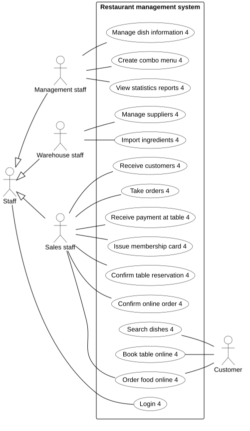
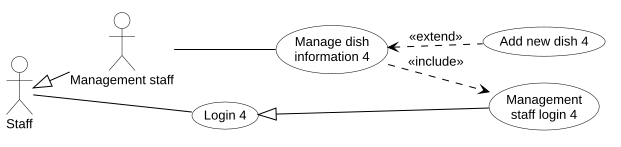
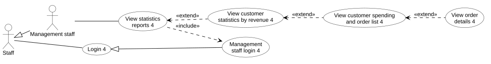

# Specification

Source: https://docs.google.com/document/d/1JFbWLYloQr5XMMeprF7i_E7MsBz_b17xwkIQgBikg-M

## 1. BẢNG TỪ KHÓA

| TT | Tên tiếng Việt | Tiếng Anh | Giải thích |
| --- | --- | --- | --- |
| Nhóm các khái niệm liên quan đến con người và tổ chức |  |  |  |
| 1 | Người dùng hệ thống | System user | Người tương tác với hệ thống trong phạm vi quyền được cấp; gồm các nhóm nhân viên và khách hàng. |
| 2 | Nhân viên quản lý | Management staff | Nhân viên chịu trách nhiệm quản lý thông tin món ăn, tạo combo và xem các báo cáo thống kê của nhà hàng. |
| 3 | Nhân viên kho | Warehouse staff | Nhân viên quản lý thông tin nhà cung cấp và ghi nhận việc nhập nguyên liệu vào kho. |
| 4 | Nhân viên bán hàng | Sales staff | Nhân viên tiếp nhận khách, ghi nhận gọi món, xác nhận đặt bàn hoặc đơn trực tuyến, lập hóa đơn, nhận thanh toán và cấp thẻ thành viên. |
| 5 | Khách hàng | Customer | Người tra cứu món ăn, đặt bàn, đặt món trực tuyến hoặc sử dụng dịch vụ trực tiếp tại nhà hàng. |
| 6 | Khách hàng thành viên | Member customer | Khách hàng đã có hồ sơ và thẻ thành viên còn hiệu lực trong hệ thống. |
| 7 | Nhà cung cấp | Supplier | Cá nhân hoặc tổ chức cung cấp nguyên liệu cho nhà hàng và được tham chiếu trong các phiếu nhập. |
| Nhóm các khái niệm liên quan đến hoạt động nghiệp vụ |  |  |  |
| 8 | Đăng nhập | Sign in | Hoạt động xác thực tài khoản nhân viên để hệ thống mở đúng chức năng theo vai trò. |
| 9 | Quản lý món ăn | Dish management | Tập hợp hoạt động thêm, sửa, tra cứu và ngừng kinh doanh món ăn mà không làm mất dữ liệu lịch sử. |
| 10 | Thêm món ăn mới | Add dish | Nhân viên quản lý khai báo thông tin món, giá bán, loại món ăn. |
| 11 | Tạo combo | Create combo | Hoạt động ghép nhiều món ăn…. thành một gói bán chung, xác định giá combo và trạng thái kinh doanh. |
| 12 | Tra cứu món ăn | Dish search | Khách hàng hoặc nhân viên tìm món theo từ khóa, loại món ăn và trạng thái đang kinh doanh. |
| 13 | Đặt bàn trực tuyến | Online table reservation | Khách hàng gửi yêu cầu giữ chỗ…. theo thời điểm, số người và thông tin liên hệ để nhân viên xác nhận. |
| 14 | Đặt món trực tuyến | Online food ordering | Khách hàng chọn món hoặc combo, nhập số lượng và gửi đơn để nhà hàng tiếp nhận, xác nhận. |
| 15 | Tiếp nhận khách | Customer reception | Nhân viên bán hàng kiểm tra đặt bàn hoặc bố trí bàn cho khách đến trực tiếp…. |
| 16 | Ghi nhận gọi món | Take order | Nhân viên tạo đơn tại bàn và ghi các món, combo, số lượng cùng ghi chú phục vụ của khách. |
| 17 | Xác nhận đặt bàn | Confirm reservation | Nhân viên kiểm tra khả năng phục vụ rồi chấp nhận hoặc từ chối yêu cầu đặt bàn. |
| 18 | Xác nhận đơn trực tuyến | Confirm online order | Nhân viên kiểm tra món còn kinh doanh và khả năng đáp ứng trước khi chuyển đơn sang trạng thái đã xác nhận. |
| 19 | Nhập nguyên liệu | Ingredient receiving | Nhân viên kho lập phiếu nhập từ nhà cung cấp; khi xác nhận, số lượng tồn của nguyên liệu được tăng tương ứng. |
| 20 | Quản lý nhà cung cấp | Supplier management | Hoạt động thêm, cập nhật, tra cứu và ngừng hợp tác với nhà cung cấp. |
| 21 | Lập hóa đơn | Billing | Hoạt động tổng hợp các dòng món của đơn, tính tổng tiền phải trả và tạo chứng từ thanh toán. |
| 22 | Thanh toán tại bàn | Table payment | Nhân viên nhận tiền cho một hóa đơn tại bàn, ghi nhận phương thức thanh toán và hoàn tất đơn. |
| 23 | Cấp thẻ thành viên | Issue membership card | Nhân viên tạo hoặc cập nhật hồ sơ khách hàng và phát hành thẻ thành viên có mã duy nhất. |
| 24 | Xem thống kê | View statistics | Nhân viên quản lý chọn tiêu chí để xem số liệu tổng hợp về món ăn, nguyên liệu, khách hàng hoặc nhà cung cấp. |
| Nhóm các khái niệm liên quan đến vật và đối tượng xử lý |  |  |  |
| 25 | Tài khoản | Account | Thông tin đăng nhập, vai trò và trạng thái truy cập của một nhân viên. |
| 26 | Loại món ăn | Dish category | Nhóm phân loại giúp tổ chức và tra cứu món ăn, ví dụ món khai vị, món chính hoặc đồ uống. |
| 27 | Món ăn | Dish | Sản phẩm phục vụ khách; có mã, tên, mô tả, giá bán, loại món ăn và trạng thái kinh doanh. |
| 29 | Nguyên liệu | Ingredient | Vật tư dùng để chế biến món ăn và được theo dõi theo đơn vị tính, số lượng tồn và trạng thái. |
| 30 | Tồn kho nguyên liệu | Ingredient inventory | Số lượng hiện có của từng nguyên liệu tại nhà hàng ở thời điểm cập nhật gần nhất. |
| 31 | Combo | Combo | Combo là một tập hợp gồm một hoặc nhiều món hàng được bán chung dưới một tên gọi, có giá bán, trạng thái và thời gian áp dụng. |
| 32 | Chi tiết combo | Combo item | Dòng liên kết một combo với một món ăn và số lượng món đó trong combo. |
| 33 | Phiếu nhập | Goods receipt | Chứng từ ghi một lần nhập nguyên liệu từ một nhà cung cấp do nhân viên kho thực hiện. |
| 34 | Chi tiết phiếu nhập | Goods receipt line | Dòng nguyên liệu trong phiếu nhập, gồm nguyên liệu, số lượng, đơn giá và thành tiền. |
| 35 | Bàn ăn | Dining table | Vị trí phục vụ khách trong nhà hàng, có số bàn, khu vực, sức chứa và trạng thái hiện tại, |
| 36 | Phiếu đặt bàn | Reservation | Yêu cầu giữ bàn của khách theo thời điểm, số người, thông tin liên hệ và trạng thái xác nhận. |
| 37 | Đơn gọi món | Order | Hồ sơ ghi yêu cầu món ăn của khách tại bàn hoặc trực tuyến cùng trạng thái xử lý và tổng tiền. |
| 38 | Chi tiết đơn | Order item | Một dòng món hoặc combo trong đơn, gồm số lượng, đơn giá, ghi chú và thành tiền. |
| 39 | Hóa đơn | Invoice | Chứng từ tài chính được lập từ một đơn gọi món để xác định số tiền khách phải thanh toán. |
| 40 | Giao dịch thanh toán | Payment transaction | Bản ghi số tiền, thời điểm, phương thức và kết quả thanh toán của hóa đơn. |
| 41 | Hồ sơ khách hàng | Customer profile | Thông tin nhận diện và liên hệ dùng cho đặt bàn, đặt món và cấp thẻ thành viên. |
| 42 | Thẻ thành viên | Membership card | Thẻ có mã duy nhất liên kết với một hồ sơ khách hàng và có trạng thái hiệu lực. |
| 43 | Báo cáo thống kê | Statistical report | Kết quả tổng hợp được sinh từ dữ liệu nghiệp vụ theo loại thống kê và điều kiện lọc. |

## 2. MÔ TẢ HỆ THỐNG BẰNG NGÔN NGỮ TỰ NHIÊN

### Bước 1. Giới thiệu mục đích của hệ thống

Hệ thống quản lý nhà hàng được xây dựng để tập trung hóa dữ liệu và hỗ trợ các nghiệp vụ từ quản lý món ăn, combo, nguyên liệu và nhà cung cấp đến đặt bàn, gọi món, thanh toán, quản lý khách hàng thành viên và thống kê. Hệ thống cung cấp một nguồn dữ liệu thống nhất cho các bộ phận, hạn chế ghi chép rời rạc và giảm sai sót khi trao đổi thông tin.

Đối với nhà hàng, hệ thống giúp theo dõi món đang kinh doanh, nguyên liệu đã nhập và tồn kho, tình trạng bàn, đơn của khách và hóa đơn. Đối với khách hàng, hệ thống giúp tra cứu món, gửi yêu cầu đặt bàn hoặc đặt món trực tuyến và nhận trạng thái xác nhận rõ ràng.

### Bước 2. Xác định phạm vi hệ thống

#### 2.1. Ranh giới nghiệp vụ

Trong phạm vi hệ thống gồm: quản lý tài khoản nhân viên; món ăn, loại món ăn và combo; nguyên liệu, tồn kho, nhà cung cấp và phiếu nhập; bàn và đặt bàn; đơn gọi món trực tiếp hoặc trực tuyến; hóa đơn, thanh toán; hồ sơ khách hàng, thẻ thành viên và các báo cáo thống kê được nêu trong đề.

Ngoài phạm vi của mô tả này là thao tác chế biến thực tế trong bếp, quá trình nhà cung cấp vận chuyển nguyên liệu và hạch toán kế toán tổng hợp. Hệ thống chỉ ghi nhận dữ liệu nghiệp vụ cần thiết để các bộ phận thực hiện và kiểm soát công việc của mình.

#### 2.2. Người sử dụng và quyền chức năng

- Chức năng chung của nhân viên: đăng nhập, đăng xuất và sử dụng các chức năng đúng với vai trò được cấp.

- Nhân viên quản lý: quản lý thông tin món ăn; thêm món mới; cập nhật hoặc ngừng kinh doanh món; tạo và quản lý combo; xem thống kê món ăn, nguyên liệu, khách hàng và nhà cung cấp.

- Nhân viên kho: quản lý thông tin nhà cung cấp; lập và xác nhận phiếu nhập nguyên liệu; tra cứu nguyên liệu và số lượng tồn.

- Nhân viên bán hàng: tiếp nhận khách; kiểm tra hoặc bố trí bàn; ghi nhận gọi món; xác nhận đặt bàn và đơn trực tuyến; lập hóa đơn; nhận tshanh toán tại bàn; lập hồ sơ và cấp thẻ thành viên.

- Khách hàng: tra cứu món ăn hoặc combo; gửi yêu cầu đặt bàn; gửi đơn đặt món trực tuyến; cung cấp thông tin liên hệ để nhà hàng xác nhận. Khách không bắt buộc phải là thành viên để sử dụng các chức năng này.

- Nhà cung cấp: là đối tượng bên ngoài được quản lý trong hệ thống nhưng không trực tiếp đăng nhập; thông tin của họ được nhân viên kho sử dụng khi lập phiếu nhập.

### Bước 3. Mô tả chi tiết hoạt động nghiệp vụ

Quy ước nghiệp vụ: khách có thể tra cứu trên website và đặt bàn từ xa; đặt món trực tuyến trong phạm vi mô tả này là tự gọi món qua mã QR tại bàn. Mỗi lượt phục vụ tại một bàn có tối đa một đơn đang mở; gọi thêm được bổ sung vào đơn đó và chỉ tính tiền khi được chấp nhận. Hồ sơ khách hàng độc lập với thẻ thành viên; khách chưa có thẻ vẫn có thể được ghi nhận chi tiêu. Khách vãng lai được bố trí bàn mà không cần cung cấp thông tin cá nhân; các đơn không gắn hồ sơ khách được thống kê chung dưới nhãn No name.

#### 3.1. Đăng nhập hệ thống

- Nhân viên nhập tên đăng nhập và mật khẩu.

- Hệ thống kiểm tra tài khoản có tồn tại, mật khẩu có đúng và tài khoản còn hoạt động hay không.

- Nếu hợp lệ, hệ thống xác định vai trò và hiển thị đúng nhóm chức năng; nếu không hợp lệ, hệ thống từ chối truy cập và thông báo lỗi.

#### 3.2. Nhân viên quản lý thêm món ăn mới

- Nhân viên quản lý mở danh sách món và chọn chức năng thêm món ăn.

- Hệ thống hiển thị biểu mẫu; nhân viên nhập mã món, tên món, mô tả, giá bán, trạng thái kinh doanh và chọn loại món ăn. Hình ảnh là thông tin tùy chọn.

- Nhân viên kiểm tra thông tin và chọn Thêm.

- Hệ thống kiểm tra mã món duy nhất; tên món không để trống; giá bán lớn hơn 0; loại món ăn tồn tại.

- Nếu hợp lệ, hệ thống lưu thông tin món và thời điểm tạo, sau đó thông báo thành công và hiển thị món mới trong danh sách.

- Nếu dữ liệu không hợp lệ, hệ thống không lưu, giữ dữ liệu đã nhập và chỉ rõ trường cần sửa.

#### 3.3. Cập nhật hoặc ngừng kinh doanh món ăn

- Nhân viên quản lý tìm món theo mã, tên hoặc loại món ăn và mở thông tin chi tiết.

- Nhân viên sửa thông tin món, giá bán, loại món ăn, hình ảnh hoặc trạng thái và chọn Save.

- Hệ thống kiểm tra dữ liệu như khi thêm mới, với mã món không trùng món khác; nếu hợp lệ thì lưu thay đổi, nếu không thì giữ dữ liệu và thông báo lỗi.

- Thay đổi giá bán trong danh mục không làm thay đổi đơn giá và thành tiền đã ghi nhận trong các đơn trước đó. Món không tiếp tục bán được chuyển sang trạng thái ngừng kinh doanh để bảo toàn lịch sử.

#### 3.4. Tạo và quản lý combo

- Nhân viên quản lý mở danh sách combo và chọn chức năng tạo combo.

- Nhân viên chọn các món đang kinh doanh và nhập số lượng của từng món trong combo.

- Nhân viên nhập mã combo, tên combo, giá bán, thời gian áp dụng; có thể bổ sung hình ảnh và ghi chú, sau đó chọn Save.

- Hệ thống kiểm tra mã combo duy nhất, tên không để trống, có ít nhất một món, số lượng mỗi món là số nguyên dương, giá bán lớn hơn 0 và thời gian bắt đầu không sau thời gian kết thúc.

- Nếu hợp lệ, hệ thống lưu thông tin combo cùng các món và số lượng tương ứng, sau đó thông báo thành công; nếu không hợp lệ thì chỉ rõ lỗi.

- Đối với combo đã có, nhân viên có thể cập nhật thông tin hoặc ngừng kinh doanh. Thay đổi combo không làm thay đổi đơn giá và thành tiền của các đơn đã ghi nhận.

#### 3.5. Xem thống kê khách hàng theo doanh thu

- Nhân viên quản lý mở chức năng báo cáo thống kê và chọn Customer statistics by revenue.

- Nhân viên chọn ngày bắt đầu, ngày kết thúc và yêu cầu xem báo cáo. Hệ thống kiểm tra ngày bắt đầu không sau ngày kết thúc; nếu sai thì yêu cầu chọn lại.

- Hệ thống tổng hợp các hóa đơn đã thanh toán thành công, có thời điểm thanh toán từ đầu ngày bắt đầu đến hết ngày kết thúc. Hóa đơn được nhóm theo hồ sơ khách; các hóa đơn của đơn không gắn hồ sơ khách được gom vào nhóm No name.

- Hệ thống hiển thị mã khách, tên khách và tổng chi tiêu trong kỳ, sắp xếp theo tổng chi tiêu giảm dần. Nhóm No name hiển thị tổng tiền các hóa đơn hợp lệ của đơn không gắn hồ sơ khách và để trống mã khách; nhóm xuất hiện khi có dữ liệu trong kỳ.

- Nhân viên chọn một khách hoặc nhóm No name; hệ thống hiển thị tổng chi tiêu cùng danh sách các đơn tạo nên số tiền đó, gồm mã đơn, thời điểm thanh toán và số tiền.

- Nhân viên chọn một đơn; hệ thống hiển thị món hoặc combo, số lượng, đơn giá đã lưu, thành tiền và tổng tiền. Danh sách đơn và chi tiết phải thuộc đúng khách hoặc nhóm No name, kỳ và điều kiện thống kê đang chọn.

- Nếu không có dữ liệu, hệ thống hiển thị kết quả rỗng và cho phép đổi khoảng thời gian. Nếu tổng hợp thất bại, hệ thống thông báo lỗi; việc xem báo cáo không làm thay đổi dữ liệu nguồn.

#### 3.6. Xem thống kê tồn kho nguyên liệu hiện tại

- Nhân viên quản lý mở chức năng thống kê nguyên liệu.

- Hệ thống hiển thị mã nguyên liệu, tên, đơn vị tính và số lượng tồn kho tại thời điểm xem báo cáo.

- Nhân viên tra cứu nguyên liệu cần xem; nếu không có kết quả thì hệ thống thông báo. Báo cáo này phản ánh tồn kho hiện tại.

#### 3.7. Xem thống kê món ăn

- Nhân viên quản lý mở chức năng thống kê món ăn, chọn ngày bắt đầu, ngày kết thúc và yêu cầu xem báo cáo.

- Hệ thống kiểm tra khoảng ngày và tổng hợp số lượng bán, doanh thu từ các hóa đơn đã thanh toán thành công trong kỳ theo thời điểm thanh toán.

- Hệ thống hiển thị mã, tên mặt hàng, số lượng bán và doanh thu. Món bán riêng và combo được trình bày thành các dòng riêng; doanh thu combo không được cộng thêm vào các món cấu thành.

- Nhân viên chọn một món hoặc combo; hệ thống hiển thị số lượng bán và doanh thu theo từng ngày trong cùng kỳ.

- Nếu khoảng ngày không hợp lệ thì hệ thống yêu cầu chọn lại; nếu không có dữ liệu thì hiển thị kết quả rỗng.

#### 3.8. Xem thống kê nhà cung cấp

- Nhân viên quản lý mở chức năng thống kê nhà cung cấp, chọn ngày bắt đầu, ngày kết thúc và yêu cầu xem báo cáo.

- Hệ thống kiểm tra khoảng ngày và tổng hợp các phiếu nhập đã xác nhận có ngày nhập thuộc kỳ đã chọn.

- Hệ thống hiển thị mã, tên nhà cung cấp, số lần nhập và tổng giá trị nhập trong kỳ.

- Nhân viên chọn một nhà cung cấp; hệ thống hiển thị các phiếu nhập tạo nên số liệu thống kê của nhà cung cấp đó trong kỳ.

- Nhân viên chọn một phiếu; hệ thống hiển thị nguyên liệu, số lượng, đơn giá nhập, thành tiền và tổng tiền phiếu. Nếu khoảng ngày sai thì yêu cầu chọn lại; nếu không có dữ liệu thì hiển thị kết quả rỗng.

#### 3.9. Quản lý nhà cung cấp và nhập nguyên liệu

- Nhân viên kho thêm mới hoặc cập nhật tên, địa chỉ, số điện thoại, email và trạng thái của nhà cung cấp; hệ thống kiểm tra và lưu thông tin hợp lệ.

- Khi nhập hàng, nhân viên chọn một nhà cung cấp còn hoạt động và lập phiếu nhập ở trạng thái nháp.

- Nhân viên thêm từng nguyên liệu, số lượng và đơn giá; hệ thống tính thành tiền từng dòng và tổng tiền phiếu.

- Khi nhân viên xác nhận, hệ thống kiểm tra nhà cung cấp và nguyên liệu tồn tại, còn được sử dụng; phiếu có ít nhất một dòng; số lượng và đơn giá nhập đều lớn hơn 0.

- Nếu hợp lệ, hệ thống lưu phiếu và chi tiết, ghi nhận nhân viên cùng thời điểm xác nhận, khóa nội dung phiếu và tăng tồn kho tương ứng. Mỗi phiếu chỉ được xác nhận một lần để tránh cộng trùng tồn kho.

- Nếu dữ liệu sai, hệ thống giữ phiếu nháp và chỉ rõ lỗi. Nếu xác nhận thất bại, hệ thống giữ nguyên trạng thái phiếu và tồn kho.

#### 3.10. Khách hàng tra cứu món ăn

- Khách hàng quét mã QR tại bàn để mở giao diện khách hàng.

- Khách nhập từ khóa hoặc chọn loại món ăn; có thể để trống điều kiện để xem toàn bộ món và combo đang kinh doanh, trong thời gian áp dụng.

- Hệ thống trả về các kết quả phù hợp, gồm tên, mô tả, giá và hình ảnh.

- Khách chọn một kết quả để xem chi tiết; nếu không có kết quả phù hợp thì hệ thống thông báo để khách thay đổi điều kiện tìm kiếm.

#### 3.11. Khách hàng tìm và đặt bàn trực tuyến

- Khách hàng truy cập website đặt bàn, chọn ngày, giờ đến, thời lượng sử dụng dự kiến và số người.

- Hệ thống kiểm tra thời gian hợp lệ, xác định khung giờ sử dụng và hiển thị các bàn đủ sức chứa, không trùng lịch đã được xác nhận trong khung giờ đó.

- Khách chọn bàn đề nghị, nhập tên, số điện thoại và ghi chú nếu có, kiểm tra thông tin rồi xác nhận gửi yêu cầu.

- Hệ thống kiểm tra dữ liệu, tìm hoặc tạo hồ sơ khách hàng từ thông tin liên hệ và lưu phiếu đặt bàn ở trạng thái chờ xác nhận, gắn với khách và bàn đề nghị.

- Hệ thống hiển thị mã yêu cầu và trạng thái chờ xác nhận. Bàn chỉ được chốt sau khi nhân viên xử lý theo mục 3.16; nếu dữ liệu sai hoặc không có bàn phù hợp thì hệ thống thông báo để khách chọn lại.

#### 3.12. Khách hàng đặt món trực tuyến tại bàn

- Khách hàng quét mã QR tại bàn.

- Khách tra cứu và chọn món hoặc combo đang kinh doanh, nhập số lượng và ghi chú.

- Hệ thống hiển thị danh sách đã chọn cùng số lượng, đơn giá và tổng tiền tạm tính để khách kiểm tra.

- Khách chọn Gửi yêu cầu. Hệ thống kiểm tra danh sách không rỗng, số lượng là số nguyên dương và mặt hàng còn được bán; nếu sai thì chỉ rõ lỗi.

- Hệ thống tạo đơn chờ xác nhận nếu đây là lần gọi đầu tiên; nếu đã có đơn đang mở của lượt phục vụ thì ghi nhận phần gọi thêm chờ xác nhận trên cùng đơn. Các món đã được chấp nhận trước đó giữ nguyên trạng thái và số tiền.

- Hệ thống hiển thị trạng thái chờ xác nhận. Phần gọi mới chỉ được tính vào tiền phải trả sau khi nhân viên chấp nhận theo mục 3.17.

#### 3.13. Tiếp nhận khách đã đặt bàn trước

- Nhân viên bán hàng hỏi tên, số điện thoại hoặc mã đặt bàn và tra cứu phiếu đặt bàn.

- Hệ thống hiển thị phiếu cùng trạng thái, khung giờ và bàn đã xác nhận; nhân viên đối chiếu thông tin và kiểm tra bàn có thể phục vụ.

- Nếu phù hợp, nhân viên ghi nhận khách đã đến; hệ thống liên kết hồ sơ khách và phiếu đặt bàn với lượt phục vụ, đồng thời chuyển bàn sang trạng thái đang phục vụ.

- Khi ghi nhận lần gọi món đầu tiên, hệ thống tạo một đơn gắn với khách, bàn và lượt phục vụ đó. Nếu phiếu chưa được xác nhận hoặc thông tin không phù hợp, nhân viên kiểm tra và trao đổi với khách trước khi bố trí bàn.

#### 3.14. Tiếp nhận khách vãng lai

- Nhân viên bán hàng xác định số người và kiểm tra bàn đủ sức chứa, đang sẵn sàng, không trùng lịch đặt đã xác nhận trong thời gian phục vụ dự kiến.

- Nếu có bàn phù hợp, nhân viên bố trí bàn mà không yêu cầu tên hoặc thông tin liên hệ của khách; hệ thống mở lượt phục vụ và chuyển bàn sang trạng thái đang phục vụ.

- Khi ghi nhận lần gọi món đầu tiên, hệ thống tạo đơn gắn với bàn và lượt phục vụ, để trống liên kết hồ sơ khách; nếu khách gọi thêm thì dùng cùng đơn đang mở. Doanh thu của đơn sau khi thanh toán thành công được tổng hợp vào nhóm No name.

- Nếu không có bàn phù hợp, nhân viên thông báo để khách lựa chọn thời điểm khác.

#### 3.15. Ghi nhận gọi món tại bàn

- Khi khách yêu cầu gọi món, nhân viên bán hàng chọn bàn sẽ phục vụ.

- Nhân viên chọn món hoặc combo, nhập số lượng, ghi chú và chọn Save.

- Hệ thống kiểm tra mặt hàng còn được bán, số lượng là số nguyên dương.

- Nếu là lần gọi đầu tiên, hệ thống tạo đơn gắn với bàn và hồ sơ khách nếu có; nếu đã có đơn đang mở thì bổ sung phần gọi thêm vào đơn đó.

- Hệ thống lưu số lượng, đơn giá tại thời điểm ghi nhận, thành tiền và đánh dấu các món do nhân viên tiếp nhận là đã chấp nhận, sau đó cập nhật tổng tiền. Nếu dữ liệu sai thì không bổ sung và thông báo lỗi.

#### 3.16. Xác nhận đặt bàn

- Nhân viên bán hàng mở danh sách phiếu đặt bàn đang chờ và chọn một phiếu.

- Hệ thống hiển thị thông tin khách, số người, khung giờ sử dụng và bàn đề nghị. Nhân viên kiểm tra sức chứa và lịch đặt đã xác nhận trong chính khung giờ đó.

- Nhân viên liên hệ khách để xác nhận; nếu cần đổi bàn hoặc khung giờ thì chỉ chốt phương án mới sau khi khách đồng ý.

- Nhân viên chọn Xác nhận hoặc Từ chối; khi từ chối phải nhập lý do.

- Trước khi xác nhận, hệ thống kiểm tra lại lịch để ngăn hai phiếu chiếm cùng bàn trong các khung giờ chồng nhau. Nếu hợp lệ thì chốt bàn và chuyển phiếu sang đã xác nhận; nếu không thì thông báo để nhân viên xử lý lại.

- Hệ thống lưu kết quả, nhân viên, thời điểm xử lý và lý do nếu có; thông báo kết quả cho khách qua kênh liên hệ đã cung cấp.

#### 3.17. Xác nhận đơn trực tuyến

- Nhân viên bán hàng mở danh sách yêu cầu gọi món trực tuyến đang chờ và chọn một yêu cầu.

- Hệ thống hiển thị bàn, lượt phục vụ, khách nếu có và các món thuộc lần gửi đang chờ; nhân viên kiểm tra thông tin cùng khả năng đáp ứng.

- Nhân viên chọn Xác nhận hoặc Từ chối; khi từ chối phải nhập lý do.

- Hệ thống kiểm tra lượt phục vụ còn mở và yêu cầu chưa được xử lý. Nếu chấp nhận thì đánh dấu phần gọi mới là đã chấp nhận và cập nhật tiền phải trả; nếu từ chối thì lưu kết quả nhưng không cộng phần đó vào tiền phải trả.

- Đối với lần gọi đầu tiên, đơn chuyển sang đã xác nhận hoặc bị từ chối theo kết quả. Đối với gọi thêm, chỉ phần gọi mới được xử lý; các món đã chấp nhận trước đó không bị thay đổi.

- Hệ thống lưu nhân viên, thời điểm, kết quả và lý do nếu có, sau đó hiển thị trạng thái xử lý cho khách trên giao diện QR.

#### 3.18. Lập hóa đơn và thanh toán tại bàn

- Nhân viên bán hàng chọn bàn.

- Hệ thống hiển thị khách nếu có cùng các món hoặc combo, số lượng, đơn giá đã lưu, thành tiền và tổng tiền. Chỉ các phần gọi đã chấp nhận, chưa hủy được tính tiền; các yêu cầu còn chờ phải được xử lý trước khi chốt hóa đơn.

- Nhân viên kiểm tra và xác nhận lập hóa đơn; hệ thống tạo hóa đơn chờ thanh toán, gắn với đơn và khách nếu xác định được, đồng thời ngừng nhận gọi thêm cho lượt phục vụ đang thanh toán.

- Nhân viên chọn phương thức và xác nhận đã nhận đủ tiền. Hệ thống ghi nhận thanh toán thành công cùng số tiền, phương thức và thời điểm thanh toán.

- Hệ thống chuyển hóa đơn sang đã thanh toán, hoàn tất đơn và kết thúc lượt phục vụ; bàn được trả về trạng thái sẵn sàng sau khi nhân viên xác nhận có thể tiếp nhận khách mới.

- Nếu chưa nhận đủ tiền hoặc ghi nhận thanh toán thất bại, hệ thống không đánh dấu đã thanh toán và cho phép nhân viên kiểm tra, xử lý lại.

#### 3.19. Cấp thẻ thành viên

- Nhân viên bán hàng tìm khách theo số điện thoại để kiểm tra hồ sơ và thẻ thành viên.

- Nếu chưa có hồ sơ, nhân viên nhập họ tên, số điện thoại và email nếu có; nếu đã có, nhân viên kiểm tra và cập nhật thông tin cần thiết.

- Nếu khách đã có thẻ còn hiệu lực, hệ thống hiển thị thẻ hiện có và không cấp thêm thẻ mới.

- Nếu khách chưa có thẻ còn hiệu lực, nhân viên xác nhận cấp thẻ; hệ thống kiểm tra lại, phát sinh mã thẻ duy nhất, liên kết với hồ sơ khách và ghi ngày cấp, trạng thái còn hiệu lực.

- Hệ thống thông báo kết quả để nhân viên bàn giao thông tin thẻ cho khách; nếu lưu thất bại thì không tạo thẻ dở dang hoặc trùng.

### Bước 4. Xác định các đối tượng được quản lý và thuộc tính

Các lớp dưới đây phục vụ nghiệp vụ đã mô tả ở Bước 3. Mã định danh là duy nhất; các liên kết giữa lớp được trình bày ở Bước 5. Dấu / chỉ thuộc tính được tính từ dữ liệu nghiệp vụ.

#### 4.1. Tài khoản và khách hàng

- Tài khoản (Account4): mã tài khoản, tên đăng nhập, mật khẩu đã băm, vai trò (quản lý, kho hoặc bán hàng), trạng thái tài khoản.

- Nhân viên (Staff4): mã nhân viên, họ tên, số điện thoại, email, trạng thái làm việc. Quyền nghiệp vụ được xác định qua vai trò của tài khoản.

- Khách hàng (Customer4): mã khách hàng, họ tên, số điện thoại, email, trạng thái hồ sơ. Chỉ lập hồ sơ khi nghiệp vụ cần nhận diện khách, như đặt bàn hoặc cấp thẻ.

- Thẻ thành viên (MembershipCard4): mã thẻ, ngày cấp, trạng thái hiệu lực. Khách có thể có lịch sử nhiều thẻ nhưng tối đa một thẻ còn hiệu lực.

#### 4.2. Món ăn và combo

- Mặt hàng bán (Product4, lớp trừu tượng): mã mặt hàng, tên, mô tả, giá bán, hình ảnh, trạng thái kinh doanh, thời điểm tạo, thời điểm cập nhật. Product4 đại diện cho các thông tin chung của món ăn và combo.

- Món ăn (Dish4): kế thừa các thuộc tính của Product4 và thuộc một loại món ăn.

- Loại món ăn (DishCategory4): mã nhóm, tên nhóm, mô tả.

- Combo (Combo4): kế thừa các thuộc tính của Product4; có thêm thời gian bắt đầu và thời gian kết thúc áp dụng.

- Chi tiết combo (ComboItem): số lượng món trong combo. Mỗi dòng xác định một món của một combo; cặp combo và món là duy nhất.

#### 4.3. Nguyên liệu và nhập kho

- Nguyên liệu (Ingredient4): mã nguyên liệu, tên, đơn vị tính, số lượng tồn hiện tại, mức cảnh báo, trạng thái sử dụng. Với phạm vi một số tồn hiện hành cho mỗi nguyên liệu, tồn kho là thuộc tính của Ingredient4.

- Nhà cung cấp (Supplier4): mã nhà cung cấp, tên, địa chỉ, số điện thoại, email, trạng thái hợp tác.

- Phiếu nhập (GoodsReceipt4): mã phiếu, ngày nhập, thời điểm lập, thời điểm xác nhận, trạng thái, /tổng tiền. Người lập, người xác nhận và nhà cung cấp được xác định bằng các liên kết.

- Chi tiết phiếu nhập (GoodsReceiptLine): mã dòng, số lượng, đơn giá nhập, /thành tiền. Thành tiền bằng số lượng nhân đơn giá nhập đã ghi nhận.

#### 4.4. Bàn ăn và phục vụ khách

- Bàn ăn (DiningTable4): mã bàn, số bàn, khu vực, sức chứa, trạng thái phục vụ hiện tại.

- Phiếu đặt bàn (Reservation4): mã đặt bàn, thời điểm gửi, giờ đến dự kiến, giờ kết thúc dự kiến, số người, ghi chú, trạng thái, thời điểm xử lý, lý do từ chối. Phiếu gắn với một khách hàng và một bàn đề nghị; khi xác nhận, bàn được chốt theo thỏa thuận với khách.

- Lượt phục vụ (ServiceSession4): mã lượt, số người thực tế, thời điểm bắt đầu, thời điểm kết thúc dự kiến, thời điểm kết thúc thực tế, trạng thái. Lượt phục vụ được mở khi bố trí bàn cho khách đã đến, kể cả khách vãng lai; đây không phải lớp nối nhiều bàn của một phiếu đặt.

- Đơn gọi món (Order4): mã đơn, thời điểm tạo, trạng thái, /tổng tiền các món đã chấp nhận và chưa hủy. Đơn thuộc một lượt phục vụ; liên kết khách hàng có thể để trống.

- Chi tiết đơn (OrderItem): mã dòng, mã lần gửi, kênh gọi (nhân viên hoặc QR), thời điểm gửi, số lượng, đơn giá tại lúc gọi, ghi chú, trạng thái xử lý, thời điểm xử lý, lý do từ chối, /thành tiền. Các dòng có cùng mã lần gửi trong một đơn được xử lý như một lần gọi món; đơn giá được giữ nguyên khi giá danh mục thay đổi.

- Hóa đơn thanh toán (Invoice4): mã hóa đơn, thời điểm lập, tổng tiền phải trả, trạng thái thanh toán. Tổng tiền được chốt từ các dòng hợp lệ của đơn khi lập hóa đơn.

- Lần thanh toán (Payment4): mã thanh toán, số tiền, phương thức, thời điểm, kết quả. Mỗi lần thực hiện được ghi nhận riêng để phân biệt lần thất bại và lần thành công.

#### 4.5. Kết quả thống kê

- Thống kê khách hàng (CustomerStatistic4): mã khách hàng (có thể để trống), tên hiển thị, ngày bắt đầu, ngày kết thúc, /tổng chi tiêu. Dòng No name tổng hợp các hóa đơn hợp lệ của đơn không gắn hồ sơ khách.

- Thống kê mặt hàng bán (ProductStatistic4): mã mặt hàng, tên mặt hàng, ngày bắt đầu, ngày kết thúc, /số lượng bán, /doanh thu. Món bán riêng và combo là các dòng riêng để tránh cộng trùng doanh thu.

- Thống kê nguyên liệu (IngredientStatistic4): mã nguyên liệu, tên, đơn vị tính, thời điểm xem, số lượng tồn hiện tại.

- Thống kê nhà cung cấp (SupplierStatistic4): mã nhà cung cấp, tên, ngày bắt đầu, ngày kết thúc, /số lần nhập, /tổng giá trị nhập.

### Bước 5. Xác định quan hệ số lượng giữa các đối tượng

Bội số đặt cạnh lớp nào cho biết số đối tượng của lớp đó có thể liên kết với một đối tượng ở đầu bên kia. 1 là đúng một, 0..1 là không hoặc một, 0..* là không hoặc nhiều, 1..* là ít nhất một. Các bội số dưới đây xét toàn bộ lịch sử; giới hạn tại một thời điểm được nêu riêng.

#### 5.1. Kế thừa và vai trò

- Dish4 và Combo4 kế thừa Product4. Mỗi Product4 cụ thể là một món ăn hoặc một combo; Product4 không được tạo như một loại mặt hàng độc lập.

- Ba nhóm nhân viên được biểu diễn bằng vai trò của Account4 gắn với Staff4. Customer4 là đối tượng nghiệp vụ độc lập, không bắt buộc có tài khoản đăng nhập.

#### 5.2. Khách hàng, bàn và đơn gọi món

- Customer4 "1" — "0..*" MembershipCard4: mỗi thẻ thuộc đúng một khách; khách có thể chưa có thẻ hoặc có lịch sử nhiều thẻ, nhưng chỉ tối đa một thẻ còn hiệu lực.

- Customer4 "1" — "0..*" Reservation4: mỗi phiếu đặt thuộc một hồ sơ khách hàng; khách có thể đặt nhiều lần.

- DiningTable4 "1" — "0..*" Reservation4: mỗi phiếu gắn đúng một bàn đề nghị hoặc đã chốt; một bàn có nhiều phiếu ở các khung giờ khác nhau. Không dùng lớp nối để đặt nhiều bàn trong một phiếu.

- DiningTable4 "1" — "0..*" ServiceSession4: mỗi lượt phục vụ thuộc đúng một bàn; một bàn phục vụ nhiều lượt trong lịch sử và có tối đa một lượt đang mở tại một thời điểm.

- Reservation4 "0..1" — "0..1" ServiceSession4: phiếu đặt có thể chưa có lượt phục vụ nếu khách chưa đến hoặc đã hủy; lượt phục vụ của khách vãng lai không có phiếu đặt. Nếu có phiếu đặt, bàn của lượt phục vụ phải là bàn đã được xác nhận trên phiếu.

- ServiceSession4 "1" — "0..1" Order4: một lượt có thể chưa phát sinh gọi món; khi đã gọi món thì dùng một đơn cho toàn bộ lượt. Gọi thêm hoặc gửi lại sau khi bị từ chối bổ sung vào cùng đơn trước khi lượt kết thúc.

- Customer4 "0..1" — "0..*" Order4: một đơn có thể không gắn hồ sơ khách; một khách có nhiều đơn. Đơn từ phiếu đặt dùng khách của phiếu; đơn khách vãng lai để trống liên kết khách và được thống kê trong nhóm No name.

- Order4 "1" — "1..*" OrderItem: mỗi dòng thuộc đúng một đơn; đơn chỉ được tạo khi có ít nhất một dòng gọi món. Lần gửi mới có các dòng riêng để việc từ chối không ảnh hưởng các món đã chấp nhận.

- Product4 "1" — "0..*" OrderItem: mỗi dòng gọi đúng một món hoặc combo thông qua Product4; một mặt hàng xuất hiện trong nhiều dòng đơn khác nhau.

- Order4 "1" — "0..1" Invoice4: một đơn có thể chưa lập hóa đơn; mỗi hóa đơn thanh toán đúng một đơn. Bàn của đơn được xác định duy nhất qua ServiceSession4, không cần quan hệ đơn với nhiều bàn.

- Invoice4 "1" — "0..*" Payment4: một hóa đơn có thể có nhiều lần thanh toán được ghi nhận nhưng tối đa một lần thành công. Trong phạm vi thanh toán toàn bộ hóa đơn, lần thành công phải bằng số tiền phải trả.

#### 5.3. Danh mục món ăn và combo

- DishCategory4 "1" — "0..*" Dish4: mỗi món thuộc đúng một loại; một loại có thể chưa có món hoặc có nhiều món. Chỉ kiểm tra loại món tồn tại; DishCategory4 không có thuộc tính trạng thái.

- Combo4 "1" — "1..*" ComboItem và Dish4 "1" — "0..*" ComboItem: mỗi dòng chi tiết thuộc một combo và chỉ ra một món cùng số lượng. Combo4 và Dish4 có quan hệ nhiều–nhiều được giải quyết bằng ComboItem; mỗi cặp combo–món xuất hiện tối đa một lần.

#### 5.4. Nguyên liệu và phiếu nhập

- Supplier4 "1" — "0..*" GoodsReceipt4: mỗi phiếu nhập của một nhà cung cấp; một nhà cung cấp có thể chưa có hoặc có nhiều phiếu nhập.

- GoodsReceipt4 "1" — "0..*" GoodsReceiptLine: mỗi dòng thuộc một phiếu. Phiếu nháp có thể chưa có dòng; khi xác nhận phải có ít nhất một dòng hợp lệ.

- Ingredient4 "1" — "0..*" GoodsReceiptLine: mỗi dòng nhập ghi một nguyên liệu; một nguyên liệu xuất hiện trong nhiều lần nhập.

#### 5.5. Tài khoản và nhân viên thực hiện

- Staff4 "1" — "1" Account4: mỗi nhân viên sử dụng một tài khoản riêng; mỗi tài khoản thuộc đúng một nhân viên.

- Staff4 "1" — "0..*" Product4, vai trò người tạo: mỗi món hoặc combo có một người tạo là nhân viên quản lý; một nhân viên quản lý có thể tạo nhiều mặt hàng.

- Staff4 "1" — "0..*" ServiceSession4, vai trò người bố trí bàn: mỗi lượt được mở bởi một nhân viên bán hàng; một nhân viên có thể mở nhiều lượt.

- Staff4 "0..1" — "0..*" Reservation4, vai trò người xử lý: phiếu đang chờ chưa có nhân viên xác nhận hoặc từ chối; sau xử lý phải lưu đúng một nhân viên bán hàng.

- Staff4 "0..1" — "0..*" OrderItem, vai trò người xử lý: dòng QR đang chờ có thể chưa có nhân viên; dòng đã được chấp nhận hoặc từ chối lưu một nhân viên bán hàng. Các dòng thuộc cùng lần gửi được cập nhật theo kết quả của lần gọi đó.

- Staff4 "1" — "0..*" GoodsReceipt4, vai trò người lập; Staff4 "0..1" — "0..*" GoodsReceipt4, vai trò người xác nhận: nhân viên phải có quyền kho; phiếu đã xác nhận phải có người xác nhận và thời điểm xử lý.

- Staff4 "1" — "0..*" MembershipCard4, Staff4 "1" — "0..*" Invoice4 và Staff4 "1" — "0..*" Payment4: mỗi thẻ được cấp, mỗi hóa đơn và mỗi lần nhận thanh toán do một nhân viên bán hàng thực hiện; một nhân viên xử lý được nhiều chứng từ.

#### 5.6. Ràng buộc và dữ liệu thống kê

- Lịch đặt bàn đã xác nhận không được chồng nhau trên cùng bàn. Kiểm tra theo giờ đến và giờ kết thúc dự kiến; trạng thái bàn hiện tại không thay thế cho việc kiểm tra lịch.

- Số lượng gọi món và số lượng món trong combo là số nguyên dương; giá bán mặt hàng, số lượng nguyên liệu nhập và đơn giá nhập lớn hơn 0. Đơn giá trên chi tiết đơn và chi tiết nhập được giữ theo thời điểm ghi nhận.

- Trạng thái xử lý thuộc các dòng của lần gọi: chờ xác nhận, đã chấp nhận, bị từ chối hoặc đã hủy. Kênh nhân viên/QR được ghi ở OrderItem vì cùng một đơn có thể nhận món từ cả hai kênh.

- Tổng tiền đơn chỉ cộng các dòng đã chấp nhận, chưa hủy. Thanh toán thành công hoàn tất hóa đơn và đơn; lượt phục vụ chỉ kết thúc và bàn sẵn sàng sau khi nhân viên xác nhận có thể đón khách mới.

- Xác nhận phiếu nhập chỉ làm tăng tồn hiện tại của từng Ingredient4 một lần và phải cập nhật phiếu cùng tồn kho nhất quán. Không có liên kết định lượng nguyên liệu giữa Dish4 và Ingredient4 trong phạm vi này.

- Chỉ các Invoice4 đã thanh toán thành công trong kỳ được tính vào doanh thu, theo thời điểm thanh toán thành công; không cộng trùng các lần Payment4 thất bại hoặc thử lại. Các đơn không có Customer4 được gom vào một dòng No name trong CustomerStatistic4, vẫn truy vết được đến từng đơn.

- CustomerStatistic4 phụ thuộc dữ liệu Customer4, Order4, Invoice4 và Payment4; ProductStatistic4 phụ thuộc Product4 và OrderItem của các đơn đã thanh toán; IngredientStatistic4 lấy tồn hiện tại từ Ingredient4; SupplierStatistic4 tổng hợp GoodsReceipt4 và GoodsReceiptLine đã xác nhận. Đây là quan hệ phụ thuộc tính toán, không phải quan hệ kế thừa.

- Liên kết thông thường được dùng giữa khách, phiếu đặt, bàn, lượt phục vụ, đơn và hóa đơn để bảo toàn lịch sử độc lập. Quan hệ toàn thể–bộ phận chỉ dùng cho Combo4–ComboItem, Order4–OrderItem và GoodsReceipt4–GoodsReceiptLine; không coi phiếu đặt là bộ phận bị xóa theo Customer4.

## 3. MÔ HÌNH UML - USE CASE

Biểu đồ tổng quan xác định các tác nhân trực tiếp và các chức năng nằm trong ranh giới hệ thống. Ba vai trò nhân viên kế thừa tác nhân Nhân viên để dùng chung chức năng đăng nhập; Khách hàng là tác nhân độc lập. Nhà cung cấp chỉ là đối tượng dữ liệu do nhân viên kho quản lý nên không được biểu diễn như một tác nhân trực tiếp.

Trong hai biểu đồ chi tiết, mỗi use case con nghiệp vụ tương ứng với một giao diện mà nhân viên tương tác. Nhân viên quản lý kế thừa tác nhân Nhân viên; use case Management staff login 4 kế thừa Login 4 và được use case chính «include». Mỗi màn hình được mở tùy chọn từ màn hình trước có quan hệ «extend» về màn hình đó. Login 4 là tiền điều kiện dùng chung, không thuộc giao diện nghiệp vụ của module. Nhập dữ liệu, chọn điều kiện, kiểm tra và lưu là các bước trong kịch bản, không tách thành use case riêng.

PlantUML source: [diagrams/use-case-system-overview.puml](diagrams/use-case-system-overview.puml)

Hình 3.1. Biểu đồ use case tổng quan hệ thống quản lý nhà hàng

PlantUML source: [diagrams/use-case-add-dish.puml](diagrams/use-case-add-dish.puml)

Hình 3.2. Biểu đồ use case chi tiết module Thêm món ăn mới

PlantUML source: [diagrams/use-case-customer-statistics.puml](diagrams/use-case-customer-statistics.puml)

Hình 3.3. Biểu đồ use case chi tiết module Xem thống kê khách hàng

### 3.1. Mô tả tác nhân

- Nhân viên (Staff): tác nhân tổng quát có chức năng đăng nhập; ba vai trò chuyên biệt kế thừa quyền sử dụng chức năng chung này.

- Nhân viên quản lý (Management staff): quản lý thông tin món ăn, tạo combo và xem các báo cáo thống kê.

- Nhân viên kho (Warehouse staff): quản lý nhà cung cấp và ghi nhận nhập nguyên liệu.

- Nhân viên bán hàng (Sales staff): tiếp nhận khách, gọi món, thanh toán, cấp thẻ thành viên và xử lý các yêu cầu trực tuyến.

- Khách hàng (Customer): tra cứu món, đặt bàn và đặt món trực tuyến; khách không bắt buộc phải có tài khoản thành viên.

### 3.2. Mô tả các use case tổng quan

| Mã | Tên use case | Tác nhân | Mô tả |
| --- | --- | --- | --- |
| UC-00 | Login 4 | Nhân viên | Xác thực tài khoản và mở đúng nhóm chức năng theo vai trò của nhân viên. |
| UC-QL-01 | Manage dish information 4 | NV quản lý | Xem danh sách món và lựa chọn thêm mới, cập nhật hoặc chuyển món sang trạng thái ngừng kinh doanh. |
| UC-QL-02 | Create combo menu 4 | NV quản lý | Ghép các món đang kinh doanh thành combo, thiết lập số lượng, giá và trạng thái bán. |
| UC-QL-03 | View statistics reports 4 | NV quản lý | Xem số liệu tổng hợp về món ăn, nguyên liệu, khách hàng và nhà cung cấp theo điều kiện lọc. |
| UC-K-01 | Manage suppliers 4 | NV kho | Thêm, cập nhật, tra cứu hoặc ngừng hợp tác với nhà cung cấp. |
| UC-K-02 | Import ingredients 4 | NV kho | Lập và xác nhận phiếu nhập để ghi nhận nguyên liệu nhận từ nhà cung cấp và tăng tồn kho. |
| UC-BH-01 | Receive customers 4 | NV bán hàng | Kiểm tra đặt bàn hoặc bố trí bàn phù hợp cho khách đến trực tiếp. |
| UC-BH-02 | Take orders 4 | NV bán hàng | Tạo đơn tại bàn và ghi món, combo, số lượng cùng ghi chú phục vụ. |
| UC-BH-03 | Receive payment at table 4 | NV bán hàng | Lập hóa đơn, ghi nhận phương thức thanh toán và hoàn tất đơn tại bàn. |
| UC-BH-04 | Issue membership card 4 | NV bán hàng | Tạo hoặc cập nhật hồ sơ khách hàng và phát hành thẻ thành viên có mã duy nhất. |
| UC-BH-05 | Confirm table reservation 4 | NV bán hàng | Kiểm tra sức chứa và lịch bàn để chấp nhận hoặc từ chối yêu cầu đặt bàn. |
| UC-BH-06 | Confirm online order 4 | NV bán hàng | Kiểm tra khả năng đáp ứng rồi xác nhận hoặc từ chối đơn trực tuyến kèm lý do. |
| UC-KH-01 | Search dishes 4 | Khách hàng | Tìm và xem thông tin món hoặc combo đang kinh doanh theo từ khóa và loại món ăn. |
| UC-KH-02 | Book table online 4 | Khách hàng | Gửi yêu cầu giữ bàn theo thời điểm, số người và thông tin liên hệ. |
| UC-KH-03 | Order food online 4 | Khách hàng; NV bán hàng | Khách tạo và gửi đơn; nhân viên bán hàng kiểm tra rồi xác nhận hoặc từ chối. |

### 3.3. Use case chi tiết - Module 1: Thêm món ăn mới

#### 3.3.1. Phân rã use case

Module có hai use case giao diện nghiệp vụ: Quản lý thông tin món ăn và Thêm món ăn mới. Giao diện xem danh sách và chọn chức năng quản lý món → đề xuất UC Quản lý thông tin món ăn. Giao diện biểu mẫu khai báo món mới → đề xuất UC Thêm món ăn mới. Nhân viên quản lý đăng nhập là use case dùng chung, kế thừa Đăng nhập và được use case chính «include». Các thao tác nhập thông tin, chọn loại món ăn, kiểm tra dữ liệu và lưu món được trình bày trong kịch bản, không vẽ thành use case riêng.

| Use case | Quan hệ | Mô tả | Giao diện |
| --- | --- | --- | --- |
| Manage dish information 4 | Use case chính | UC này cho phép nhân viên quản lý xem danh sách món và các chức năng quản lý; có điểm mở rộng Chọn chức năng thêm món ăn. | DishManagementView4 dishManagementView4.jsp |
| Management staff login 4 | include | UC này cho phép xác thực tài khoản của nhân viên quản lý trước khi mở màn hình quản lý món ăn; kế thừa use case Đăng nhập. | — (tiền điều kiện; không thuộc module) |
| Login 4 | Use case cha của Nhân viên quản lý đăng nhập | UC này cho phép nhân viên xác thực tài khoản để sử dụng chức năng theo vai trò; Nhân viên quản lý kế thừa tác nhân Nhân viên. | — (tiền điều kiện; không thuộc module) |
| Add new dish 4 | extend | UC này cho phép mở biểu mẫu từ màn hình Quản lý thông tin món ăn khi nhân viên chọn chức năng thêm món ăn; toàn bộ nhập liệu, kiểm tra và lưu thuộc kịch bản của use case này. | AddDishView4 addDishView4.jsp |

#### 3.3.2. Đặc tả use case UC-QL-01.1

Tên use case: Add new dish 4

Tác nhân chính: Nhân viên quản lý

Mục tiêu: Tạo một món ăn hợp lệ để đưa vào danh mục kinh doanh.

Tiền điều kiện: Nhân viên quản lý có tài khoản đang hoạt động; hệ thống đã có ít nhất một loại món ăn.

Kích hoạt: Nhân viên chọn chức năng Thêm món ăn từ danh sách món.

Hậu điều kiện thành công: Thông tin món ăn được lưu; hệ thống ghi người tạo và thời điểm tạo.

Bảo đảm tối thiểu: Nếu lưu thất bại, hệ thống không để lại bản ghi món dở dang.

#### Luồng chính

- Nhân viên quản lý đăng nhập và mở chức năng Quản lý thông tin món ăn.

- Nhân viên chọn Add dish; hệ thống hiển thị biểu mẫu tạo món mới.

- Nhân viên nhập mã món, tên món, mô tả, giá bán và trạng thái kinh doanh.

- Nhân viên chọn một loại món ăn từ danh sách có trong hệ thống.

- Nhân viên có thể tải ảnh minh họa cho món.

- Nhân viên chọn Save.

- Hệ thống kiểm tra dữ liệu bắt buộc, mã món không trùng, giá bán lớn hơn 0 và loại món ăn tồn tại.

- Hệ thống lưu thông tin món ăn, ghi nhận người tạo và thời điểm tạo.

- Hệ thống thông báo thành công và hiển thị món mới trong danh sách theo trạng thái đã chọn.

#### Luồng thay thế và ngoại lệ

- A1 - Chưa có loại món ăn: hệ thống không cho lưu và yêu cầu tạo loại món ăn trước.

- E1 - Dữ liệu không hợp lệ hoặc trùng mã: hệ thống đánh dấu trường lỗi, giữ dữ liệu đã nhập và cho phép nhân viên sửa.

- E2 - Lỗi khi lưu: hệ thống hoàn tác toàn bộ giao dịch và thông báo chưa tạo được món.

#### Quy tắc nghiệp vụ

- BR-01: Mã món phải duy nhất; tên món, giá bán và loại món ăn là thông tin bắt buộc.

- BR-02: Giá bán phải lớn hơn 0.

- BR-03: Loại món ăn được chọn phải tồn tại trong hệ thống.

- BR-04: Chỉ lưu món khi dữ liệu hợp lệ; nếu lưu thất bại, không để lại bản ghi món dở dang.

- BR-05: Ảnh món là tùy chọn và không làm thay đổi tính hợp lệ của món.

### 3.4. Use case chi tiết - Module 2: Xem thống kê khách hàng

#### 3.4.1. Phân rã use case

Module được phân rã theo bốn màn hình nối tiếp. Giao diện chọn loại báo cáo → đề xuất UC Xem báo cáo thống kê. Giao diện chọn kỳ và xem danh sách thống kê khách hàng → đề xuất UC Xem thống kê khách hàng theo doanh thu. Giao diện xem chi tiêu của một khách hoặc nhóm No name và các đơn tương ứng → đề xuất UC Xem chi tiết chi tiêu khách hàng và danh sách đơn hàng. Giao diện xem các dòng tính tiền của một đơn → đề xuất UC Xem chi tiết đơn hàng. Nhân viên quản lý đăng nhập là use case dùng chung, kế thừa Đăng nhập và được use case chính «include». Chọn khoảng thời gian, chọn khách hàng và chọn đơn là các thao tác trong kịch bản hoặc điểm kích hoạt chuyển màn hình.

| Use case | Quan hệ | Mô tả | Giao diện |
| --- | --- | --- | --- |
| View statistics reports 4 | Use case chính | UC này cho phép nhân viên quản lý xem các loại báo cáo; có điểm mở rộng Chọn thống kê khách hàng. | StatisticsReportView4 statisticsReportView4.jsp |
| Management staff login 4 | include | UC này cho phép xác thực tài khoản của nhân viên quản lý trước khi mở báo cáo; kế thừa use case Đăng nhập. | — (tiền điều kiện; không thuộc module) |
| Login 4 | Use case cha của Nhân viên quản lý đăng nhập | UC này cho phép nhân viên xác thực tài khoản để sử dụng chức năng theo vai trò; Nhân viên quản lý kế thừa tác nhân Nhân viên. | — (tiền điều kiện; không thuộc module) |
| View customer statistics by revenue 4 | extend | UC này cho phép mở màn hình thống kê từ Xem báo cáo thống kê khi nhân viên chọn thống kê khách hàng; chọn khoảng thời gian và xem danh sách kết quả trên cùng màn hình. | CustomerStatisticsView4 customerStatisticsView4.jsp |
| View customer spending and order list 4 | extend | UC này cho phép mở chi tiết từ Xem thống kê khách hàng theo doanh thu khi nhân viên chọn một khách hàng hoặc nhóm No name; hiển thị tổng chi tiêu và danh sách đơn tương ứng trong kỳ. | CustomerSpendingView4 customerSpendingView4.jsp |
| View order details 4 | extend | UC này cho phép mở chi tiết từ Xem chi tiết chi tiêu khách hàng và danh sách đơn hàng khi nhân viên chọn một đơn để xem món, số lượng, đơn giá, thành tiền và tổng tiền. | OrderDetailView4 orderDetailView4.jsp |

#### 3.4.2. Đặc tả use case UC-QL-03.1

Tên use case: View customer statistics by revenue 4

Tác nhân chính: Nhân viên quản lý

Mục tiêu: Xem tổng chi tiêu của từng khách hàng hoặc nhóm No name theo khoảng thời gian và truy vết đến từng đơn hàng chi tiết.

Tiền điều kiện: Nhân viên quản lý đã đăng nhập bằng tài khoản đang hoạt động.

Kích hoạt: Nhân viên mở Báo cáo thống kê và chọn Customer statistics by revenue.

Hậu điều kiện thành công: Danh sách thống kê, chi tiết chi tiêu, danh sách đơn và chi tiết đơn được hiển thị theo phạm vi đã chọn; dữ liệu nguồn không bị thay đổi.

Bảo đảm tối thiểu: Nếu không thể lập báo cáo, hệ thống thông báo lỗi và không thay đổi dữ liệu khách hàng, đơn hoặc hóa đơn.

#### Luồng chính

- Nhân viên quản lý đăng nhập và mở menu Báo cáo thống kê.

- Nhân viên chọn loại báo cáo Thống kê khách hàng theo doanh thu.

- Hệ thống hiển thị điều kiện thời gian bắt đầu và kết thúc.

- Nhân viên chọn khoảng thời gian cần thống kê và yêu cầu xem báo cáo.

- Hệ thống kiểm tra khoảng thời gian, tổng hợp các hóa đơn hợp lệ theo từng khách hàng; hóa đơn của các đơn không gắn hồ sơ khách được gom vào nhóm No name và tính tổng tiền riêng.

- Hệ thống hiển thị danh sách thống kê theo khoảng thời gian đã chọn, gồm các khách có hồ sơ và nhóm No name phát sinh trong kỳ, cùng tổng chi tiêu tương ứng.

- Nhân viên chọn một khách hàng hoặc nhóm No name để xem chi tiết chi tiêu.

- Hệ thống hiển thị tổng chi tiêu và danh sách các đơn thuộc khách hàng hoặc nhóm No name đang chọn trong cùng kỳ thống kê.

- Nhân viên chọn một đơn trong danh sách.

- Hệ thống hiển thị chi tiết đơn gồm món hoặc combo, số lượng, đơn giá, thành tiền và tổng tiền.

#### Luồng thay thế và ngoại lệ

- A1 - Không có dữ liệu trong kỳ: hệ thống hiển thị danh sách rỗng và giữ nguyên điều kiện để nhân viên chọn khoảng thời gian khác.

- A2 - Thay đổi điều kiện thống kê: nhân viên thay đổi thời gian; hệ thống kiểm tra và tổng hợp lại báo cáo theo điều kiện mới.

- E1 - Khoảng thời gian không hợp lệ: hệ thống không lập báo cáo, đánh dấu điều kiện lỗi và yêu cầu ngày bắt đầu không sau ngày kết thúc.

- E2 - Khách hàng hoặc đơn không còn phù hợp với bộ lọc: hệ thống thông báo dữ liệu đã thay đổi và tải lại danh sách theo điều kiện hiện tại.

- E3 - Lỗi tổng hợp dữ liệu: hệ thống thông báo chưa thể lập báo cáo và không hiển thị số liệu tổng hợp dở dang.

#### Quy tắc nghiệp vụ

- BR-06: Thời điểm bắt đầu phải nhỏ hơn hoặc bằng thời điểm kết thúc.

- BR-07: Doanh thu và chi tiêu khách hàng chỉ tính từ các hóa đơn đã thanh toán thành công trong khoảng thời gian chọn.

- BR-08: Tổng chi tiêu của một khách hàng bằng tổng tiền các hóa đơn hợp lệ gắn với khách hàng đó trong kỳ. Tổng của nhóm No name bằng tổng tiền các hóa đơn hợp lệ của đơn không gắn hồ sơ khách trong cùng kỳ; nhóm này tổng hợp nhiều lượt khách vãng lai.

- BR-09: Danh sách đơn và chi tiết đơn phải thuộc đúng khách hàng hoặc nhóm No name đang được chọn và nằm trong phạm vi thống kê.

- BR-10: Chức năng báo cáo chỉ đọc, không được làm thay đổi dữ liệu khách hàng, đơn, hóa đơn hoặc thanh toán.

